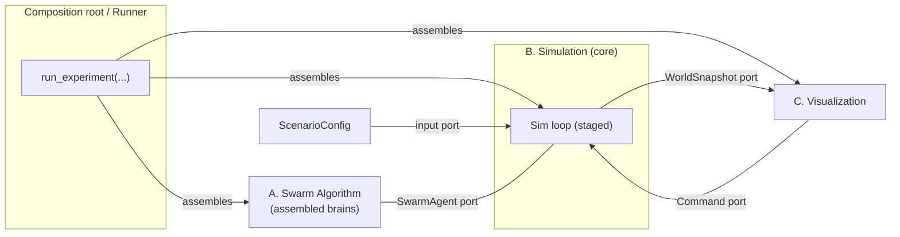
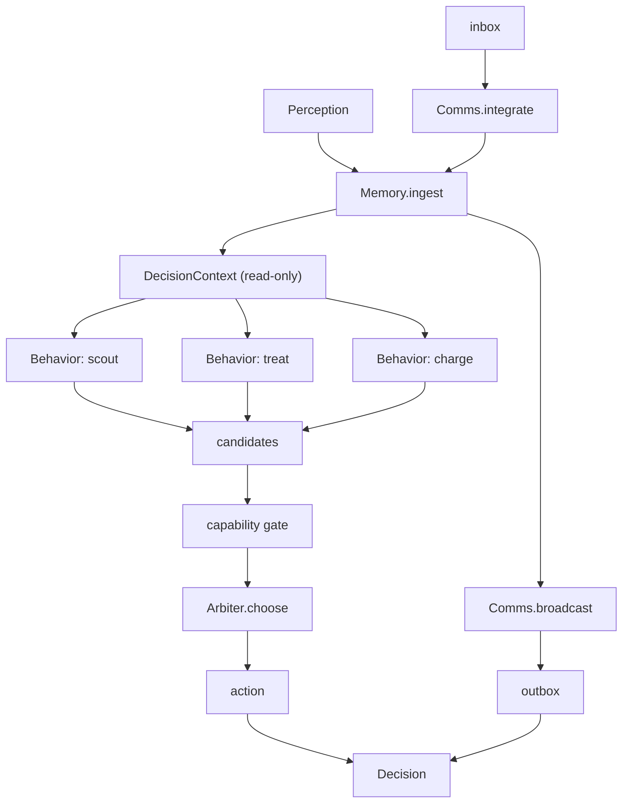
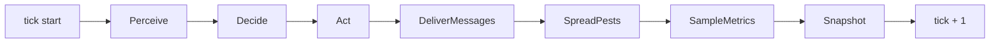
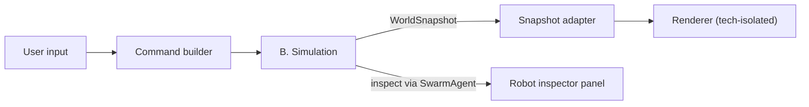

# Architecture

> **Purpose.** This is the Phase‑2 architecture. [`system-decomposition.md`](./system-decomposition.md) fixed the module boundaries and the `contracts` types; this document describes *how the pieces are structured and wired* — the general architecture. It is split into two parts kept deliberately distinct:
>
> - **Part I — Inter‑module architecture:** how the components (A, B, C, `contracts`) connect, and where they are assembled.
> - **Part II — Intra‑module architecture:** how each component is built internally so it stays extensible and testable.
>
> Two internal shapes are load‑bearing and requested explicitly: the robot brain (A) is **composed / assembled from pluggable parts, not written as a monolith**, and the simulation loop (B) is a **pipeline of independent stages** so behaviours like pest spreading are uncoupled from everything else.
>
> As in the decomposition doc, type sketches are real contract shapes but field lists may grow. They fix the seams, not the internals of any one part.

---

## Architectural principles

These extend the five boundary principles from the decomposition doc; they are the ones that drive the internal structure below.

1. **Depend on ports, not implementations.** Every component talks to another only through a small typed interface (`SwarmAgent`, `WorldSnapshot` / `Command`, and the internal ports defined here). Concrete classes are wired together in exactly one place (the composition root, §I.2).
2. **Composition over monolith.** Both the brain and the loop are *assembled* from independently written, independently tested parts. Adding a capability means adding a part and naming it in a config — not editing an orchestrator.
3. **Data‑driven assembly.** What goes into a brain or a loop is described by a spec (data), resolved through a registry of named parts. This is what lets us swap algorithms and stages to run experiments without code changes.
4. **Determinism is a property of the whole system.** There is a single seeded random source per run, threaded through the parts in a fixed order. Given a seed and a config, a run is reproducible — a hard requirement for benchmarking (B.5).
5. **One concern per part.** A behaviour, a navigator, a simulation stage each does one thing. Cross‑part communication happens through the shared context or an event sink, never by one part reaching into another.

---

# Part I — Inter‑module architecture

## I.1 Ports and adapters

The system is a hexagonal (ports‑and‑adapters) arrangement around the Simulation, with `contracts` as the shared language spoken across every port.



There are exactly four inter‑module ports, all typed in `contracts`:

- **`SwarmAgent`** — B drives A. B holds agents behind this port and never sees a concrete algorithm class.
- **`ScenarioConfig`** — the input port. B is constructed from a scenario, never hard‑coded.
- **`WorldSnapshot`** — B → C, read‑only. C renders whatever it is handed.
- **`Command`** — C → B, the only way C influences a run.

Because A and C both depend only on `contracts` and on these ports, either can be replaced wholesale (a different algorithm, a different renderer) with no change to the other or to B.

## I.2 The composition root

There is one place — the runner — that knows every concrete class and wires them together. Everything else depends on ports. This is where "assembled, possibly dynamically" actually happens: the runner reads specs, resolves named parts from registries, and constructs the object graph for a single run.

```python
def run_experiment(
    scenario: ScenarioConfig,
    brain_spec: BrainSpec,        # how to assemble each robot's brain (Part II.A)
    pipeline_spec: PipelineSpec,  # which simulation stages, in order (Part II.B)
) -> RunSummary:
    rng    = Random(scenario.seed)          # single seeded source for the whole run
    world  = build_world(scenario)          # B.1 ground truth
    agents = {
        spec.robot_id: build_agent(brain_spec, spec.body, rng)   # A, assembled
        for spec in scenario.robots
    }
    loop   = build_loop(pipeline_spec, world, agents, rng)       # B, assembled
    return loop.run(until=..., metrics=MetricsCollector())
```

The runner is also the natural home for the batch / sweep logic that runs many configurations for benchmarking. Visualization attaches to the same `loop` through its snapshot / command ports, or consumes a recorded run offline.

## I.3 Threads of control (who calls whom)

- The **loop drives everything**: it is the active object. A and C are passive with respect to it — A is *called* (`decide`), C *pulls* snapshots and *pushes* commands.
- **Visualization runs on its own clock.** Rendering frequency is decoupled from tick rate: C reads the latest `WorldSnapshot` at its own pace, and `SetTimeScale` / `Pause` / `StepOnce` commands change how fast the loop advances. Nothing in B blocks on C.
- **No component calls A except B**, and only through `SwarmAgent`. This is what keeps algorithms swappable and independently testable.

---

# Part II — Intra‑module architecture

## II.A The Swarm Algorithm — a composed brain

### A.1 The idea

A brain is **not** a class with all the logic in it. It is a thin orchestrator (`ComposedAgent`) that holds a set of pluggable parts and runs them in a fixed order each tick. Robots differ by *which parts they are assembled from*, driven by their body/capabilities and by the experiment config. This is what makes capabilities, actions and whole algorithms addable over time without rewriting the agent.

The pluggable ports inside the brain:

| Port | One job | Examples of swappable implementations |
|---|---|---|
| `Memory` | hold + decay the local belief map and self‑state | grid‑cell map, continuous markers, bounded LRU map |
| `Behavior` | propose scored action candidates from a read‑only context | scout‑coverage, treat‑nearest‑pest, return‑to‑charge, avoid‑crowding |
| `Arbiter` | fuse candidates into one chosen action | max‑utility, weighted sum, priority with hysteresis |
| `Navigator` | turn a target cell into a concrete `Move` / `Turn` | potential‑field, coverage‑control, greedy‑grid |
| `CommsStrategy` | decode inbox → memory, encode memory → outbox | map‑merge, vicinity‑vector, stigmergy marks |
| `CapabilitySet` | declare which action types the body can perform | monitor (Sense), killer (Treat), battery (Charge) |

### A.2 The ports

```python
class Memory(Protocol):
    def ingest(self, perception: Perception) -> None: ...          # own sensed + self_state
    def merge(self, observations: Iterable[Observation]) -> None: ...  # from received messages
    def decay(self, now: Tick) -> None: ...
    def view(self) -> "MemoryView": ...          # read-only query surface for behaviors
    def snapshot(self) -> object: ...            # for AgentInspection.belief

class Navigator(Protocol):
    def step_towards(self, target: CellId, ctx: "DecisionContext") -> Action: ...  # Move | Turn

@dataclass(frozen=True)
class ActionCandidate:
    action: Action
    score: float
    source: str                   # which behavior produced it (inspection / debugging)

@dataclass(frozen=True)
class DecisionContext:            # read-only bundle handed to every behavior
    tick: Tick
    self_state: RobotSelfState
    memory: "MemoryView"
    capabilities: "CapabilitySet"
    navigator: Navigator          # injected, for movement-oriented behaviors

class Behavior(Protocol):
    name: str
    def propose(self, ctx: DecisionContext) -> Iterable[ActionCandidate]: ...

class Arbiter(Protocol):
    def choose(self, candidates: list[ActionCandidate], ctx: DecisionContext) -> Action: ...

class CommsStrategy(Protocol):
    def integrate(self, inbox: list[Message], memory: Memory, now: Tick) -> None: ...
    def broadcast(self, memory: Memory, ctx: DecisionContext) -> list[Message]: ...

class Capability(Protocol):
    def action_types(self) -> frozenset[type[Action]]: ...   # which actions it enables

@dataclass(frozen=True)
class CapabilitySet:
    body: BodyType
    capabilities: tuple[Capability, ...]
    def can(self, action_type: type[Action]) -> bool: ...
```

### A.3 The orchestrator

`ComposedAgent` is the only class that implements `SwarmAgent`, and it is deliberately dumb: it wires the parts and enforces one rule — a robot may only emit actions its capabilities allow.

```python
class ComposedAgent:                     # implements SwarmAgent
    def __init__(self, memory, behaviors, arbiter, comms, capabilities, self_ref):
        ...

    def decide(self, perception: Perception) -> Decision:
        self.memory.ingest(perception)
        self.comms.integrate(perception.inbox, self.memory, perception.tick)
        self.memory.decay(perception.tick)

        ctx = DecisionContext(perception.tick, perception.self_state,
                              self.memory.view(), self.capabilities, self.navigator)

        candidates = [
            c
            for behavior in self.behaviors
            for c in behavior.propose(ctx)
            if self.capabilities.can(type(c.action))     # capability gate
        ]
        action = self.arbiter.choose(candidates, ctx)
        outbox = self.comms.broadcast(self.memory, ctx)
        return Decision(action, outbox)

    def inspect(self) -> AgentInspection: ...
```



### A.4 Assembly (data‑driven)

Parts register under names; a `BrainSpec` names the parts to use; `build_agent` resolves them. Testing a different configuration is editing a spec, not code — and specs can come from a config file, so assembly can be dynamic.

```python
BEHAVIORS: Registry[Behavior] = Registry()

@BEHAVIORS.register("scout-coverage")
class ScoutCoverage:
    ...

@dataclass
class BrainSpec:
    memory: str                       # registry key
    behaviors: list[str]              # registry keys; order does not matter (Arbiter decides)
    arbiter: str
    navigator: str
    comms: str
    params: dict[str, object]         # per-part parameters

def build_agent(spec: BrainSpec, body: BodyType, rng: Random) -> SwarmAgent:
    ...   # resolve names -> instances, build CapabilitySet from body, wire ComposedAgent
```

### A.5 How the brain grows (worked cases)

- **New action type** (e.g. a future `Disperse`): add the `Disperse` dataclass to `contracts`, add a `DisperseCapability`, and a `Behavior` that proposes it. The orchestrator and every other part are untouched — the capability gate simply starts admitting the new action for bodies that have it.
- **New algorithm**: write new `Behavior` / `Arbiter` / `Navigator` implementations, register them, point a `BrainSpec` at them. The old ones remain for A/B comparison.
- **New body/robot class**: define its `CapabilitySet`; assembly picks compatible behaviors. Heterogeneous swarms are just a per‑robot `BrainSpec`.

### A.6 Testing posture

Because A depends only on `contracts`, each part is unit‑tested with hand‑built `Perception` / `DecisionContext` values and no simulation. `ComposedAgent` is tested with fake parts to verify wiring and the capability gate. Whole‑brain tests feed scripted perception sequences and assert on the `Decision` stream.

### A.7 Open decisions this structure leaves to implementers

Everything the decomposition doc deferred (shared vs. body‑specific engine, map‑merge vs. vicinity‑vector, potential‑field vs. coverage‑control, grid vs. continuous memory) is now literally a choice of which part to register and name in a spec. None of them change the ports above.

---

## II.B The Simulation — a staged pipeline

### B.1 The idea

The loop does not know what happens in a tick. It holds an ordered list of `SimStage`s and runs each against a shared `SimContext`. Every distinct concern — building perceptions, running brains, applying actions, delivering messages, spreading pests, sampling metrics — is its own stage. Pest spreading is therefore just one stage that can be added, removed, reordered or swapped without touching the rest.

### B.2 The ports

```python
@dataclass
class SimContext:
    tick: Tick
    world: WorldState                     # B.1 ground truth (mutable within a tick)
    agents: Mapping[RobotId, SwarmAgent]  # A, behind the port
    channel: Channel                      # B.3
    rng: Random                           # the single seeded source; stages draw in order
    metrics: MetricsCollector             # B.5
    events: EventSink                      # decoupled notifications (see B.4)
    # per-tick scratch space for handoff between stages:
    perceptions: dict[RobotId, Perception]
    decisions: dict[RobotId, Decision]

class SimStage(Protocol):
    name: str
    def run(self, ctx: SimContext) -> None: ...

class SimLoop:
    def __init__(self, stages: list[SimStage]):
        self.stages = stages
    def step(self, ctx: SimContext) -> None:
        for stage in self.stages:
            stage.run(ctx)
        ctx.tick += 1
```

### B.3 The default pipeline



| Stage | Reads | Writes | Notes |
|---|---|---|---|
| `Perceive` | world, robot poses/sensors | `ctx.perceptions` | applies detection model + position error |
| `Decide` | `ctx.perceptions`, agents | `ctx.decisions` | calls `SwarmAgent.decide`; scheduling policy lives here |
| `Act` | `ctx.decisions` | world | applies Move / Turn / Sense / Treat; consumes energy |
| `DeliverMessages` | decisions' outboxes, poses | agents' next inbox | range/timing rules; payload opaque |
| `SpreadPests` | world | world | infestation dynamics; **fully uncoupled** |
| `SampleMetrics` | world, events | `ctx.metrics` | passive observer |
| `Snapshot` | world, metrics | `WorldSnapshot` | on demand for C; can be skipped in headless runs |

Ordering is a property of the pipeline spec, not of the stages. The `Decide` scheduling question from the decomposition doc (all robots against a frozen snapshot vs. sequentially against a live world) is a choice *inside* the `Decide` stage — invisible to every other stage and to A.

### B.4 Keeping stages uncoupled

Stages never call each other. They communicate two ways only:

- **Shared context** for direct handoff within a tick (`perceptions`, `decisions`, `world`).
- **Event sink** for facts other stages might care about without depending on their producer — e.g. `Act` emits `TargetRemoved`, `Perceive` emits `TargetDetected`, and `SampleMetrics` consumes them to compute detection latency. Metrics thus depend on events, not on the internals of the dynamics stages.

### B.5 Assembly and determinism

Like the brain, the pipeline is assembled from a named, ordered spec through a registry.

```python
STAGES: Registry[SimStage] = Registry()

@STAGES.register("spread-pests")
class SpreadPests:
    ...

@dataclass
class PipelineSpec:
    stages: list[str]                 # ordered registry keys
    params: dict[str, object]

def build_loop(spec: PipelineSpec, world, agents, rng) -> SimLoop: ...
```

Determinism holds because there is one `rng` in the context and stages consume it in a fixed order; any stage needing randomness (detection noise, pest spread, tie‑breaks) draws from `ctx.rng`, never from a private source.

### B.6 How the pipeline grows (worked cases)

- **A different pest model**: write a new `SimStage`, register it as `"spread-pests-v2"`, and name it in the spec instead of the old one. Nothing else changes — this is exactly the "pest spreading is just a stage" requirement.
- **A new dynamic** (weather, canopy closure switching lane access mid‑run, robot failures): add a stage and slot it into the order. Out‑of‑scope v1 items (rail graph, layers) land as changes to `world` / the `Perceive`/`Act` stages, not the loop.
- **Headless benchmarking**: drop the `Snapshot` stage; the loop runs faster and still produces metrics.

### B.7 Testing posture

Each stage is tested in isolation with a hand‑built `SimContext` and asserted on the context mutation it is responsible for. The loop is tested with fake stages to verify order and context threading. Whole‑sim tests run a seeded scenario for N ticks and assert on metrics and reproducibility (same seed → identical `RunSummary`).

---

## II.C The Visualization — an adapter

C is an adapter over B's two ports and holds no simulation state. It keeps a render loop independent of the tick loop: it reads the most recent `WorldSnapshot`, draws it, and translates user input into `Command`s. Robot inspection uses `AgentInspection` via `SwarmAgent.inspect()`, so the frontend never reaches into a brain's internals. The rendering technology stays isolated behind this adapter, so choosing a non‑Python renderer (per the brief) changes only this component.



---

## Extensibility summary

| I want to… | I add / change | I do **not** touch |
|---|---|---|
| Add a robot action | a `contracts` action + a `Capability` + a `Behavior` | orchestrator, arbiter, loop, sim |
| Try a new decision algorithm | `Behavior` / `Arbiter` implementations + a `BrainSpec` | ports, contracts, simulation |
| Change how robots share knowledge | a `CommsStrategy` (payload stays opaque) | simulation, other agents |
| Add a simulation dynamic (e.g. pest model) | a `SimStage` + a `PipelineSpec` entry | brains, contracts, other stages |
| Add a robot/body class | a `CapabilitySet` + per‑robot `BrainSpec` | orchestrator, simulation |
| Swap the renderer | the C adapter | A, B, contracts |

The recurring shape is the same on both sides of the system: a dumb orchestrator (`ComposedAgent` / `SimLoop`) running an assembled, ordered set of single‑purpose parts, resolved from a data spec through a registry. That symmetry is intentional — it is the same extensibility mechanism applied to the algorithm and to the environment.
