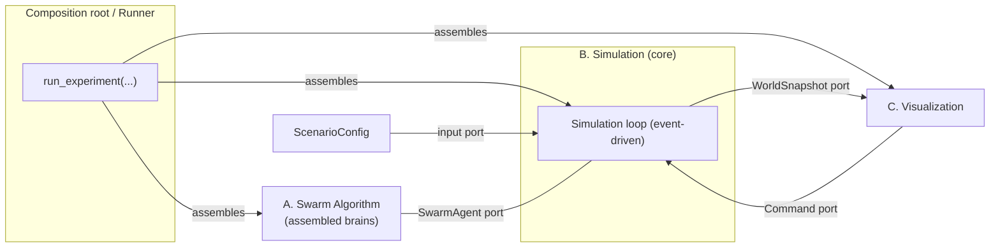
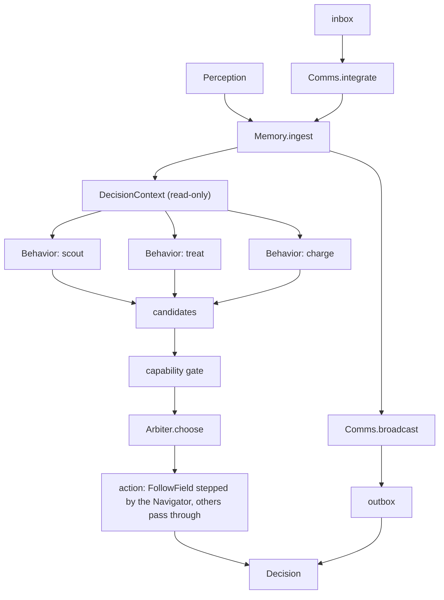
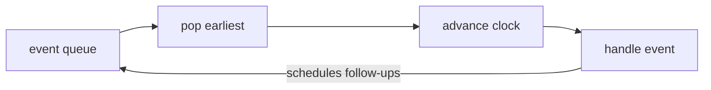
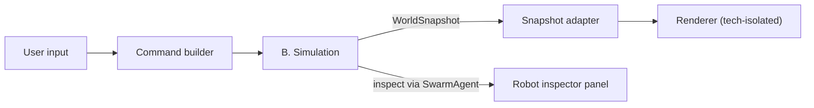

# Architecture

> **Purpose.** This is the Phase‑2 architecture. [`system-decomposition.md`](./system-decomposition.md) fixed the module boundaries and the `contracts` types; this document describes *how the pieces are structured and wired* — the general architecture. It is split into two parts kept deliberately distinct:
>
> - **Part I — Inter‑module architecture:** how the components (A, B, C, `contracts`) connect, and where they are assembled.
> - **Part II — Intra‑module architecture:** how each component is built internally so it stays extensible and testable.
>
> Two internal shapes are load‑bearing and requested explicitly: the robot brain (A) is **composed / assembled from pluggable parts, not written as a monolith**, and the simulation (B) is a **discrete-event loop** whose behaviours (like pest spreading) are independent events, uncoupled from everything else.
>
> As in the decomposition doc, type sketches are real contract shapes but field lists may grow. They fix the seams, not the internals of any one part.

---

## Architectural principles

These extend the five boundary principles from the decomposition doc; they are the ones that drive the internal structure below.

1. **Depend on ports, not implementations.** Every component talks to another only through a small typed interface (`SwarmAgent`, `WorldSnapshot` / `Command`, and the internal ports defined here). Concrete classes are wired together in exactly one place (the composition root, §I.2).
2. **Composition over monolith.** Both the brain and the loop are *assembled* from independently written, independently tested parts. Adding a capability means adding a part and naming it in a config — not editing an orchestrator.
3. **Data‑driven assembly.** What goes into a brain is described by a spec (data), resolved through a registry of named parts. This is what lets us swap algorithms and behaviours to run experiments without code changes.
4. **Determinism is a property of the whole system.** There is a single seeded random source per run, threaded through the parts in a fixed order. Given a seed and a config, a run is reproducible — a hard requirement for benchmarking (B.5).
5. **One concern per part.** A behaviour, a navigator, a simulation event handler each does one thing. Cross‑part communication happens through the shared context, never by one part reaching into another.

---

# Part I — Inter‑module architecture

## I.1 Ports and adapters

The system is a hexagonal (ports‑and‑adapters) arrangement around the Simulation, with `contracts` as the shared language spoken across every port.



There are exactly four inter‑module ports, all typed in `contracts`:

- **`SwarmAgent`** — B drives A. B holds agents behind this port and never sees a concrete algorithm class.
- **`ScenarioConfig`** — the input port. B is constructed from a scenario, never hard‑coded.
- **`WorldSnapshot`** — B → C, read‑only. C renders whatever it is handed.
- **`Renderer`** — the C side of that port, so B can offer render ticks without importing an implementation. It sits in `contracts` for the same reason `SwarmAgent` does: a run is handed a renderer exactly as it is handed an agent, and neither side names the other's class.
- **`Command`** — C → B, the only way C influences a run.

Because A and C both depend only on `contracts` and on these ports, either can be replaced wholesale (a different algorithm, a different renderer) with no change to the other or to B.

## I.2 The composition root

There is one place — the runner — that knows every concrete class and wires them together. Everything else depends on ports. This is where "assembled, possibly dynamically" actually happens: the runner reads specs, resolves named parts from registries, and constructs the object graph for a single run.

```python
def run_experiment(config: ExperimentConfig) -> RunSummary:
    ctx, collector = build_run(config)   # assemble + seed the first events
    SimulationLoop().run(ctx, config.until)
    return RunSummary.from_series(config.label, config.scenario_name,
                                  config.scenario.seed, collector.series())
```

Every random draw a run makes happens inside `build_run`, in a fixed order, so a run is a function of its seed and configuration. The context's `rng` is then left to the pest dynamics; the metrics collector holds no random source of its own, so recording metrics cannot change the world a run produces.

The runner is also the natural home for the batch / sweep logic that runs many configurations for benchmarking: `sweep_scenarios` runs the cross product of scenarios and seeds, and `robustness_sweep` runs one scenario under each fault condition from a shared seed, so a condition and its baseline see identical pest dynamics.

`run_experiment`, `sweep` and `robustness_sweep` each take an optional `Renderer`. Handing one in makes the run draw its world on every metric tick, so a sweep can be watched without a second driver. Because a render only reads ground truth, a run with a renderer measures exactly what the same run without one would — `test_a_run_with_a_renderer_measures_exactly_the_same_as_one_without` pins that. One renderer shared across a sweep sees all the conditions and cannot tell them apart, so to attribute frames to a condition, rebuild that one condition with `robustness_case_config` and pass the renderer to a single `run_experiment`: a run is a function of its seed, so the drawn run is the tabled one.

Visualization also attaches to a run the other way round, through `Command`, or consumes a recorded event log offline.

## I.3 Threads of control (who calls whom)

- The **loop drives everything**: it is the active object. A and C are passive with respect to it — A is *called* (`decide`), C *pulls* snapshots and *pushes* commands.
- **Visualization runs on its own clock.** Rendering is decoupled from simulation time: C samples the world at its own render clock (interpolating robot positions between events for smooth motion), independent of how fast the loop advances simulation time. Nothing in B blocks on C.
- **Rendering during a batch run happens on the metrics cadence, not a render clock.** `MetricSample` is the tick: the loop hands the world to `SimulationContext.renderer` and carries on. That keeps a sweep and a live view on one cadence, at the cost that frames are coarse — an interactive frontend that wants its own clock drives the loop in steps instead, as the interactive console does.
- **No component calls A except B**, and only through `SwarmAgent`. This is what keeps algorithms swappable and independently testable.

---

# Part II — Intra‑module architecture

## II.A The Swarm Algorithm — a composed brain

### A.1 The idea

A brain is **not** a class with all the logic in it. It is a thin orchestrator (`ComposedAgent`) that holds a set of pluggable parts and runs them at each decision point. Robots differ by *which parts they are assembled from*, driven by their body/capabilities and by the experiment config. This is what makes capabilities, actions and whole algorithms addable over time without rewriting the agent.

The pluggable ports inside the brain:

| Port | One job | Examples of swappable implementations |
|---|---|---|
| `Memory` | hold + decay the local belief map and self‑state | grid‑cell map, continuous markers, bounded LRU map |
| `Behavior` | bid for what the robot does next: scored candidates carrying an intent, from the robot's state and memory; never from a field | scout‑coverage, treat‑nearest‑pest, return‑to‑charge |
| `FieldSeeder` | turn memory into the targets (`Seed`s) of one potential field, and say when they change | TREAT pests, EXPLORE stale cells, RECHARGE docks |
| `AgentObjective` | the stable objective a candidate serves, reported to peers with the robot's target | `TREAT`, `EXPLORE`, `VERIFY`, `RECHARGE` |
| `Arbiter` | fuse candidates into one chosen action | max‑utility, weighted sum, priority with hysteresis |
| `FieldProvider` | build the winner's field, which picks its target, and cache one per seeder, for the navigator | quadtree potential field, uniform grid |
| `Navigator` | turn the winner's field into a concrete `Move` | potential‑field, coverage‑control, greedy‑grid |
| `CommsStrategy` | decode inbox → memory, encode memory → outbox | map‑merge, vicinity‑vector, stigmergy marks |
| `CapabilitySet` | declare which action types the body can perform | scout (senses), killer (Treat), battery (Charge) |

**Behaviors never read potential fields.** A behavior decides *whether and how much* the robot should pursue an objective, from a heuristic over the robot's own state and its memory. A field decides only *where*: the field of the winning candidate picks the target and guides the navigator. `DecisionContext` therefore has no access to the fields, and a decision builds at most one field, the winner's.

### A.2 The ports

```python
class Memory(Protocol):
    def ingest(self, perception: Perception) -> None: ...          # own sensed + self_state
    def merge(self, observations: Iterable[Observation]) -> None: ...  # from received messages
    def decay(self, now: Time) -> None: ...
    def view(self) -> "MemoryView": ...          # read-only query surface for behaviors
    def snapshot(self) -> object: ...            # for AgentInspection.belief

class FieldSeeder(Protocol):      # the targets of one potential field, registered by name
    name: str
    def field_key(self, memory: "MemoryView", robot: CellId, now: Time) -> Hashable: ...  # changes when the seeds do
    def seeds(self, memory: "MemoryView", robot: CellId, now: Time) -> tuple[Seed, ...]: ...

class FieldProvider:              # holds the seeders and the quadtree, caches one field per seeder
    def field_for(self, seeder: str, robot: CellId, now: Time) -> SeededField | None: ...

class Navigator:                  # moves the winner along its field
    def step_towards(self, seeded: SeededField, robot: CellId) -> Move | Idle: ...

@dataclass(frozen=True)
class FollowField:                # "step along this seeder's field"; only the navigator moves
    seeder: str

Intent = FollowField | Treat | Charge | Idle   # what a behavior wants done; no bare Move

@dataclass(frozen=True)
class ActionCandidate:
    action: Intent
    score: float                  # the highest wins; one scale for all behaviors
    source: str                   # which behavior produced it (inspection / debugging)
    target: CellId | None         # what the bid commits to, for the arbiter's hysteresis

@dataclass(frozen=True)
class DecisionContext:            # read-only bundle handed to every behavior
    time: Time
    self_state: RobotSelfState
    memory: "MemoryView"
    capabilities: "CapabilitySet"
                                  # no fields: behaviors score from state and memory alone

class Behavior(Protocol):
    name: str
    def propose(self, ctx: DecisionContext) -> tuple[ActionCandidate, ...]: ...

class Arbiter(Protocol):
    def choose(self, candidates: list[ActionCandidate], ctx: DecisionContext) -> ActionCandidate | None: ...

class CommsStrategy(Protocol):
    def integrate(self, inbox: list[Message], memory: Memory, now: Time) -> None: ...
    def broadcast(self, memory: Memory, ctx: DecisionContext) -> list[Message]: ...

class Capability(Protocol):
    def action_types(self) -> frozenset[type[Action]]: ...   # which actions it enables

@dataclass(frozen=True)
class CapabilitySet:
    body: BodyType
    capabilities: tuple[Capability, ...]
    def can(self, action_type: type[Action]) -> bool: ...
```

### A.3 The orchestrator

`ComposedAgent` is the only class that implements `SwarmAgent`, and it is deliberately dumb: it wires the parts and enforces one rule — a robot may only emit actions its capabilities allow.

```python
class ComposedAgent:                     # implements SwarmAgent
    def __init__(self, memory, behaviors, arbiter, comms, capabilities, self_ref):
        ...

    def decide(self, perception: Perception) -> Decision:
        self.memory.ingest(perception)
        self.comms.integrate(perception.inbox, self.memory, perception.time)
        self.memory.decay(perception.time)

        ctx = DecisionContext(perception.time, perception.self_state,
                              self.memory.view(), self.capabilities)

        candidates: list[ActionCandidate] = []
        for behavior in self.behaviors:
            for candidate in behavior.propose(ctx):
                if self.capabilities.can(type(candidate.action)):   # capability gate; FollowField needs Move
                    candidates.append(candidate)

        winner = self.arbiter.choose(candidates, ctx)
        action = self.action_for(winner)   # FollowField: the provider builds only the winner's field,
                                           # which picks the target, and the navigator steps along it;
                                           # any other intent passes through; no winner: Idle
        outbox = self.comms.broadcast(self.memory, ctx)
        return Decision(action, outbox)

    def inspect(self) -> AgentInspection: ...
```



### A.4 Assembly (data‑driven)

Parts register under names; a `BrainSpec` names the parts to use; `build_agent` resolves them. Testing a different configuration is editing a spec, not code — and specs can come from a config file, so assembly can be dynamic.

```python
BEHAVIORS: Registry[Behavior] = Registry()

@BEHAVIORS.register("scout-coverage")
class ScoutCoverage:
    ...

@dataclass
class BrainSpec:
    memory: str                       # registry key
    behaviors: list[str]              # registry keys; order does not matter (Arbiter decides)
    arbiter: str
    navigator: str
    comms: str
    params: dict[str, object]         # per-part parameters

def build_agent(spec: BrainSpec, body: BodyType, rng: Random) -> SwarmAgent:
    ...   # resolve names -> instances, build CapabilitySet from body, wire ComposedAgent
```

### A.5 How the brain grows (worked cases)

- **New action type** (e.g. a future `Disperse`): add the `Disperse` dataclass to `contracts`, add a `DisperseCapability`, and a `Behavior` that proposes it. The orchestrator and every other part are untouched — the capability gate simply starts admitting the new action for bodies that have it.
- **New algorithm**: write new `Behavior` / `Arbiter` / `Navigator` implementations, register them, point a `BrainSpec` at them. The old ones remain for A/B comparison.
- **New body/robot class**: define its `CapabilitySet`; assembly picks compatible behaviors. Heterogeneous swarms are just a per‑robot `BrainSpec`.

### A.6 Testing posture

Because A depends only on `contracts`, each part is unit‑tested with hand‑built `Perception` / `DecisionContext` values and no simulation. `ComposedAgent` is tested with fake parts to verify wiring and the capability gate. Whole‑brain tests feed scripted perception sequences and assert on the `Decision` stream.

### A.7 Open decisions this structure leaves to implementers

Everything the decomposition doc deferred (shared vs. body‑specific engine, map‑merge vs. vicinity‑vector, potential‑field vs. coverage‑control, grid vs. continuous memory) is now literally a choice of which part to register and name in a spec. None of them change the ports above.

---

## II.B The Simulation — a discrete-event loop

### B.1 The idea

**Current B.1 simplification.** The world is coarse-grained: cells are field patches, robot occupancy is unlimited, and a robot command is a direct `Move(to=CellId)`. There is no turn/facing model. Robot speed determines the simulated travel time between cells, while the navigation algorithm is responsible for choosing target cells from potential-field or other local rules.

The simulation is discrete-event: an event queue holds timestamped events, and the loop pops the earliest, advances the clock to it, and handles it. Each distinct concern — a robot deciding, a robot arriving at a cell, pests spreading, a metric sample — is its own event type with its own handler, and a handler may schedule follow-up events. There is **no fixed timestep and no global frame**: each robot acts at its own event times on its own latest information. Pest spreading is just a recurring world event, uncoupled from everything else.

### B.2 The ports

```python
class Event(Protocol):
    time: Time
    def handle(self, ctx: SimulationContext) -> None: ...   # may schedule follow-up events

class EventQueue:                # min-priority queue ordered by (time, tie-break)
    def schedule(self, event: Event) -> None: ...
    def peek(self) -> Event | None: ...
    def pop(self) -> Event | None: ...

@dataclass
class SimulationContext:
    now: Time
    rng: Random                            # the single seeded source; handlers draw in event order
    agents: dict[RobotId, SwarmAgent]      # A, behind the port
    world: WorldState                      # B.1 ground truth, behind a read-only port
    queue: EventQueue
    channel: Channel                       # B.3; handlers hand it an outbox, it delivers by range
    def schedule(self, event: Event) -> None: ...

class SimulationLoop:
    def run(self, ctx: SimulationContext, until: Time) -> None:
        while True:
            event = ctx.queue.peek()
            if event is None or event.time > until:
                break
            ctx.queue.pop()
            ctx.now = event.time
            event.handle(ctx)
```

### B.3 The event flow and the default events



| Event | On handling | Schedules |
|---|---|---|
| `RobotDecision` | build the robot's `Perception`, call `SwarmAgent.decide`, apply the action, hand `outbox` to the channel | the robot's next fixed decision interval |
| *CellArrival* (to add) | update the robot's cell / occupancy | usually a `RobotDecision` on arrival |
| `WorldTick` | advance infestation dynamics one step | itself, at the next coarse cadence |
| `MetricSample` | record a metrics sample, and hand the world to the run's `Renderer` if it has one | itself, periodically |
| `FailureCheck` | fail each live robot that draws a fault from `ctx.noise` | itself, at the next coarse cadence |

### B.4 Keeping handlers uncoupled

Handlers never call each other. They communicate only through the shared `SimulationContext` (and, later, a notification mechanism so metrics can observe facts like `TargetRemoved` without depending on the dynamics that produce them). Determinism holds because there is one `rng` in the context, drawn in event order, and equal timestamps break deterministically by *world events before robot events, then `robot_id`*.

The context carries a **second** random source, `noise`, for the simulation's own hardware faults and sensor error. It is separate from `rng` on purpose: a robustness run has to be comparable with its baseline, so the faults must not consume draws that the pest dynamics would otherwise see. Both are derived from the scenario seed, so the pair is reproducible while the streams stay disjoint. `ctx.rng` is the world and nothing else; `ctx.noise` is reached only by `FailureCheck` and the position-error draw. See [`docs/research/robustness.md`](research/robustness.md).

### B.5 Simplifying assumptions (v1)

Two assumptions keep the loop simple and cheap: **no collisions / occupancy conflicts**, and **actions cannot be interrupted**. Together they mean no scheduled event is ever cancelled — the queue is effectively append-only, which removes the classic discrete-event headache (invalidating stale events). And because idle / observing robots schedule no events, cost tracks *activity* rather than wall-clock time, which is what makes day-to-week-scale runs feasible.

### B.6 How it grows (worked cases)

- **A different pest model**: write a new `WorldTick`-style event and schedule it instead. Nothing else changes — this is the "pest spreading is just an event" requirement.
- **A new dynamic** (weather, robot failures): a new event type + handler, scheduled into the run. Out-of-scope v1 items (rail graph, layers) land as changes to the world and the arrival/decision handlers, not the loop.
- **Movement fidelity**: cell-arrival timing is computed by the world from speed and distance; swapping to sub-cell interpolation touches only the arrival handler and the world, not the algorithm.

### B.7 Testing posture

The queue and loop are tested with fake events (ordering, the `until` bound, self-rescheduling). Each real handler is tested with a hand-built `SimulationContext`, asserting the state change it makes. Whole-simulation tests run a seeded scenario to a target time and assert reproducibility (same seed → identical outcome).

---

## II.C The Visualization — an adapter

C is an adapter over B's ports and holds no simulation state. It keeps a render loop independent of simulation time: it samples the world (interpolating robot positions between events for smooth motion), draws it, and translates user input into commands. Robot inspection uses `AgentInspection` via `SwarmAgent.inspect()`, so the frontend never reaches into a brain's internals. The rendering technology stays isolated behind this adapter, so choosing a non‑Python renderer (per the brief) changes only this component.



---

## Extensibility summary

| I want to… | I add / change | I do **not** touch |
|---|---|---|
| Add a robot action | a `contracts` action + a `Capability` + a `Behavior` | orchestrator, arbiter, loop, simulation |
| Try a new decision algorithm | `Behavior` / `Arbiter` implementations + a `BrainSpec` | ports, contracts, simulation |
| Change how robots share knowledge | a `CommsStrategy` (payload stays opaque) | simulation, other agents |
| Add a simulation dynamic (e.g. pest model) | a new `Event` type + handler | brains, contracts, other events |
| Add a robot/body class | a `CapabilitySet` + per‑robot `BrainSpec` | orchestrator, simulation |
| Swap the renderer | the C adapter | A, B, contracts |

The recurring shape is the same on both sides of the system: a dumb orchestrator (`ComposedAgent` / `SimulationLoop`) running assembled single‑purpose parts — behaviours for the brain, event handlers for the simulation. That symmetry is intentional — it is the same extensibility mechanism applied to the algorithm and to the environment.


## Implemented body capability model

The initial body-specific capability gate is implemented in `src/swarm_field/swarm/capabilities.py`,
`src/swarm_field/swarm/brain.py`, and `src/swarm_field/swarm/assembly.py`. `ComposedAgent` filters
candidates before score selection, maps `FollowField` to the `Move` capability, and validates the
resolved concrete action before returning it. The factory `build_agent(robot_id, body, field,
docks=...)` assembles the default behaviours and flying/ground field provider per body. The profile
values, sensing rules, battery service semantics, and simplifications are documented in
[`body-capabilities.md`](body-capabilities.md).
