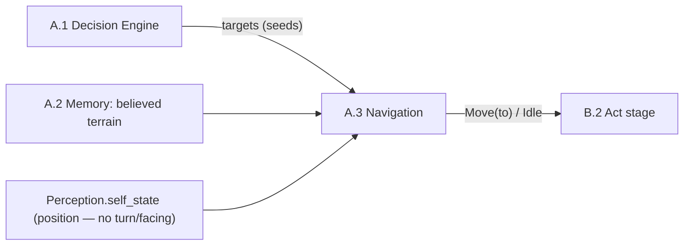
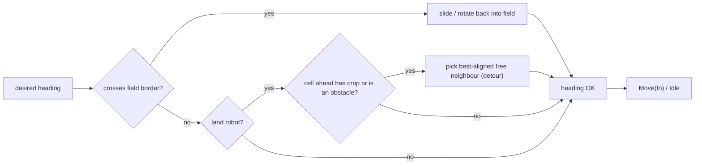
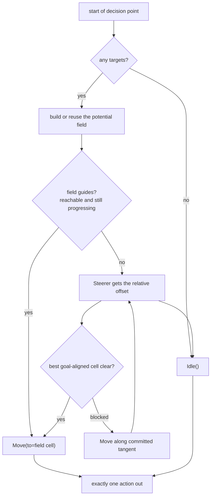
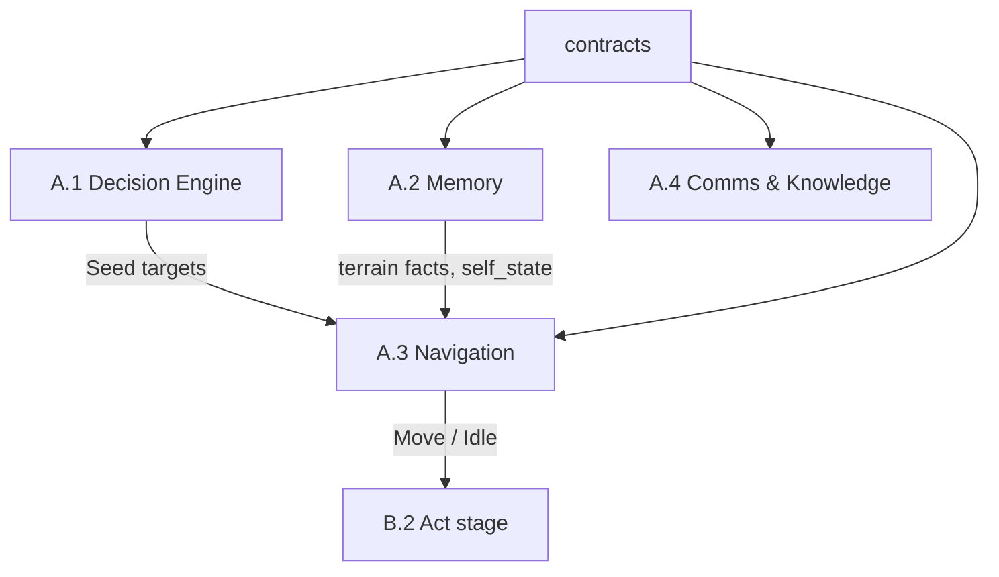

# Navigation Module — A.3

> **Purpose.** This document is the design description of the **navigation module** (A.3 Navigation & Exploration in [`system-decomposition.md`](./system-decomposition.md)). It turns a *goal* into a concrete movement action for the next tick: how land robots respect their movement constraints, how explorer robots keep apart from each other, and how a robot walks towards the targets an objective picked out of its own beliefs.
>
> **Scope.** The module **receives** goals from the Decision Engine (A.1); which cells are worth walking to is a decision, not a navigation concern. As in the decomposition doc, the type sketches are real contract shapes but field lists may grow — they fix the seam between A.1 (what is wanted) and A.3 (how to move), never the internals of other modules.
>
> **A note on the architecture's `Navigator` port.** [`architecture.md`](./architecture.md) sketches a `Navigator.step_towards(target: CellId) -> Action`. The port in the code is `step_towards(seeds: tuple[Seed, ...], robot: CellId) -> Action`: an objective hands over the targets it scored, not a single trusted cell address, and gets back one `Move` (or `Idle`). The goal therefore *is* a set of cells — the module plans over the terrain the robot believes in, and the only absolute cell it trusts is the one it is standing on. This document designs the *reactive* half of that seam — the policy that turns a goal into a step with no map — as the `Steerer` of `swarm/steering.py`, which is handed a goal as a relative vector and probes clearance one cell at a time. Where the robot *does* have a map of believed terrain — the quadtree of its own memory — the `Navigator` in front of it prefers a Dijkstra potential field and only calls the `Steerer` when that field cannot guide, so everything below still holds as the fallback path (see §10.1).

---

## 1. The module's boundary

Three rules, in the spirit of the decomposition doc's boundary principles:

1. **A.3 never chooses a goal.** A.1 hands it the objective's targets every tick. If A.1 says "nothing is worth moving for", it hands over no targets and navigation must not invent any — it holds still and waits.
2. **A.3 is movement-only.** It converts those targets plus the robot's own beliefs into a movement action. It never asks the world for ground truth; everything it reads is a perception, or a fact already in the robot's own memory. Decision *why*, navigation *how*.
3. **A.3 is deterministic given its inputs.** It holds no private random source. Any drift vector is ready-made from A.1 (drawn from the run's single seeded RNG), so a run is reproducible.



---

## 2. The two robot bodies

Two body types from `contracts` (SCOUT and KILLER) exist at project start, and they move fundamentally differently. Navigation's job splits into two bodies of rules.

| Aspect | Explorer (SCOUT, aerial) | Utility / killer (KILLER, land) |
|---|---|---|
| Sensory/movement medium | Flies; no cell-level obstacles | Drives on the ground |
| Movement constraints | Field border only | Field border **and** cannot enter crop cells |
| Has a goal to navigate to | Never — always in exploration mode | Yes, whenever an objective hands over targets |
| Attitude to other explorers | Strong aversion (personal-space separation) | Indifferent |
| Attitude to utility robots | Indifferent | Indifferent |

The explorer's role in navigation is minimal and negative: it has no destination, so its "navigation" is a biased random walk plus a separation impulse (Section 9). Everything below this point concerns the utility robot unless the section says otherwise.

---

## 3. Coordinate frame and vector conventions

All vectors are expressed in the simulation's metric frame, which must agree with the grid conventions already in `contracts.ids`:

- **x increases East, y increases North** — same convention as `Direction.offset`.
- A field cell at `(cx, cy)` has its centre at metres `(cx * cell_size, cy * cell_size)` with `cell_size` from `FieldGeometry`.
- A vector is a *relative* displacement in metres, `(dx, dy)`, in this frame. `Vector2 = tuple[float, float]`.

The implementation keeps vectors grid-native: a `Vector2` is a displacement in **cells** between the cells it connects, matching the grid frame of `contracts.ids`. The metre framing above is the presentation-level reading of the same vectors (one cell is one `cell_size` wide); nothing in navigation scales or converts.

### 3.1 Two goal shapes: cells to plan for, a vector to walk towards

The module has one goal in, one action out, and the goal is a set of cells: the targets an objective scored out of the robot's memory, as `Seed`s. Navigation plans over what the robot *believes* — the quadtree of terrain facts in its memory — and trusts those cells exactly as much as it trusts the rest of its memory. A robot's own belief being wrong is a memory problem, not a navigation problem.

The reactive fallback inside the module needs less than that: it is handed a single *relative* vector from the robot to the cell it is heading for, and clearance is probed per compass heading through the `Sensing` port, so it never consults the field layout at all. The one absolute value it needs is its own `RobotSelfState.position` — not to reason about the field, but to name the target cell of the direct `Move(to=CellId)` the high-level world model requires (movement is a direct target-cell command; there is no turn/facing, per `README.md`).

All spatial knowledge comes from two sources only:

- **Terrain facts in the robot's own memory.** Cells it has sensed, plus anything a peer told it, merged into the belief map the quadtree is built from. This is what a plan is computed over.
- **Per-heading clearance probing.** A short-range sensor ring that reports, per adjacent cell, whether it is clear to enter — crop, obstacle, or empty ground. This is how a land robot discovers it is blocked without asking the world for a map: it knows its own cell, and probes the neighbours' contents.

### 3.2 Two consequences the whole module relies on

1. **The target is re-solved, not memorised.** A goal is handed in fresh every tick and the step is computed from it, so the module never accumulates a waypoint list. What persists across ticks is only the plan cache and the wall-following state — the committed tangent, the detour and stuck accounting.
2. **A goal is never invented.** No targets means no movement; a stalled or unreachable target means no movement. Choosing something to walk towards is A.1's decision, every time.

---

## 4. The goal on the seam

A.1 tells navigation what it wants by handing over the targets of the objective it is pursuing, and nothing else:

```python
# swarm_field.swarm.field
@dataclass(frozen=True)
class Seed:
    cell: CellId          # a target cell
    value: float          # its start value, -beta * objective's value: the lower, the better

# swarm_field.swarm.navigator
def step_towards(self, seeds: tuple[Seed, ...], robot: CellId) -> Move | Idle: ...
```

Design intent:

- **Targets, not a destination.** An objective may pursue several cells at once (every infested cell it knows, a set of dock cells, a cell plus its neighbours), each with its own attractiveness. Deciding between them belongs to the objective; walking to them belongs here.
- **No targets is a real answer.** An objective with nothing worth walking to hands over an empty tuple, and navigation returns `Idle` rather than inventing a target. Whether to re-issue or drop such an objective is the brain's (A.1) call, made from its own memory — navigation just holds still.
- **The reactive fallback is handed a vector, not cells.** When a plan cannot guide, the module measures the offset from the robot to the cell it is walking towards and hands that `Vector2` to the `Steerer`, which needs nothing else (§3.1).

There is deliberately no second goal shape — no "wander along a drift" and no "follow a chain" mode. A goal is a set of cells; how the robot gets there, and what it does when it cannot get there, is internal to A.3.

---

## 5. Border and obstacle constraints

Movement constraints are checked in a fixed order, and they are the same every tick:

1. **Field border (both bodies).** A robot must not leave the field. The border is *felt, not computed*, through the sensing ring (Section 3.1): a step that would leave the field is reported blocked, exactly like a crop or obstacle, and navigation responds as it does to any other blockage: it replaces the heading with the admissible tangent (slide along the border). The quadtree encodes the same rule for the planner — cells outside the field are not traversable — so both layers agree.
2. **Crop and obstacle cells (land only).** A utility robot may not drive through crops or blockages. It probes the adjacent cells through its **sensing ring** (Section 3.1) when it has no plan, and over the quadtree of believed terrain when it does: the ring reports, per neighbour heading, whether the cell one step away is clear — crop, obstacle, or empty ground — and the desired heading is only honoured if that report says *clear*. This is the biggest single constraint named in the system: the killer robot must keep the rows. When the straight-line heading is blocked, navigation picks the admissible neighbour whose direction has the largest dot product with the desired heading (a tangent detour, chosen among the cells reported clear), commits it, and reverts to the desired heading once the blocker is passed — see the per-tick flow in Section 8.
3. **Occupancy by another robot (both bodies, deferred).** Robot–robot collisions are an open decision (Section 12). Until resolved, navigation ignores the `occupant` field; the aversion rules in Section 9 are behavioral, not physical.

Aerial explorers skip rule 2 entirely: they are bounded only by the field border.



---

## 6. Scenario 1 — deployment and random spread (not on the seam yet)

The situation at the start of the swarm:

- All robots begin at (or within sensing distance of) the truck / charging station.
- Because no pest has been found, a utility robot has no target at all, so the seam returns `Idle` and it stays where it was deployed.
- The scenario calls for a **spread**: A.1 draws one random drift vector per robot from the seeded RNG — for example *10 m west, 20 m north* — and the robot follows that heading, bouncing or sliding on the border (Section 5), until A.1 hands over real targets. Only a very small number of utility robots are deployed now, typically 1 or 2, possibly none.

This has **no representation on the seam**: with no targets there is nothing for `step_towards` to walk towards, and a drift is not a target. Today the behaviour that would do it calls the `Steerer` directly — `steer(drift, position)` is public and tested — or the explorer's own local potential field takes care of wandering. When the team decides this is worth building properly, the question is whether "spread" becomes a goal shape on the A.1 ↔ A.3 seam or a behaviour that sidesteps it. Recorded as an open decision (Section 12, #3).

The *purpose* of the random vector is to keep the few utility robots out of local optima and out of the truck's shadow: without it a "no goal" robot would just sit where it was spawned. A fixed drift per deployment also guarantees a spread that is reproducible for a given seed — two runs with the same seed deploy the same 1–2 utility robots drifting to the same places.

---

## 7. Deferred: reaching a pest a peer discovered

Scenario 2 of the problem statement is the interesting one: an explorer finds the pest, and a *different* robot has to walk to it. Nothing on the seam today represents that, and an earlier design for it — a chain of hop numbers in which each explorer broadcasts its own hop plus the vector toward the next hop down, and the pursuer composes `r + v` into a target — was removed, because nothing ran it and the seam it needed was the seam this document no longer has. The two live options for A.4 (Communication & Knowledge), which owns pest knowledge, are:

- **Cells, not vectors.** The explorer that sees the pest writes the infested `CellId` into shared memory, and every robot believes it through the same merge path as any other map fact. Navigation is then unchanged: the objective hands that cell to `step_towards` as a `Seed` and the quadtree plans to it. This is what the code already expresses, and it costs one shared cell.
- **A relative hop chain.** Explorers keep broadcasting a hop number plus a parent vector, and the pursuer composes a target from the freshest qualifying beacon. This keeps a robot from trusting a peer's absolute cell, at the cost of a second goal shape, a staleness rule, and a new protocol payload in A.4.

The trade is *trust a peer's cell* against *trust a peer's measurement plus a chain that has to stay fresh*. The cell version is what the seam expresses today, so it is the default until the team rules the absolute-address error of a peer unacceptable for pest response. Recorded as an open decision (Section 12, #2).

The reactive `Steerer` does not care which way this goes: it is handed a `Vector2` to the cell being walked towards, so both options end in the same one-step `Move`. What they must both answer is *arrival* — a land robot cannot enter the crop cell holding the pest, so "the cell to walk to" and "the cell to stand in" are different cells, and the objective handing out the `Seed` has to know which one it means. That is open as well (Section 12, #5).

The walkthrough that used to live here is gone, but its hard half survives as tests: `tests/test_steering.py` drives the reactive policy over crop rows, including `test_finds_the_single_hole_in_a_closed_crop_wall`, which carries a robot around a sealed crop line through its one gap and along the next column without ever entering a crop cell.

---

## 8. The per-tick navigation decision

Every decision point, navigation runs one deterministic procedure:

1. **Read the goal.** The targets of the objective being pursued. None → `Idle`, done.
2. **Ask the field first.** Build or reuse the potential field over the quadtree for those targets, and read the neighbouring cell it points at (Section 10.1).
   - **The field guides** — the target is reachable and the potential at the robot's cell still beats its running minimum. Step into that cell. The field is built once per block travelled, not once per step.
   - **The field cannot guide** — either no wave reaches the robot at all, or three ticks went by without progress, which is how a window's edge can make a robot turn back and forth over approximate leaf distances. Hand the relative offset to the reactive `Steerer`, which walks towards the most attractive target and stalls if it is walled off.
   - **The field's target is the robot's own cell.** Arrived → `Idle`.
3. **Add the separation impulse (explorers only).** Each explorer sums short-range repulsion from other explorers into the heading (Section 9); utility robots skip this.
4. **Apply body constraints.** Border for both; crop / obstacle cells for land robots only (Section 5). In the field path this is already settled — cells the body cannot enter are not in the quadtree — so it is the reactive path that probes clearance one cell at a time.
5. **Emit the action.** Exactly one per decision point: a `Move(to=CellId)` into the cell the field points at, a `Move(to=CellId)` into the best goal-aligned clear cell, a `Move(to=CellId)` along the committed wall-follow tangent while detouring, or `Idle` when there are no targets, the robot has arrived, nothing is clear, or the steerer is stalled.



Both paths are the same seam: targets in, one action out. Neither keeps a waypoint list: the field is rebuilt only when the terrain, the targets or the robot's block change, and the only state the reactive path carries is its committed tangent and its stuck accounting. And navigation reports nothing back — a robot that is not making progress is something A.1 sees in its own memory of that robot's position, not something A.3 announces (Section 11).

---

## 9. Explorer aversion (separation impulse)

The one behavioral constraint that is neither border nor obstacle: explorers must not clump. Each aerial explorer, in addition to its exploratory wander, adds a short-range repulsion from every *other explorer* it perceives — never from utility robots. The impulse is:

- **range-limited** to a "personal-space" radius (a multiple of `radio_range`, scenario-tunable);
- **strongest when closest**, scaled by inverse distance and capped at a maximum deflection so it never overwhelms the exploratory heading;
- **summed** over all perceived explorers, then added to the desired heading before the border check in Section 8.

Utility robots take no separation from anyone — they do not mind sharing space with explorers, and their spacing emerges from the targets they are each walking towards, not from aversion.


---

## 10. Output: the movement action

The navigation module does not move anything; it emits the concrete one-step action, which the Act stage (B.2) applies on the discrete grid. Because the world model is a direct `Move(to=CellId)` (no turn/facing), the output seam is the contracts `Action` union and needs no module-scoped shape:

```python
# exactly one physical action per decision point:
Move(to=field_cell)                      # the potential field's step
Move(to=position + best_aligned.offset)  # reactive: the best-aligned cell is clear
Move(to=position + tangent.offset)       # reactive: wall-following detour, committed tangent
Idle()                                   # no targets, arrived, or stalled
```

The policy, one physical action per decision point (Section 8): the targets are handed in fresh every time; the field decides the step whenever it can guide, and the steerer's committed wall-follow takes over when it cannot (Section 10.1). The Act stage only validates that `to` is the adjacent cell navigation intended and applies it. Note what is *not* in the output: no reason code, no failure flag. `Idle` means "nothing to do this decision point" and nothing more — a robot standing still looks the same whether it arrived, has no targets, or is walled off for good.

### 10.1 Where the field takes over

The reactive policy described above assumes the robot has no map, only the clearance ring. A robot that also builds a local map does better with one: a Dijkstra potential field over the quadtree of its believed terrain (`swarm/field/`) gives a near-optimal route around every obstacle it knows, at any distance, and one step of that route is still just a `Move(to=<adjacent cell>)`. So `swarm/navigator.py` puts the field in front of that policy, and the `Steerer` became the fallback rather than the way:

- **The field guides.** `step_towards(seeds, robot)` builds (or reuses) the field for the objective's targets and returns the neighbouring cell the field points at. Distance to the target is irrelevant: a field is better than a wall-follow at every range, because it sees the whole window instead of one cell.
- **The steerer guides when the field cannot.** Either no wave reaches the robot at all — nothing is reachable, so the steerer walks towards the objective's most attractive target and stalls if it is walled off — or the field stopped guiding: the potential at the robot's cell stopped beating its running minimum for a few ticks, which is how a robot near the edge of its window would turn back and forth over approximate leaf distances. Three ticks without progress is enough to hand over.
- **The handover is not latched.** Every decision point the field is asked first, so the robot returns to the field route as soon as the field points forward again.

Two consequences for the design above. The policy is now a *fallback* with a narrow job, and it keeps the property that made it useful in the first place — it needs no map, only clearance — so it still works over unknown ground and can be handed a live sensor ring through `Sensing`. And `QuadtreeSensing`, its map-backed implementation, asks the quadtree the same question its routing does, so the two layers never disagree about where a robot may go.

---

## 11. Interface summary

| Neighbour | Gives to navigation | Expects from navigation |
|---|---|---|
| A.1 Decision Engine | the objective's `Seed` targets, each decision point | exactly one `Move` / `Idle`; nothing else |
| A.2 Memory | the terrain facts the quadtree is built from, and `Perception.self_state` (position) to name the `Move(to)` target cell (Section 3.1) | nothing directly |
| A.4 Communication & Knowledge | — (pest knowledge reaches A.3 only as map facts, merged into A.2; see Section 7) | — |
| B.2 Act / Simulation | (translation of the action into world movement) | `Move(to=CellId)` / `Idle`, exactly one |
| C.1 Visualization | — (via `inspect()`) | short human-readable `explain` string for the "click a robot" panel |

The boundary is deliberately narrow: A.1 is the *only* module that may put a goal in front of navigation, a goal is always a set of cells, and there is no channel back. A robot that is making no progress is a fact about the world that A.1 already holds — the robot's own position, tick by tick, in A.2 — so navigation does not need to report it. If that turns out not to be enough, the place to add a reason is `Idle` (Section 12, #8), not a second goal shape.

---

## 12. Open decisions register

All open items below are internal to A.3 (or a B.2 translation detail), so the module boundary above is stable regardless of how they resolve.

| # | Decision | Affects boundary? |
|---|---|---|
| 1 | **Heading hysteresis.** **Resolved (v1): no turn model.** The world's direct `Move(to=CellId)` removes grid snapping and turn hysteresis altogether; a straight run to a target shows no turning oscillation, and alignment ties break by fixed enum order | No |
| 2 | **How a peer shares a pest location.** A shared `CellId` in the memory map, or a relative hop chain of broadcast vectors (Section 7). The cell is what the seam expresses today; the chain is what A.4 would have to carry | No — it decides what A.1 hands over, not the shape of the call |
| 3 | **Spread on stuck detection.** Single drift per deployment vs. re-roll after a stuck timeout; who detects "stuck" (Section 6) | No |
| 4 | **Robot–robot collisions.** Currently both bodies ignore the `occupant` cell field; land robots might later yield to each other | No |
| 5 | **Arrival semantics at a target the body cannot enter.** Stop on the row edge (`STAND`) vs. continuous pursuit around it while it "lives". **Resolved: STAND** — the utility robot ends on the aisle cell next to the crop cell holding the pest, and treatment proceeds from there. **Not implemented**: the chase layer that owned this rule is gone, and the generic arrival rule (`target_tolerance`, 0.75 cells) only fires once the robot is *within* that distance, which a robot standing next to a crop cell never is. It has to land wherever targets become non-traversable cells | No |
| 6 | **Speed / energy coupling.** Whether the action carries a `speed_fraction` vs. `v_max`; how battery consumption modifies it (a decision concern, surfaced here) | No |
| 7 | **Aversion parameters.** Personal-space radius, impulse cap and decay curve for the explorer separation (scenario-tunable) | No |
| 8 | **Telling "arrived" from "walled off".** A `Seed` on a cell the body can never enter — a crop cell, a cell outside the field — produces no wave, so today the steerer wall-follows the row indefinitely and A.3 reports nothing (Section 10). Either the objective seeds the nearest cell the body *can* stand in, or the seam grows a reason on `Idle` | **Yes, if the seam grows a reason** |

Every entry marked "Affects boundary? No" — the same success criterion as the decomposition doc: the A.1 ↔ A.3 seam (targets in, one action out) holds no matter which option the implementers pick. #8 is the one item that could still change it, and only by *adding* to the output, never by adding a second goal shape.

---

## 13. Dependency summary



- Navigation depends only on `contracts` and on the values its neighbours hand it behind that contract — it is unit-testable with hand-built `Seed`s and a hand-built terrain view, no simulation.
- Navigation never reads ground truth, never picks its own target, and never sends `Message`s. A.4 is not in its dependency list at all: knowledge a peer shares reaches navigation only as map facts, merged into A.2 first (Section 7).
