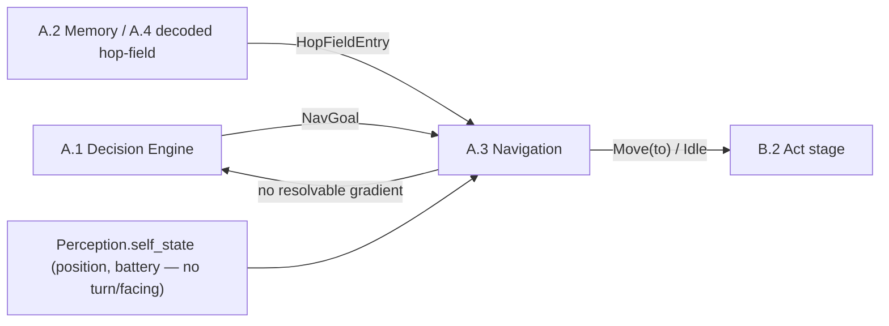
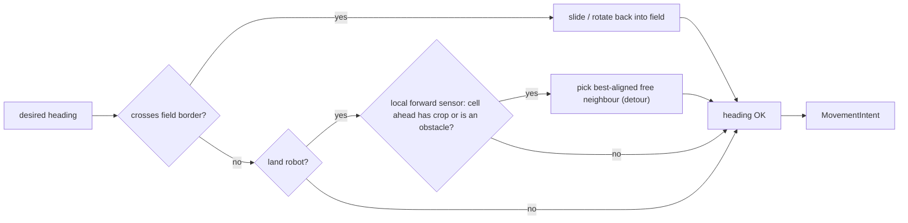
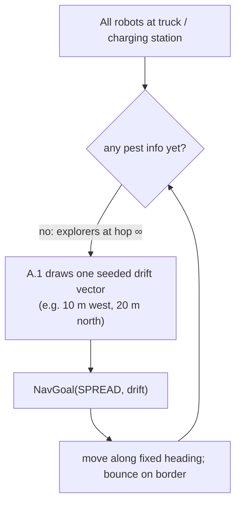
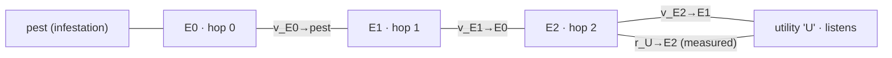
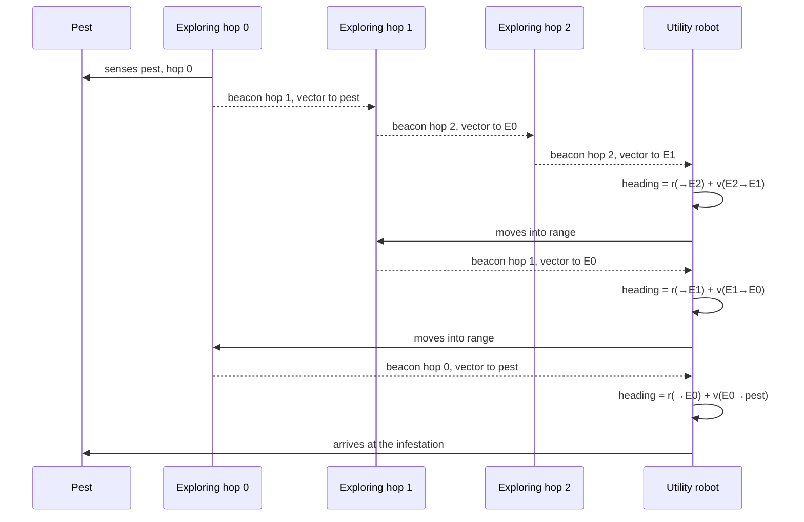
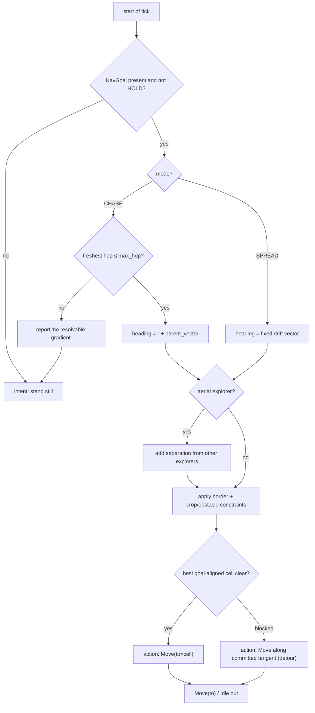
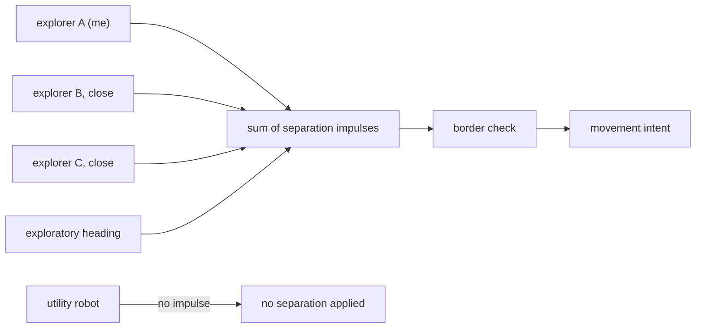
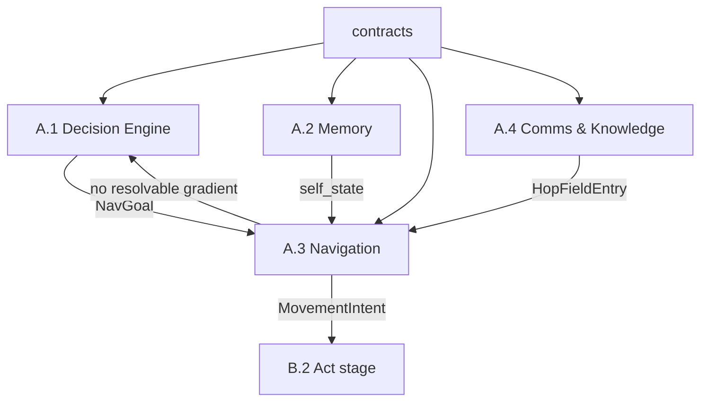

# Navigation Module — A.3

> **Purpose.** This document is the design description of the **navigation module** (A.3 Navigation & Exploration in [`system-decomposition.md`](./system-decomposition.md)). It turns a *goal* — or the deliberate absence of one — into a concrete movement intent for the next tick: how the two robot bodies move differently, how land robots respect their movement constraints, how explorer robots keep apart from each other, and how a utility robot finds a pest by following a chained series of hop vectors broadcast by the explorers.
>
> **Scope.** The module **receives** goals from the Decision Engine (A.1); whether a pest is "close enough" to chase is a decision, not a navigation concern. The explorer *hop numbers* are defined here because navigation consumes them, but computing them is the job of A.4 (Communication & Knowledge). As in the decomposition doc, the type sketches are real contract shapes but field lists may grow — they fix the seam between A.1 (what is wanted) and A.3 (how to move), never the internals of other modules.
>
> **A note on the architecture's `Navigator` port.** [`architecture.md`](./architecture.md) sketches a `Navigator.step_towards(target: CellId) -> Action`. The port in the code is `step_towards(seeds: tuple[Seed, ...], robot: CellId) -> Action`: an objective hands over the targets it scored, not a single trusted cell address, and gets back one `Move` (or `Idle`). This document designs the *reactive* half of that seam — the policy that turns a goal into a step with no map — as the `Steerer` of `swarm/steering.py`. It steers by relative vectors: a utility robot's *goal* is composed from perceived neighbours as a displacement, never from trusted absolute cell addresses (it has no ground truth); only the resulting one-step `Move(to=CellId)` names an absolute cell, derived from the robot's own position plus the chosen heading's offset. Where the robot *does* have a map of believed terrain — the quadtree of its own memory — the `Navigator` in front of it prefers a Dijkstra potential field and only calls the `Steerer` when that field cannot guide, so everything below still holds as the fallback path (see "Where the field takes over" below). The change is internal to component A; the A.1 ↔ A.3 boundary is the `NavGoal` defined below.

---

## 1. The module's boundary

Three rules, in the spirit of the decomposition doc's boundary principles:

1. **A.3 never chooses a goal.** A.1 hands it a `NavGoal` every tick. If A.1 says "nothing is worth moving for", navigation must not invent a target — it holds still and waits.
2. **A.3 is movement-only.** It converts a `NavGoal` + current perceived state into a movement intent. It never asks the world for ground truth; everything it reads is a perception or a message already decoded by A.4. Decision *why*, navigation *how*.
3. **A.3 is deterministic given its inputs.** It holds no private random source. Random drift vectors come ready-made from A.1 (drawn from the run's single seeded RNG), so a run is reproducible.



---

## 2. The two robot bodies

Two body types from `contracts` (SCOUT and KILLER) exist at project start, and they move fundamentally differently. Navigation's job splits into two bodies of rules.

| Aspect | Explorer (SCOUT, aerial) | Utility / killer (KILLER, land) |
|---|---|---|
| Sensory/movement medium | Flies; no cell-level obstacles | Drives on the ground |
| Movement constraints | Field border only | Field border **and** cannot enter crop cells |
| Has a goal to navigate to | Never — always in exploration mode | Yes, whenever A.1 issues one |
| Attitude to other explorers | Strong aversion (personal-space separation) | Indifferent |
| Attitude to utility robots | Indifferent | Indifferent |
| Broadcasts hop beacons | Yes (it owns the pest gradient) | No — it only consumes them |
| Publishes its own hop number | Yes, hop 0 when it sees the pest | No — it never broadcasts hop beacons |

The explorer's role in navigation is minimal and negative: it has no destination, so its "navigation" is a biased random walk plus a separation impulse (Section 10). Everything below this point concerns the utility robot unless the section says otherwise.

---

## 3. Coordinate frame and vector conventions

All vectors are expressed in the simulation's metric frame, which must agree with the grid conventions already in `contracts.ids`:

- **x increases East, y increases North** — same convention as `Direction.offset`.
- A field cell at `(cx, cy)` has its centre at metres `(cx * cell_size, cy * cell_size)` with `cell_size` from `FieldGeometry`.
- A vector is a *relative* displacement in metres, `(dx, dy)`, in this frame. `Vector2 = tuple[float, float]`.

The implementation keeps vectors grid-native: a `Vector2` is a displacement in **cells** between the cells it connects, matching the grid frame of `contracts.ids`. The metre framing above is the presentation-level reading of the same vectors (one cell is one `cell_size` wide); nothing in navigation scales or converts.

### 3.1 Core assumption: goals are relative, only the final cell is absolute

The steering policy works on *relative* vectors and never consults the field layout: a goal arrives as a displacement (the `SPREAD` drift, or a composed `r + v` for CHASE), and clearance is probed per compass heading through the `Sensing` port. The one absolute value the steerer needs is its own `RobotSelfState.position` — not to reason about the field, but to name the target cell of the direct `Move(to=CellId)` the high-level world model requires (movement is a direct target-cell command; there is no turn/facing, per `README.md`).

All spatial knowledge comes from two sources only:

- **Relative radio measurements.** Range and bearing to a broadcasting explorer, derived from the incoming signal. This is how the utility robot learns the vector `r` to the explorer whose beacon it is following.
- **Per-heading clearance probing.** A short-range sensor ring that reports, per adjacent cell, whether it is clear to enter — crop, obstacle, or empty ground. This is how a land robot discovers it is blocked without asking the world for a map: it knows its own cell, and probes the neighbours' contents.

### 3.2 Two consequences the whole module relies on

1. **Navigation composes relative vectors, never absolute positions.** The utility robot measures `r` (the vector from itself to a broadcasting explorer) by perception, and receives `v` (that explorer's vector to the next hop down) in the message. Absolute addresses would be subject to a position error the robot cannot trust away; composed relative vectors cancel the shared error and stay valid as long as the messages are fresh.
2. **The target is re-solved, not memorised.** Because every hop vector is re-issued and re-measured continuously, the module re-solves its desired heading every tick (Section 9) instead of remembering long waypoint chains. What persists across ticks is only the wall-following state — the committed tangent, the detour and stuck accounting.

---

## 4. The navigation goal (`NavGoal`)

A.1 tells navigation what it wants through one small union. There are exactly three modes in v1 — no more, because navigation should not be in the business of proliferating goals.

```python
from dataclasses import dataclass
from enum import Enum, auto

Vector2 = tuple[float, float]


class NavMode(Enum):
    HOLD = auto()     # no useful goal right now: stand still and wait
    SPREAD = auto()   # move along one fixed drift vector; there is no destination
    CHASE = auto()    # commit to following the pest gradient (hop chain) until it resolves


@dataclass(frozen=True)
class NavGoal:
    mode: NavMode
    drift: Vector2 | None = None   # SPREAD only — the random vector, fixed per deployment (cells in the implementation)
    max_hop: int | None = None     # CHASE only — chase while freshest heard hop is <= max_hop
```

Design intent:

- **HOLD** is what a utility robot does while it has no information: parked at (or near) the truck. Every driver that would otherwise produce movement — no pest gradient known, no charge pressure, nothing shared that warrants a trip — resolves to this until A.1 decides otherwise.
- **SPREAD** carries a single drift vector that A.1 drew once from the seeded RNG (Scenario 1, Section 6). Navigation holds the heading constant so the robot actually ends up somewhere off its start point; a per-tick re-roll would keep the robot parked in expectation at the spawn point.
- **CHASE** carries no vector — the target is a *live* value that only exists in the hop-field (Section 7). Navigation reads the field fresh each tick (Section 8).

Navigation also reports back to A.1 with one, and only one, signal: **"no resolvable gradient"** — the committed chase chain went stale (Section 8, edge cases). A.1 then re-issues a goal (typically a fresh SPREAD). This is the single output of A.3 that is not a movement intent.

---

## 5. Border and obstacle constraints

Movement constraints are checked in a fixed order, and they are the same every tick regardless of mode:

1. **Field border (both bodies).** A robot must not leave the field. The border is *felt, not computed*, through the sensing ring (Section 3.1): a step that would leave the field is reported blocked, exactly like a crop or obstacle, and navigation responds as it does to any other blockage: it replaces the heading with the admissible tangent (slide along the border) or keeps the drift vector back inside the field. For CHASE mode this usually means "skirt the border until the hop-field re-syncs" — a pest cannot be outside the field.
2. **Crop and obstacle cells (land only).** A utility robot may not drive through crops or blockages. It probes the adjacent cells through its **sensing ring** (Section 3.1), never from a lookup of a stored map: the ring reports, per neighbour heading, whether the cell one step away is clear — crop, obstacle, or empty ground — and the desired heading is only honoured if that report says *clear*. This is the biggest single constraint named in the system: the killer robot must keep the rows. When the straight-line heading is blocked, navigation picks the admissible neighbour whose direction has the largest dot product with the desired heading (a tangent detour, chosen among the cells the sensors report as clear), commits it, and reverts to the desired heading once the blocker is passed — see the per-tick flow in Section 9.
3. **Occupancy by another robot (both bodies, deferred).** Robot–robot collisions are an open decision (Section 13). Until resolved, navigation ignores the `occupant` field; the aversion rules in Section 10 are behavioral, not physical.

Aerial explorers skip rule 2 entirely: they are bounded only by the field border.



---

## 6. Scenario 1 — deployment and random spread

The situation at the start of the swarm:

- All robots begin at (or within sensing distance of) the truck / charging station.
- Because no pest has been found, the explorers' hop numbers are all **∞** (encoded as `None` — Section 7), so the utility robots have no gradient to chase.
- A.1 therefore issues **SPREAD** to each deployed utility robot, with a random drift vector drawn once from the seeded RNG — for example *10 m west, 20 m north*. Only a very small number of utility robots are deployed now, typically 1 or 2, possibly none.
- Navigation holds that heading (Section 4) and follows it until the border, bouncing/sliding on contact (Section 5), until A.1 hands over a real CHASE goal.



The *purpose* of the random vector is to keep the few utility robots out of local optima and out of the truck's shadow: without it a "no goal" robot would just sit where it was spawned. A fixed drift per deployment also guarantees a spread that is reproducible for a given seed — two runs with the same seed deploy the same 1–2 utility robots drifting to the same places.

---

## 7. The pest gradient (the hop chain)

The explorers collectively hold a **gradient down to the pest**: a hop number and — crucially for navigation — the *vector toward the next hop*. Only explorers broadcast; utility robots only listen.

### 7.1 Numbers and their meaning

- An explorer that detects the infestation directly has **hop 0**. It is rooted at the pest and knows the location vector to it.
- An explorer that has, in its freshest knowledge, a beacon of hop **n − 1** within its radio range announces itself as hop **n**, and attaches the relative vector to that hop-(n−1) neighbour — the *parent vector*.
- No pest knowledge at all is hop **∞**, encoded as `None` (this is exactly the state of Scenario 1).
- A utility robot never announces a hop; it only reads the gradient.

```python
@dataclass(frozen=True)
class HopBeacon:            # payload of Message(kind=KNOWLEDGE) — shape owned by A, opaque to B
    holder_hop: int         # this explorer's hop number; None-equivalent ∞ is never broadcast
    parent_vector: Vector2  # relative vector from this explorer toward the hop-(holder_hop-1) neighbour
    seen_at: int            # tick of the observation that produced this beacon
```

### 7.2 How navigation composes the chain

Let a utility robot U measure the relative vector **r** to an in-range explorer E that announces hop h with parent vector **v**. U's vector to the hop-(h−1) node is the vector sum:

```
v_next = r + v
```

where **r** = U → E and **v** = E → next hop. The addition is valid because vectors are relative and all live in the same metre frame: the target's position relative to U is what U measured to E plus what E reports onward. Chaining down:

```
U → pest  =  r_U→E2  +  v_E2→E1  +  v_E1→E0  +  v_E0→pest
```

Each term is re-measured / re-received continuously, so the utility robot only ever needs the *freshest* single beacon to steer toward the *next hop down*, never the whole chain at once: it follows a moving target one hop at a time.



---

## 8. Scenario 2 — the first pest is found, and it is close

The fuller scenario, exercising CHASE end to end:

1. An explorer detects the pest and broadcasts hop 0. Hop numbers propagate outward through the radio graph — 1, 2, 3, … — each explorer attaching its parent vector.
2. The utility robot's A.1 sees, through its in-range explorers, a freshest hop ≤ **2** (the commitment threshold in `NavGoal.max_hop`). It judges this close enough to commit and issues `NavGoal(CHASE, max_hop=2)`.
3. Navigation reads the hop-field. Say U's nearest in-range beacon is E2 (hop 2) with parent vector to E1. The pilot heading is `r_U→E2 + v_E2→E1`, i.e. steer toward E1.
4. U moves on that heading, recomputing every tick from fresh beacons and fresh measurements (reactive steering — it does not memorize the destination).
5. On entering E1's radio range, a fresher hop-1 beacon arrives with the vector to E0. Navigation switches parent: heading becomes `r_U→E1 + v_E1→E0`.
6. On entering E0's range, the hop-0 beacon resolves the chain's tail: the vector to the pest itself. U's heading becomes `r_U→E0 + v_E0→pest` and it arrives at the infestation, where the utility's *Treat* module takes over (a decision concern, not navigation).



**When the chain stalls.** If committed to CHASE but the hop-field goes stale (no beacon refreshed within the freshness window, Section 13), navigation emits the single **"no resolvable gradient"** report and A.1 re-issues a goal — usually a fresh SPREAD. The utility robot is never allowed to wander in CHASE without a live gradient; without it, moving is a decision A.1 has to make again.

### 8.1 The walkthrough as a 2D view of the field

The same scenario, step by step, drawn as a crop field: the crop rows run East–West, the aisles between rows and the two headland lanes (x = 0 and x = 12) are drivable, and the land utility robot may not enter crop cells. The example uses a `radio_range` of 3 cells, so the beacon chain hops every 2 cells; positions and ranges are illustrative, not a scenario spec. Grid coordinates such as "(11, 4)" are the **designer's god's-eye view** — they exist so a human reader can follow the action, not because any robot holds them: every robot here discovers its own situation purely by relative radio measurements and local forward sensing (Section 3.1).

```text
Legend (one character per cell; x grows East →, y grows North ↑):
  H  headland lane   — drivable strip at the field edges (x = 0, x = 12)
  .  bare aisle      — drivable ground between crop rows
  C  crop cell       — BLOCKED for the land utility robot (its key constraint)
  P  infested crop cell — the pest, sitting inside a crop row
  0 / 1 / 2  an explorer hovering over that cell (hop numbers 0 / 1 / 2); aerial, ignores cells
  U  the utility robot (KILLER body, land)
```

**Step 0 — the chain is formed.** E0 hovers in the aisle cell (5, 4) directly south of the pest at (5, 5) and broadcasts `{hop: 0, parent_vector: (0, +1)}` (one cell north, to the pest). E1 at (7, 4) announces hop 1 with parent vector `(-2, 0)` toward E0; E2 at (9, 4) announces hop 2 with parent vector `(-2, 0)` toward E1. The utility robot has finished its Scenario-1 drift and sits at (11, 4).

```text
y=8 | H...........H
y=7 | HCCCCCCCCCCCH
y=6 | H...........H
y=5 | HCCCCCPCCCCCH
y=4 | H....0.1.2.UH
y=3 | HCCCCCCCCCCCH
y=2 | H...........H
y=1 | HCCCCCCCCCCCH
y=0 | H...........H
```

**Step 1 — U commits to CHASE.** U is 2 cells from E2 (well inside range 3), so its freshest heard hop is 2 and A.1's `NavGoal(CHASE, max_hop=2)` fires. U composes its first target `r(U→E2) + v(E2→E1) = (-2, 0) + (-2, 0) = (-4, 0)`, turns to face West on the aisle and starts driving. The field is unchanged; the lane now reads:

```text
y=4 | H....0.1.2.UH   ← U faces west, target (-4, 0)
```

**Step 2 — U catches the fresher hop-1 beacon.** U advances to (9, 4), now standing at E2's hover cell (E2 stays airborne above it) and 2 cells from E1. E1's fresher hop-1 beacon replaces E2's as the pilot: `r(U→E1) + v(E1→E0) = (-2, 0) + (-2, 0) = (-4, 0)`. Same heading, but the gradient is now two hops shorter.

```text
y=8 | H...........H
y=7 | HCCCCCCCCCCCH
y=6 | H...........H
y=5 | HCCCCCPCCCCCH
y=4 | H....0.1.U..H
y=3 | HCCCCCCCCCCCH
y=2 | H...........H
y=1 | HCCCCCCCCCCCH
y=0 | H...........H
```

**Step 3 — the hop-0 beacon resolves the tail.** U advances to (7, 4), inside E0's range (E1 stays airborne above U). E0's beacon carries the vector to the pest itself: `r(U→E0) + v(E0→P) = (-2, 0) + (0, +1) = (-2, +1)`. The heading acquires its North component.

```text
y=8 | H...........H
y=7 | HCCCCCCCCCCCH
y=6 | H...........H
y=5 | HCCCCCPCCCCCH
y=4 | H....0.U.2..H
y=3 | HCCCCCCCCCCCH
y=2 | H...........H
y=1 | HCCCCCCCCCCCH
y=0 | H...........H
```

**Step 4 — arrival at the aisle, not the crop.** U drives the last two cells to (5, 4), the aisle cell directly south of the pest. It cannot enter (5, 5): that cell is a crop — the land robot's cardinal constraint — so it stops on the aisle, E0 cedes its hover cell, and treatment happens from the row edge. Navigation ends with `STAND` and "arrived"; A.1's Treat logic takes over from here.

```text
y=8 | H...........H
y=7 | HCCCCCCCCCCCH
y=6 | H...........H
y=5 | HCCCCCPCCCCCH
y=4 | H....U.1.2..H
y=3 | HCCCCCCCCCCCH
y=2 | H...........H
y=1 | HCCCCCCCCCCCH
y=0 | H...........H
```

Summary of the chase, per step:

| Step | U at | Freshest beacon (hop, parent_vector) | Composed target | Steering |
|---|---|---|---|---|
| 1 | (11, 4) | E2: hop 2, `(-2, 0)` | `(-2, 0) + (-2, 0) = (-4, 0)` | West |
| 2 | (9, 4) | E1: hop 1, `(-2, 0)` | `(-2, 0) + (-2, 0) = (-4, 0)` | West |
| 3 | (7, 4) | E0: hop 0, `(0, +1)` | `(-2, 0) + (0, +1) = (-2, 1)` | West then North |
| 4 | (5, 4) | — (arrived) | — | Stop; Treat from the aisle |

**Implementation status — §8.1 is real, tested code.** `contracts.navigation` provides `Vector2`, `NavMode` / `NavGoal` and the decoded `HopFieldEntry` (the per-explorer hop-field entry A.4 hands to navigation: `holder_hop`, `parent_vector`, `to_holder`, `seen_at`); `swarm_field.swarm.steering.resolve_chase_target` composes `to_holder + parent_vector` for the best pilot (the hop / closeness / freshness tie-breaks of decision #2), and `Steerer.steer_chase` / `steer_goal` turn that into `Move(to=CellId)` / `Idle` while applying the row-edge `STAND` at the tail (decision #5). `tests/test_chase_scenario.py` replays this walkthrough end to end: a fabricated A.4 re-derives every explorer's `to_holder` from a live utility-robot position and a `radio_range` of 3, the composed targets come out `(-4,0) → (-4,0) → (-2,1) → (0,1)`, and the utility robot ends `STAND`-idle at (5, 4) without ever entering a crop cell, its pilot hop descending 2 → 1 → 0. The other `NavGoal` modes of Section 4 are implemented and exercised too: `HOLD` → `Idle`, SPREAD's fixed drift (which detours around crops), and CHASE's "no resolvable gradient" → `Idle` fallback.

---

## 9. The per-tick navigation decision

Every tick, regardless of mode, navigation runs one deterministic procedure:

1. **Read the goal.** If `NavGoal` is absent or `HOLD` → movement intent *stand still*, done.
2. **Resolve the current desired heading.**
   - `SPREAD`: the fixed drift vector (Section 6).
   - `CHASE`: read the freshest qualifying `HopBeacon` from the hop-field; compose `v_next = r + v` (Section 7). None fresh → report **"no resolvable gradient"** and fall back to *stand still* until A.1 replies with a new goal.
3. **Add the separation impulse (explorers only).** Each explorer sums short-range repulsion from other explorers into the heading (Section 10); utility robots skip this.
4. **Apply body constraints.** Border for both; crop / obstacle cells for land robots only (Section 5).
5. **Emit the action.** One physical action per tick: a `Move(to=CellId)` into the best goal-aligned cell when it is clear, a `Move(to=CellId)` along the committed wall-follow tangent while detouring, or `Idle` when the goal is reached, nothing is clear, or no gradient resolves.



Because the heading is re-solved from live beacons every tick, CHASE is a pursuit, not a path plan: there are no waypoints, no global path, nothing for an individual robot to remember across ticks. That is a deliberate consequence of the "no trusted absolute geometry" principle.

---

## 10. Explorer aversion (separation impulse)

The one behavioral constraint that is neither border nor obstacle: explorers must not clump. Each aerial explorer, in addition to its exploratory wander, adds a short-range repulsion from every *other explorer* it perceives — never from utility robots. The impulse is:

- **range-limited** to a "personal-space" radius (a multiple of `radio_range`, scenario-tunable);
- **strongest when closest**, scaled by inverse distance and capped at a maximum deflection so it never overwhelms the exploratory heading;
- **summed** over all perceived explorers, then added to the desired heading before the border check in Section 9.

Utility robots take no separation from anyone — they do not mind sharing space with explorers, and their spacing emerges from their SPREAD/CHASE targets, not from aversion.



---

## 11. Output: movement intent

The navigation module does not move anything; it emits the concrete one-step action, which the Act stage (B.2) applies on the discrete grid. Because the world model is a direct `Move(to=CellId)` (no turn/facing), the output seam is the contracts `Action` union and needs no module-scoped shape:

```python
# the steerer's output each decision point — exactly one physical action per tick:
Move(to=position + best_aligned.offset)  # goal reachable and the target cell clear
Move(to=position + tangent.offset)       # wall-following detour, committed tangent
Idle()                                   # goal reached, no gradient, or stalled
```

The policy, one physical action per tick (Section 9): the goal is re-resolved every tick; when the best goal-aligned cell is clear the action is `Move(to=...)` into it, when it is blocked the action follows the committed wall-follow tangent (Section 5), and when the goal is reached, no gradient resolves, or the steerer is stalled the action is `Idle`. The Act stage only validates that `to` is the adjacent cell the steerer intended and applies it. The `Navigator` seam returns the same two actions from a different policy: a `Move` into the cell a potential field points at when that field can guide, and the steerer's action when it cannot.

### 11.1 Where the field takes over

Everything above assumes the robot has no map, only the clearance ring. A robot that also builds a local map does better with one: a Dijkstra potential field over the quadtree of its believed terrain (`swarm/field/`) gives a near-optimal route around every obstacle it knows, at any distance, and one step of that route is still just a `Move(to=<adjacent cell>)`. So `swarm/navigator.py` puts the field in front of the policy described here, and the `Steerer` becomes the fallback rather than the way:

- **The field guides.** `step_towards(seeds, robot)` builds (or reuses) the field for the objective's targets and returns the neighbouring cell the field points at. Distance to the target is irrelevant: a field is better than a wall-follow at every range, because it sees the whole window instead of one cell.
- **The steerer guides when the field cannot.** Either no wave reaches the robot at all — nothing is reachable, so the steerer walks towards the objective's most attractive target and stalls if it is walled off — or the field stopped guiding: the potential at the robot's cell stopped beating its running minimum for a few ticks, which is how a robot near the edge of its window would turn back and forth over approximate leaf distances. Three ticks without progress is enough to hand over.
- **The handover is not latched.** Every decision point the field is asked first, so the robot returns to the field route as soon as the field points forward again.

Two consequences for the design above. The policy is now a *fallback* with a narrow job, and it keeps the property that made it useful in the first place — it needs no map, only clearance — so it still works over unknown ground and can be handed a live sensor ring through `Sensing`. And `QuadtreeSensing`, its map-backed implementation, asks the quadtree the same question its routing does, so the two layers never disagree about where a robot may go.

---

## 12. Interface summary

| Neighbour | Gives to navigation | Expects from navigation |
|---|---|---|
| A.1 Decision Engine | `NavGoal` each tick | `MovementIntent`; the single signal "no resolvable gradient" when a committed CHASE goes stale |
| A.4 Communication & Knowledge | decoded `HopBeacon` hop-field, freshness-filtered | — |
| A.2 Memory | `Perception.self_state` (position, battery) — position only to name the `Move(to)` target cell (Section 3.1) | nothing directly |
| B.2 Act / Simulation | (translation of intents into actions) | `MovementIntent` per tick, exactly one |
| C.1 Visualization | — (via `inspect()`) | short human-readable `explain` string for the "click a robot" panel |

The boundary is deliberately asymmetric: A.1 is the *only* module that may put a goal in front of navigation, and "no resolvable gradient" is the *only* way navigation talks back to it.

---

## 13. Open decisions register

All open items below are internal to A.3 (or a B.2 translation detail), so the module boundary above is stable regardless of how they resolve.

| # | Decision | Affects boundary? |
|---|---|---|
| 1 | **Heading hysteresis.** **Resolved (v1): no turn model.** The world's direct `Move(to=CellId)` removes grid snapping and turn hysteresis altogether; a straight chase shows no turning oscillation, and alignment ties break by fixed enum order | No |
| 2 | **Gradient freshness window.** Number of ticks a `HopBeacon` stays usable (decay), and the tie-break between same-hop beacons: prefer lower hop, then closer, then freshest | No |
| 3 | **SPREAD behaviour on stuck detection.** Single drift per deployment vs. re-roll after a stuck timeout; who detects "stuck" | No |
| 4 | **Robot–robot collisions.** Currently both bodies ignore the `occupant` cell field; land robots might later yield to each other | No |
| 5 | **Arrival semantics.** Stop exactly at the pest (`STAND`) vs. continuous pursuit around it while it "lives". **Resolved: STAND.** Implemented as the row-edge rule in `Steerer.steer_chase`: when the pilot hop is 0, `to_holder` is inside `target_tolerance`, and the composed target's cell is blocked (a crop), the steerer resets and emits `Idle` — the utility robot stands on the aisle and treatment proceeds from the row edge (§8.1 Step 4). | No |
| 6 | **Speed / energy coupling.** `MovementIntent` carries a `speed_fraction` vs. `v_max`; how battery consumption modifies it (a decision concern, surfaced here) | No |
| 7 | **Aversion parameters.** Personal-space radius, impulse cap and decay curve for the explorer separation (scenario-tunable) | No |

Every entry marked "Affects boundary? No" — the same success criterion as the decomposition doc: the A.1 ↔ A.3 seam (`NavGoal` / `MovementIntent` / "no resolvable gradient") holds no matter which option the implementers pick.

---

## 14. Dependency summary



- Navigation depends only on `contracts` and on the values its neighbours hand it behind that contract — it is unit-testable with hand-built `NavGoal`s and a fabricated hop-field, no simulation.
- Navigation never reads ground truth, never touches a goal on its own, and never sends `Message`s itself (the hop beacons it consumes are produced by A.4).