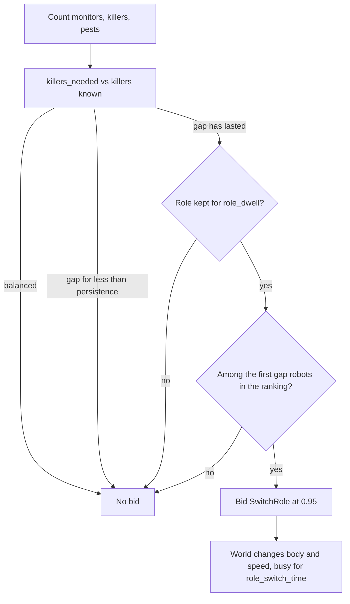

# Role rebalancing: when, and how many, robots switch between monitor and killer

This covers #64: how the swarm decides, without a central controller, how many robots monitor the field (explorers, scout body) and how many treat pests (killers), and when a robot changes from one role to the other. The decision is `RebalanceRoles` in `swarm/rebalance.py`. The simulation side is the `SwitchRole` action in `contracts/actions.py`, which scouts and killers may emit (`swarm/capabilities.py`), and `WorldState._switch_role` in `simulation/world.py`. A robot that may switch is a `RebalancingPreset` (`experiments/presets.py`), and `experiments/rebalancing.py` builds the compared swarms. The results below come from `uv run python -m studies.rebalancing --seeds 8` and are reproducible from the seeds.

## What it has to solve

Explorers are fast (they fly at 2 m/s in the scenarios, against 0.5 m/s for ground killers), so one explorer keeps more of the field fresh than a killer could. Killers are only worth having while there are pests to treat. With bodies fixed when a run is assembled, the split is a guess made before the first pest appears: too many killers and the field goes stale, too few and pests pile up. Rebalancing lets that split follow the pests.

Three questions have to be answered at every decision point: **how many** killers the swarm needs, **when** an imbalance is real enough to act on, and **who** switches, so that a shortage of two killers produces two switches and not ten.

## How many

Every robot counts, from its own memory, the monitors, the killers and the pests it knows of. Peers report their body in every status message, and the robot's own body comes from its perception, so the count needs nothing new on the wire. Peers last heard of longer ago than `peer_horizon` are left out, so a robot that has gone silent stops counting.

The swarm needs `min_killers` plus one killer for every `pests_per_killer` known pests, but never so many that fewer than `min_monitors` monitors are left:

```
killers_needed = min(min_killers + ceil(pests / pests_per_killer), max(min_killers, robots - min_monitors))
```

`min_monitors` comes from the field: the explorers needed to sense every free cell once per revisit age. An explorer senses at most one new cell per decision, and no faster than it can fly across one, so `monitors_needed` takes the slower of the two. On the 32 × 32 river field that is 948 free cells, a 30 min revisit target (`REVISIT_TARGET`) and 4 cells per minute per explorer (capped by the 15 s decision interval rather than by speed), so 8 explorers. It ignores overlap, so it is a lower bound. `rebalancing_configurations` sets it unless it is given a `RebalanceConfig`.

## When

The same idea as the arbiter's hysteresis, for the same reason: news arrives in bursts when robots meet, and a robot should not change role at the rate its map changes.

- **Persistence.** An imbalance in the same direction has to last `persistence` (2 min) before anyone acts on it. A single encounter that briefly shows a shortage does nothing.
- **Dwell.** A robot keeps a new role for `role_dwell` (15 min) before it may switch again. This bounds switches to four per robot per hour, whatever the pests do.
- **Cost.** A switch keeps the robot busy for `RobotConfig.role_switch_time` (60 s): it decides, but does not act.

The switch is bid at `switch_score` (0.95), above the arbiter's override threshold. A lower bid would hardly ever win: an explore commitment holds at the maximum margin of 0.5 after five minutes (#60), so a rival needs more than 1.0. Treating the pest underfoot (0.99) and charging on a dock (1.0) still outbid it, so a robot finishes those first. With `switch_at_dock`, a robot only switches while it stands on a dock, so the switch can ride along with a recharge stop.

## Who

Every robot sees roughly the same imbalance. If the rule were "killers are short, so switch", every monitor would switch at once and the swarm would overshoot. Instead each robot ranks itself among the robots that could switch and only acts if it is among the first `|gap|`:

- monitor to killer: nearest a known pest first;
- killer to monitor: furthest from any known pest first;
- ties, and the case with no known pest, go to the lowest robot id.

Robots rank the same peers from slightly different maps, so two may occasionally both decide they are the one. Persistence and dwell absorb that: the next count shows the overshoot, and nobody can switch back for 15 minutes.



## One brain for both roles

A `RebalancingPreset` carries the behaviours of both roles: `TreatInfestation`, the explore behaviour, `ReturnToDock` and `RebalanceRoles`. `BodyGate` wraps `TreatInfestation` so it only bids while the robot is a killer, and the explore behaviour so it only bids while the robot is a scout; the body is read from the perception at every decision, so the gates follow a switch at once. The runner applies a gate to every behaviour named under `"body_gates"` in a `BrainSpec`'s parameters (`runner.build_behaviors`). The brain's capability gate cannot replace these gates: it checks a `FollowField` as a move, so it would let a scout head for a pest it cannot treat.

The world changes the robot's body and sets its speed from `RoleSwitchSpec.speeds`, which `SwarmScenario` fills from `RobotConfig`; sensing and battery drain follow the new body's capabilities. The renderer colours robots by body, so a switch is visible in the viewer.

**What a switch stands for.** On main a scout is a flying drone and a killer a ground robot, so no real robot turns one into the other. A switch stands for a robot whose role is a module: a sensor head or a sprayer. Three choices follow from that. A rebalancing robot plans its routes on the ground whatever its body (`BrainSpec.flies = False`), so a robot that becomes a killer is never planned across the river. Only scouts and killers switch; a battery robot cannot. And with `switch_at_dock` a robot switches only on a dock, where a module swap would happen; that is off in the results below, so they show the best case of switching anywhere.

## Parameters

| Parameter | Default | Meaning |
|---|---|---|
| `min_killers` | 1 | killers kept with no known pest, so a new one is treated quickly |
| `min_monitors` | 6, or 8 from the field (`monitors_needed`) | explorers kept whatever the pests |
| `pests_per_killer` | 2 | known pests one killer is expected to handle |
| `persistence` | 2 min | how long an imbalance must last before anyone acts |
| `role_dwell` | 15 min | how long a robot keeps a new role |
| `peer_horizon` | 20 min | peers heard of longer ago are not counted |
| `switch_score` | 0.95 | the bid to switch, an override |
| `switch_at_dock` | off | switch only while on a dock |
| `RobotConfig.role_switch_time` | 60 s | how long a switch keeps a robot from acting (scenario) |

Like the arbiter's margins, these are first guesses.

## Results

`REBALANCING`: fourteen robots, 8 explorers and 6 seeded killers at the start, on the 32 × 32 river field with a dock in every corner. 20 pests an hour, treated at `FAST_TREATMENT`, 300 m radio, 15 s decisions, batteries of ten charges and a hundred doses per killer. Three simulated hours, the first left out of the infested count, seeds 0 to 7. Both arms are the same robots in the same places with the same pests; the only difference is whether robots may switch. Mean ± standard error over the seeds; Δ infested is paired by seed.

| Arm | Infested cells | Δ infested | Treated | Response (min) | Open at the end | Idleness (min) | Killers | Role switches |
|---|---|---|---|---|---|---|---|---|
| Fixed roles | 6.52 ± 0.85 | – | 50.9 ± 2.8 | 19.1 ± 1.5 | 6.1 ± 1.2 | 9.3 ± 1.1 | 6 | 0 |
| Rebalancing | 4.82 ± 0.32 | −1.70 ± 0.67 | 52.3 ± 3.0 | 14.4 ± 0.4 | 5.1 ± 1.0 | 6.8 ± 0.1 | 2.6 (1 to 6) | 27.3 ± 1.4 |

The rebalancing swarm keeps about a quarter fewer cells infested, answers a pest five minutes sooner and keeps the field fresher, with fewer than half the killers on average. It was better on 7 of the 8 seeds and 0.11 cells worse on the eighth (seed 0), and gained most where fixed roles did worst (seed 2: 8.1 to 4.4, seed 5: 9.3 to 4.6). Two things can carry the gain: the killers it does not need explore instead, and a robot that becomes a killer is the explorer nearest a known pest, which got there flying at four times a killer's speed. The second depends on switching anywhere; with `switch_at_dock` it would be lost, which is not measured yet.

**Doses.** At main's default of ten doses per killer the fixed killers run dry within the run (all six, on each of seeds 0 to 3), while a robot that becomes a killer brings a full supply, so rebalancing then looks far better (5.0 against 12.2 infested cells over seeds 0 to 3) for a reason that has nothing to do with the split. `REBALANCING` gives killers a hundred doses so that doses do not decide the comparison. How a switched robot's doses should work (a refilled module from the dock, or the supply it had) is open.

## Compared with a utility-based switch

A proposal from the team: every robot scores each role from its behaviour scores, `U_k = Σ_i w_ik s_i` with weights per role (killer 0.6 treat + 0.4 explore, explorer 0.3 treat + 0.7 explore), and may switch when the other role's utility is higher by Δ = 0.05. Two ways to keep robots from switching together were proposed: (A) robots share their utility and only the highest switches, and (B) a robot switches only when its utility beats a random number drawn from 0.75 to 1.

It was measured on this branch's code before the merge with main (8 scouts and 6 killers, 20 pests an hour, seeds 0 to 2, three hours), with the scores of main's `TreatInfestation` (`1 / (1 + e^-(pests − killers))`) and `ExploreBehaviour`. Option A needed one change to work at all: robots decide at different moments, so the first robot to want a switch always saw no rival; each robot now announces, waits one decision, and switches only if it is still the highest.

| Arm | Infested cells | Role switches | Switched back within 10 min | Time with no killer |
|---|---|---|---|---|
| Fixed roles | 8.92 | 0 | 0 | 0 % |
| This rebalancing | 7.58 | 30 | 0 | 0 % |
| Utility, no conflict rule | 10.60 | 1,292 | 1,262 | 29 % |
| Utility, option A | 8.20 | 206 | 127 | 6 % |
| Utility, option B | 9.14 | 1 | 0 | 0 % |

- **Without a conflict rule** it is worse than fixed roles. A killer that knows of no pest has a treat score of 0, so every killer leaves at once, and with Δ alone robots flip back and forth as the scores change at every decision.
- **The weights set one threshold.** With two roles, `U_killer − U_explorer = 0.3 (s_treat − s_explore)`, so the rule is "become a killer when the treat score beats the explore score by Δ / 0.3 ≈ 0.17".
- **Option B switches almost never.** It compares the utility itself, not the gain, with a number of at least 0.75. The explore score stays near 0.47, so an explorer's utility never passed 0.45 and a killer's barely reached 0.76.
- **Option A works, but less well than counting.** It lets one robot switch per round, so a shortage of three killers fills slowly, and robots that hear the same news compute the same utility, so the tie-break (the lowest id) picks who switches rather than who is nearest the pest.

What it does well is reuse the scores robots already compute, which on main react to demand: the treat score falls as more killers are known. Using that utility to rank who switches, in place of the distance to the nearest pest, with this count, persistence and dwell deciding how many and when, is a possible next step.

## What it does not do yet

- **It only counts the pests it knows of.** Robots that have heard of only a few of the pests keep too few killers, and a robot can count a pest a peer has already treated until it hears otherwise. The estimate is only as good as the swarm's shared map.
- **It does not weigh where pests are.** A cluster of pests far from every killer needs more killers than the same number next to one; `pests_per_killer` is a flat rate.
- **The ranking ignores the battery.** A robot about to recharge may still be the one chosen to switch.
- **Only seeded killers.** A `RebalancingPreset` treats like a seeded killer; switching into a hop killer, which keeps no map, is not built.
- **It does not interact with crowding yet.** Two new killers can head for the same pest; that is the crowding problem of #42 and the TREAT seeder's peer discount, not of rebalancing.

## Using it

```bash
uv run python examples/scenario_viewer.py --scenario rebalancing
uv run python examples/scenario_viewer.py --scenario rebalancing-fixed
uv run python -m studies.rebalancing --seeds 8
```

The viewer colours robots by body, so every switch shows. In code, `rebalancing_configurations(scenario)` turns any scenario of explorers and seeded killers into the two arms, and `rebalancing_configurations(scenario, RebalanceConfig(switch_at_dock=True))` switches only at docks. A swarm can also mix fixed and switching robots, e.g. `SwarmScenario().add_robots(EXPLORER, 4).add_robots(REBALANCING_EXPLORER, 4).add_robots(SEEDED_KILLER, 2)`.
