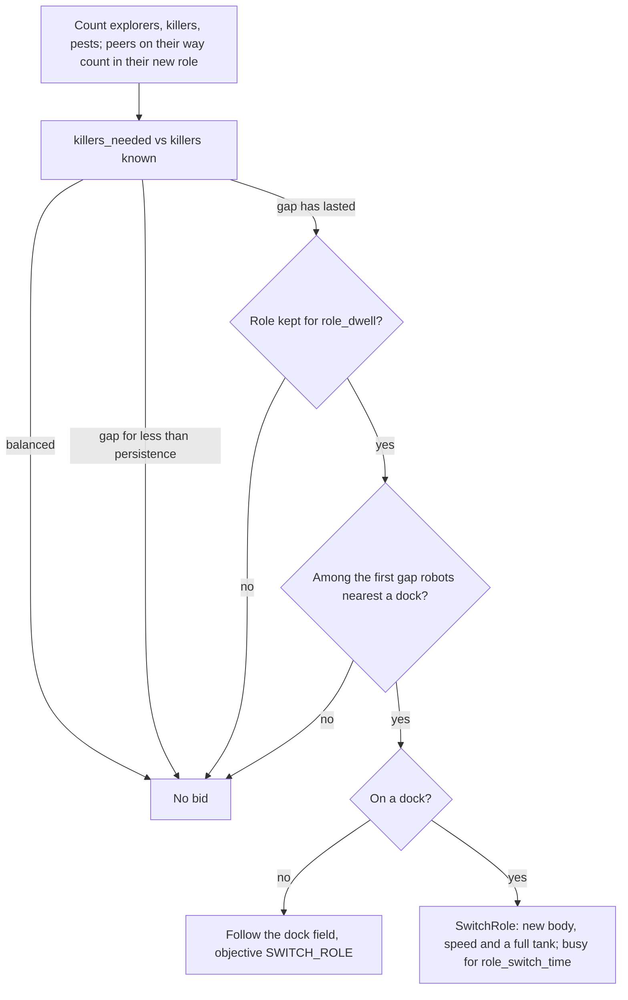

# Role rebalancing: when, and how many, robots switch between explorer and killer

This covers #64 and the REBALANCE experiment of the [experiment plan](../experiment-plan.md): how the swarm decides, without a central controller, how many robots explore the field (scout body) and how many treat pests (killers), and when a robot changes from one role to the other. A role is a module swapped at the home base: a robot picked to switch drives to the nearest dock and switches there.

The decision is `RebalanceRoles` in `swarm/rebalance.py`. The simulation side is the `SwitchRole` action in `contracts/actions.py`, which scouts and killers may emit (`swarm/capabilities.py`), and `WorldState._switch_role` in `simulation/world.py`. A robot that may switch is a `RebalancingPreset` (`experiments/presets.py`), `experiments/rebalancing.py` builds the compared swarms, and `studies/rebalancing.py` runs the experiment.

## What it has to solve

Explorers are drones and fast (8 m/s in the default settings, against 1 m/s for ground killers), so one explorer keeps far more of the field fresh than a killer could. Killers are only worth having while there are pests to treat. With roles fixed when a run is assembled, the split is a guess made before the first pest appears: too many killers and the field goes stale, too few and pests pile up. Rebalancing lets that split follow the pests.

Three questions have to be answered at every decision point: **how many** killers the swarm needs, **when** an imbalance is real enough to act on, and **who** switches, so that a shortage of two killers produces two switches and not ten.

## How many

Every robot counts, from its own memory, the explorers, the killers and the pests it knows of. Peers report their body and objective in every status message, and the robot's own body comes from its perception, so the count needs nothing new on the wire. Peers last heard of longer ago than `peer_horizon` are left out, so a robot that has gone silent stops counting. A peer on its way to a dock to switch (objective `SWITCH_ROLE`) already counts in its new role.

The swarm needs `min_killers` plus one killer for every `pests_per_killer` known pests, but never so many that fewer than `min_monitors` explorers are left:

```
killers_needed = min(min_killers + ceil(pests / pests_per_killer), max(min_killers, robots - min_monitors))
```

`min_monitors` is `kept_explorers`: the explorers needed to sense every free cell once per 30 min (`monitors_needed`), and at least half of the explorers the swarm starts with. With drones at 8 m/s `monitors_needed` is a single explorer on the small field, because it ignores how much explorers overlap; on its own it would let the swarm give up nearly all of them.

## When

The same idea as the arbiter's hysteresis, for the same reason: news arrives in bursts when robots meet, and a robot should not change role at the rate its map changes.

- **Persistence.** An imbalance in the same direction has to last `persistence` (2 min) before anyone acts on it.
- **Dwell.** A robot keeps a new role for `role_dwell` (15 min) before it may switch again, which bounds switches to four per robot per hour.
- **Cost.** A switch keeps the robot busy for `RobotConfig.role_switch_time` (60 s): it decides, but does not act.

Both the trip to the dock and the switch are bid at `switch_score` (0.95), above the arbiter's override threshold, so a long-running commitment does not hold them back; treating the pest underfoot (0.99) still outbids them.

## Who

Every robot sees roughly the same imbalance. If the rule were "killers are short, so switch", every explorer would switch at once and the swarm would overshoot. Instead each robot ranks itself among the robots that could switch and acts only if it is among the first `|gap|`. Since the switch happens on a dock, the robots nearest a dock go first; ties go to the lowest robot id. (Switching anywhere, without docks, ranks explorers nearest a known pest first and killers furthest from any.)

Robots rank the same peers from slightly different maps, so two may occasionally both decide they are the one. A robot that set off reports `SWITCH_ROLE`, so the others count it at once; persistence and dwell absorb what remains.



## One robot, both roles

A `RebalancingPreset` is an explorer and a killer in one: the brain of its `explorer` (an `ExplorerPreset`) while its body is a scout, and the brain of its `killer` while it is a killer. The killer is the scenario's own preset, `SEEDED_BEST` or `HOP_BEST`, so a switching robot treats with the tuned parameters of that method: the seeded killer's claims and claim time, or the hop killer's beacons and source time. `BodyGate` wraps the pest response so it only bids while the robot is a killer, and the explore behaviour so it only bids while the robot is a scout; the runner applies a gate to every behaviour named under `"body_gates"` in a `BrainSpec`'s parameters (`runner.build_behaviors`). The brain's capability gate cannot replace these gates: it checks a `FollowField` as a move, so it would let a scout head for a pest it cannot treat.

Unlike main's hop killer, a switching robot keeps its map and shares what it knows, as an explorer does: it needs the map to explore, to count the pests it rebalances on, and to find a dock. It plans its routes on the ground whatever its body (`BrainSpec.flies = False`), since it may become a killer, which cannot cross a river. Only scouts and killers switch; a battery robot cannot.

On main a scout is a flying drone and a killer a ground robot, so no real robot turns one into the other; the switch stands for a robot whose role is a module, a sensor head or a sprayer, swapped at the home base. The world gives the robot the other body and that body's speed (`RoleSwitchSpec`, filled from `RobotConfig`), and a full tank of doses, as a module taken from the dock would have.

## Parameters

| Parameter | Default | Meaning |
|---|---|---|
| `min_killers` | 1 | killers kept with no known pest, so a new one is treated quickly |
| `min_monitors` | `kept_explorers`: 5 of 10 on the default fields | explorers kept whatever the pests |
| `pests_per_killer` | 2 | known pests one killer is expected to handle |
| `persistence` | 2 min | how long an imbalance must last before anyone acts |
| `role_dwell` | 15 min | how long a robot keeps a new role |
| `peer_horizon` | 20 min | peers heard of longer ago are not counted |
| `switch_score` | 0.95 | the bid to drive to a dock and to switch, an override |
| `switch_at_dock` | on in `rebalancing_configurations` | switch only on a dock, driving there first |
| `RobotConfig.role_switch_time` | 60 s | how long a switch keeps a robot from acting |

Like the arbiter's margins, these are first guesses.

## Results: REBALANCE on the small river field

`studies/rebalancing.py --maps rivers-small --seeds 5`: the default small river field (`RIVER_SMALL`, 32 × 32 cells, one river and rocks, docks at (0, 0) and (31, 31)) for 2 h, 10 explorers at 8 m/s and 4 killers at 1 m/s, 100 m radio, 20 static pests at the start and 20 more per hour, no battery drain and unlimited doses. Fixed roles against rebalancing at the docks, with `SEEDED_BEST` and with `HOP_BEST` killers; seeds 0 to 4, the same robots, starts and pests per seed. Mean ± standard error over the seeds; Δ open is paired by seed.

| Killers | Roles | Latency (min) | Open at the end | Δ open | Cleared per hour | Cells per pest | Killers (mean) | Killers (range) | Switches |
|---|---|---|---|---|---|---|---|---|---|
| seeded | fixed | 4.89 ± 0.30 | 3.40 ± 0.75 | – | 27.4 ± 1.3 | 8.8 ± 0.3 | 4 | 4 | 0 |
| seeded | rebalancing | 5.38 ± 0.26 | 2.20 ± 0.20 | −1.20 ± 0.73 | 28.0 ± 1.3 | 14.9 ± 0.7 | 2.73 ± 0.06 | 1–8 | 17.6 ± 0.2 |
| hop-based | fixed | 11.16 ± 0.81 | 2.80 ± 0.49 | – | 27.6 ± 1.2 | 36.7 ± 2.3 | 4 | 4 | 0 |
| hop-based | rebalancing | 9.64 ± 0.60 | 4.40 ± 0.51 | +1.60 ± 0.68 | 26.8 ± 1.5 | 37.1 ± 1.4 | 3.93 ± 0.12 | 2–11 | 20.8 ± 1.9 |

"Cells per pest" counts the cells robots drove while they were killers: main's standard measure follows the robots that start as killers, which in a rebalancing swarm also fly as explorers.

Against the hypotheses written in the study before it ran:

- **Every arm clears what arrives.** All four clear 27 to 28 pests an hour, close to all that appear (20 at the start and 20 an hour over 2 h). On this field the default swarm keeps up with fixed roles already, which leaves rebalancing little to gain; hypothesis 2, that it clears more, is not supported.
- **Seeded: the same work with a third fewer killers.** Rebalancing keeps 2.7 killers on average instead of 4 and leaves 1.2 ± 0.7 fewer pests open at the end, which is under two standard errors, so no conclusion. Its latency is 0.5 min longer, also within two standard errors. Its killers drive 70 % more cells per pest, since fewer of them cover the field and new ones start from a corner.
- **Hop-based: worse at the end.** Rebalancing leaves 1.6 ± 0.7 more pests open, 2.4 standard errors, with about as many killers as fixed roles (3.9), and every seed but one ends with at least as many open. Its latency is 1.5 min shorter, under two standard errors. This agrees with hypothesis 4 and with the earlier hop result below.
- **Switches stay bounded.** About 18 switches per run with seeded killers and 21 with hop killers, about one per robot per hour, and the killers range from 1 to 8 (seeded) or 2 to 11 (hop).

The large river field (`RIVERS_LARGE`, 4 h) is set up in the same study (`--maps rivers-large`, default 3 seeds) but not run yet: its runs take about six times as long. Hypothesis 3, a smaller gain on the large field because the docks are in two corners, waits on it.

## Earlier measurements, switching anywhere

Before the experiment plan's defaults existed, rebalancing was measured on a custom scenario (8 explorers and 6 killers at 2 and 0.5 m/s, a dock in every corner, 20 pests an hour for 3 h, 8 seeds), switching wherever the robot stood. With seeded killers it kept 4.82 ± 0.32 cells infested against 6.52 ± 0.85 for fixed roles, with 2.6 killers on average; part of that gain came from explorers flying to a pest and becoming killers next to it, which a switch at the home base cannot do. With hop killers it was worse on all 8 seeds (26.9 against 15.4 infested); ruled out as causes were the switching robot's brain, the explorers planning on the ground, turning a pest's beacon source into a killer, and the demand rule's tuning. A likely cause, not yet measured, is that hop killers have no claims, so robots that switch near the same pests crowd one of them. A utility-based switch proposed in the team was compared there as well and did worse than counting; that comparison is not carried over to the default scenarios.

## What it does not do yet

- **It only counts the pests it knows of.** Robots that have heard of only a few of the pests keep too few killers, and a robot can count a pest a peer has already treated until it hears otherwise.
- **It does not weigh where pests are.** A cluster of pests far from every killer needs more killers than the same number next to one; `pests_per_killer` is a flat rate.
- **It does not help hop killers.** See the results above.
- **The ranking ignores the battery,** and a robot does not combine its trip to the dock with a recharge.
- **It does not interact with crowding.** Two new killers can head for the same pest; that is the crowding problem of #42 and the TREAT seeder's peer discount, not of rebalancing.

## Using it

```bash
uv run python examples/scenario_viewer.py --scenario rebalancing
uv run python examples/scenario_viewer.py --scenario rebalancing-fixed
uv run python examples/scenario_viewer.py --scenario rebalancing-hop
uv run python -m studies.rebalancing --maps rivers-small --seeds 5
uv run python -m studies.rebalancing --seeds 5 --large-seeds 3
```

The viewer colours robots by body, so every switch shows. The study writes its tables, a PDF figure per field and their LaTeX fragments to a new folder in `output/`. In code, `rebalancing_configurations(scenario)` turns any scenario of explorers and one kind of killer into the two arms, and takes a `RebalanceConfig` for other parameters. A swarm can also mix fixed and switching robots, e.g. `SwarmScenario().add_robots(EXPLORER, 4).add_robots(REBALANCING_EXPLORER, 4).add_robots(SEEDED_BEST, 2)`.
