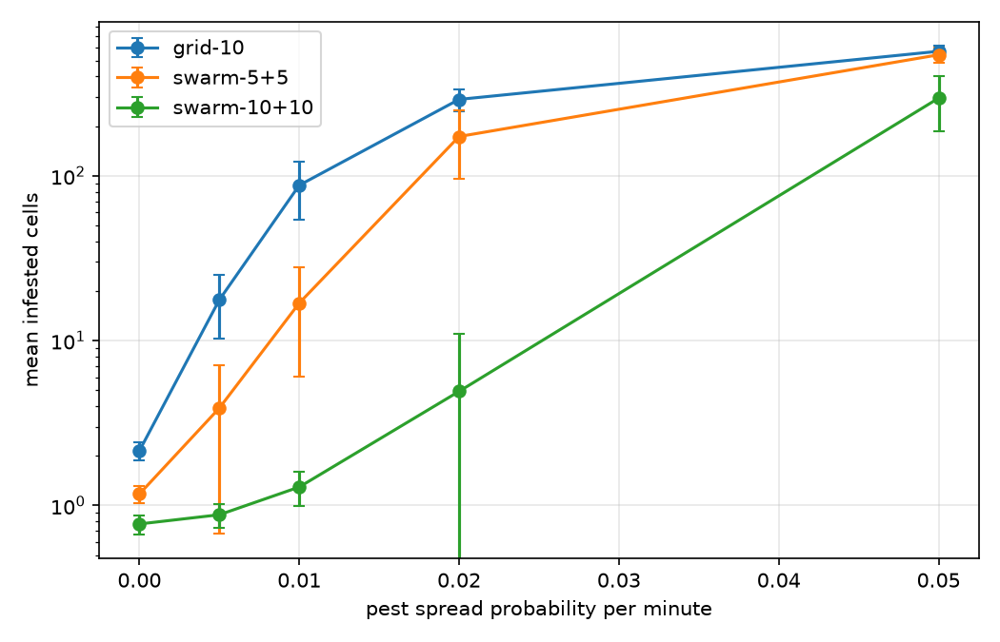

# Research note — from which pest spread rate is a swarm needed? (#74)

Status: describes the grid-search baseline (`GridSweepSeeder` and `grid_sweep_brain` in `studies/baselines.py`), the study `studies/spread_threshold.py`, and its results, measured on the code of `main` after the body capabilities (#61), the battery lifecycle (#81), `SwarmScenario` (#84) and the spreading of killers over pests (#60). The results below are reproducible with (75 runs, about six minutes):

```bash
uv run python -m studies.spread_threshold --seeds 5 --hours 3 --jobs 6
```

Use at most about six to eight processes on a machine with 16 GB: the runs at the highest spread rates fill the field and take the most memory.

## The question

A swarm is only worth its complexity if it does something simpler robots cannot. The simplest alternative is a grid search: utility robots that each sweep a strip of the field in a fixed pattern and treat whatever they drive over, without communicating. Such a sweep revisits every cell at a fixed period, so it should keep slowly spreading pests under control but fall behind once pests spread faster than the sweep comes back. The swarm reacts to a pest as soon as an explorer sees it, so it should hold out to a higher spread rate. The study looks for that crossover.

## Setup

The field, pests and robots of the base demo (`SMOKE`, see `smoke.md`): 32 × 32 cells of 10 m with a river and two rocks, 948 crop cells, one dock in the corner. Every run starts with ten pests of severity 0.1 on random cells off the bottom row, drawn from the seed, so all systems face the same pests for the same seed. No pest appears after that, so pests only multiply by spreading, and the spread rate is the only variable: the chance per minute that a pest of severity 1 infests each free neighbour, over 0, 0.005, 0.01, 0.02 and 0.05. Severity grows 0.05 per minute, and a killer clears a pest of full severity in a minute (`FAST_TREATMENT`). Five seeds per point, three simulated hours per run, sampled every minute.

| System | Robots | Behaviour |
|---|---|---|
| `grid-10` | 10 utility robots (ground, 0.5 m/s) | each sweeps its own strip of about three columns in a lawnmower pattern and treats the pest underfoot; no radio |
| `swarm-5+5` | 5 explorers (drones, 2 m/s) + 5 seeded killers (ground, 0.5 m/s) | the base demo: explorers follow the EXPLORE field, killers claim and treat the pests they hear of over a 300 m radio |
| `swarm-10+10` | 10 explorers + 10 seeded killers | the same swarm with twice the robots |

The utility robots are killers with the grid-sweep brain, so they have the killers' speed, sensing and treatment. Every killer and utility robot carries ten treatment doses, and nothing refills them, so ten treating robots can clear at most about 100 pests and five about 50.

A run is out of control when its infested cells still grow at the end: their mean over the last hour is more than 1.5 times, and more than 10 cells above, their mean over the hour before. A run whose infestation has filled the field stops growing for want of healthy cells, so it is out of control too when at least a quarter of the crop cells (237) are infested over its last hour. A system's threshold is the lowest spread rate at which most of its seeds are out of control.

## Results

Mean infested cells over the run, with the standard deviation over the seeds and the seeds out of control:

| Spread | grid-10 | swarm-5+5 | swarm-10+10 |
| --- | --- | --- | --- |
| 0 | 2.1 (sd 0.3; 0/5 lost) | 1.2 (sd 0.1; 0/5 lost) | 0.8 (sd 0.1; 0/5 lost) |
| 0.005 | 17.7 (sd 7.4; 3/5 lost) | 3.9 (sd 3.2; 0/5 lost) | 0.9 (sd 0.1; 0/5 lost) |
| 0.01 | 87.5 (sd 33.4; 5/5 lost) | 16.9 (sd 10.9; 4/5 lost) | 1.3 (sd 0.3; 0/5 lost) |
| 0.02 | 290.4 (sd 44.0; 5/5 lost) | 173.0 (sd 77.5; 5/5 lost) | 4.9 (sd 6.0; 1/5 lost) |
| 0.05 | 568.5 (sd 45.1; 5/5 lost) | 541.2 (sd 56.6; 5/5 lost) | 295.5 (sd 108.8; 5/5 lost) |

Threshold: `grid-10` 0.005, `swarm-5+5` 0.01, `swarm-10+10` 0.05.



Seeds whose field was clean before the end, and when on average, and the pests cleared of those that appeared (means over the seeds):

| Spread | grid-10 | swarm-5+5 | swarm-10+10 |
| --- | --- | --- | --- |
| 0 | 5/5 after 71 min; 10.0 of 10.0 | 5/5 after 36 min; 10.0 of 10.0 | 5/5 after 23 min; 10.0 of 10.0 |
| 0.005 | 0/5; 34.0 of 75.4 | 3/5 after 49 min; 19.4 of 24.8 | 5/5 after 25 min; 12.2 of 12.2 |
| 0.01 | 0/5; 78.8 of 315.8 | 1/5 after 42 min; 39.8 of 85.4 | 5/5 after 35 min; 19.4 of 19.4 |
| 0.02 | 0/5; 101.6 of 778.2 | 0/5; 43.0 of 475.8 | 4/5 after 44 min; 38.4 of 50.0 |
| 0.05 | 0/5; 107.4 of 1039.8 | 0/5; 47.8 of 975.2 | 0/5; 92.0 of 766.2 |

## What the results show

- **Without spread, the swarm clears the field twice as fast as the grid search.** Every system clears all ten pests in every seed, but the swarm of five plus five needs 36 minutes against 71 for the grid's ten sweepers, and ten plus ten needs 23. A sweep needs about one pass of its strip to reach a pest; the swarm drives to it as soon as an explorer has seen it.
- **The grid search loses control from a spread rate of 0.005.** It then cleared only 34 of its about 100 doses' worth of pests, so it does not run out of treatment: its sweep comes back too late, and pests spread in the meantime.
- **The swarm of five plus five holds out twice as long with half the treating robots.** At 0.005 it keeps every seed in control and clears the field in three of five; its threshold is 0.01. There it has used about 40 of its 50 doses, so its treatment supply starts to count as well.
- **The swarm of ten plus ten, with as many treating robots as the grid, holds out to a spread rate ten times higher.** It clears the field in every seed up to 0.01 and in four of five at 0.02, where the grid has 290 infested cells. Only at 0.05 does it lose control, having used 92 of its about 100 doses.
- **The difference comes from finding pests, not from treating more.** Up to 0.01, where the grid is already lost, no system is close to its dose limit, so what separates them is how soon a pest is found and reached.

So a grid search is only enough when pests barely spread, below about 0.005 per minute on this field. Above that a swarm is needed, and the spread rate it handles grows with its size: doubling the swarm raised its threshold from 0.01 to 0.05.

## Caveats

- **The systems differ in hardware as well as in coordination.** The swarm's explorers are drones at 2 m/s that sense 3 × 3 cells, while the grid's utility robots are ground robots that sense one cell. That is the heterogeneous design being compared, but part of the swarm's advantage comes from its drones. A grid baseline of drones sweeping strips would separate the two.
- **Treatment doses limit the highest spread rates.** At 0.02 and 0.05 the grid and the five-plus-five swarm have used most of their doses, and the ten-plus-ten swarm reaches its limit at 0.05. Those results compare treatment supply more than search; a rerun with more doses (`PestConfig.treatment_doses`) would show how far each system holds out on search alone.
- **One dock for the whole swarm.** Explorers fly 30 minutes per charge and queue at the single dock, so over three hours part of their time goes to charging. This counts against the swarm, which has the explorers; the grid's ground robots last the run without charging.

## What would extend the result

- **Test where a grid search scales badly:** a larger field (a sweep's period grows with the area, a swarm's response does not), fewer robots per area, or robots that fail (a failed sweeper leaves its whole strip unwatched).
- **Separate hardware from coordination** with a drone grid baseline, and search from supply with more treatment doses.
