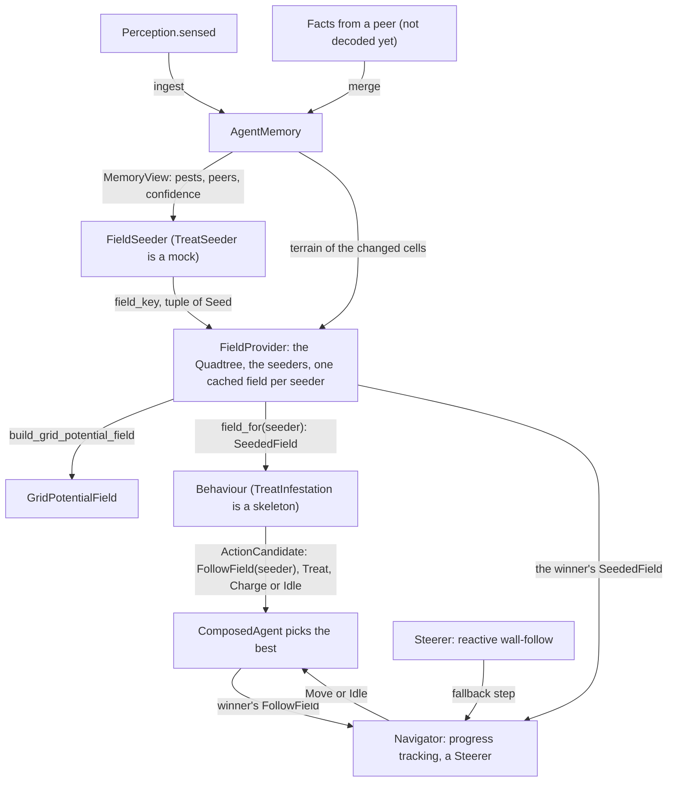
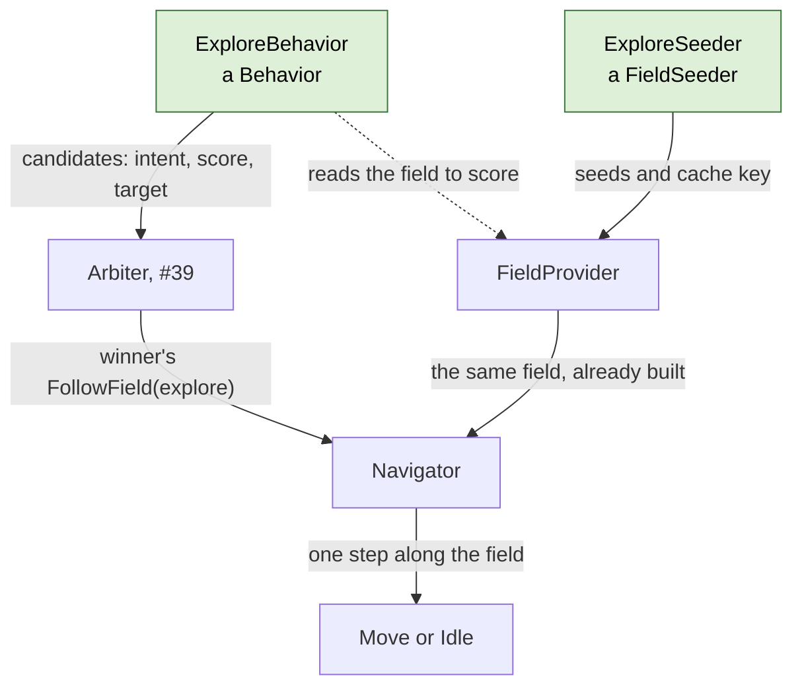

# Robot memory and navigation (v1)

This document describes what was built for the robot's local memory and for navigation by grid potential fields, and where the implementation differs from the *Field-level swarm design* document. It stays at a high level: for the details, read the classes and functions it names, whose docstrings explain the rules and show small diagrams.



Memory holds facts and nothing else. The quadtree says where a robot can be and where it can move, and knows nothing about costs or targets. The builder turns targets and the quadtree into a grid potential field, and knows nothing about pests or objectives. A *field seeder* is the small piece of code that connects memory to targets: it reads memory and decides which cells are targets of one field and how attractive each one is. A *behaviour* bids for what the robot does next, possibly reading a seeder's field to score its bid, and says what to do if it wins: follow that field, or act on the spot. The *field provider* holds the quadtree and the seeders, hands targets to the builder, and keeps the field it built for each seeder, so behaviours and the navigator share it. The *navigator* is the one movement seam: for the winning bid only, it steps along that bid's field, asking the *steerer* for a step whenever the field cannot guide. Only a mock seeder and a skeleton behaviour exist; writing the real ones is the next step (see "Writing a behaviour" below).

| Module | Contents |
| --- | --- |
| `swarm/memory.py` | `AgentMemory`, `MemoryView`, `DecayConfig` |
| `swarm/field/quadtree.py` | `Quadtree`, `Leaf`, `find_leaves`, `TerrainView`, `traversable_cells` |
| `swarm/field/dijkstra.py` | `multi_source_dijkstra`, `SettledNode` |
| `swarm/field/builder.py` | `Seed`, `build_grid_potential_field`, `GridPotentialField`, `MixedGraph` |
| `swarm/provider.py` | `FieldProvider` (the quadtree, the seeders, one cached field per seeder) |
| `swarm/navigator.py` | `Navigator` (the seam: progress, fallback) |
| `swarm/steering.py` | `Steerer`, `Sensing`, `QuadtreeSensing`, `SteeringConfig` |
| `swarm/seeder.py` | `FieldSeeder`, `SeededField`, `TreatSeeder` (mock) |
| `swarm/behavior.py` | `Behavior`, `ActionCandidate`, `FollowField`, `Intent`, `DecisionContext`, `TreatInfestation` (skeleton) |
| `swarm/brain.py` | `ComposedAgent` |

Tests: `tests/test_memory.py`, `tests/test_quadtree.py`, `tests/test_field.py`, `tests/test_provider.py`, `tests/test_navigator.py`, `tests/test_steering.py`, `tests/test_swarm.py`.

## Memory

`AgentMemory` stores the contract facts a robot senses or receives. Terrain and infestation facts are keyed by cell; named peer sightings and peer-target announcements are keyed by robot id. An incoming fact replaces the stored one only if it was observed strictly later, so on a tie memory keeps what it already has. The robot's own sensing (`ingest`) and facts from peers (`merge`) use the same rule, so a fact forwarded through a third robot does not overwrite a newer report. A cell seen to be clean is stored as an infestation fact with severity 0. That is how memory tells "known clean" from "never seen", and how a report that a pest was treated replaces the old pest fact.

`PeerTargetObservation` is an intent fact separate from `PeerObservation`, which records where a robot was seen. It contains the announcing robot (`source`), its current `target` cell, its objective name and the announcement time. An announcement with both target and objective set to `None` explicitly clears that robot's previous target. Only the latest announcement per peer is retained, and the original source and timestamp survive when the fact is forwarded to another robot. This prevents stale reports from restoring an old target.

Confidence is computed on demand by `AgentMemory.confidence`. Infestation confidence decays over 24 h; peer sightings and peer-target announcements decay over 10 min; terrain does not decay. `peer_target_confidence(target, objective, now)` returns the strongest decayed confidence among peers announcing that exact target/objective pair. Nothing in memory changes as time passes, so there is no periodic decay step.

Memory does not compute aggregates (such as the coarse tiles in the design document). Behaviours and objectives read facts through `MemoryView`, including peer targets, and can use their decayed confidence to lower the attractiveness of already-pursued work.

Contract changes made for memory: `ObstacleObservation` became `TerrainObservation` with a `Terrain` value (`FREE`, `OBSTACLE`, `OUTSIDE`; no observation means unknown); `PeerObservation` gained the peer's `body`; `BodyType` moved to `contracts/ids.py`; and `TimeUnit` gives named durations, e.g. `24 * TimeUnit.HOUR` (`Time` is in milliseconds).

## Quadtree

The design document computes the far part of a field on fixed 4 × 4 tiles. That was built first and dropped: a tile only records whether its borders can be crossed, not how the cells inside are connected, so a river running straight through the middle of a tile left both of its borders open, and the coarse search saw a crossing that does not exist. The `Quadtree` replaces the tiles.

The quadtree starts from one boolean per cell, *traversable*: can a robot of this body be in the cell. `traversable_cells` reads it from any `TerrainView` (`AgentMemory` is one) using the v1 cost rule below. The quadtree then groups the cells into *leaves*: square blocks that are entirely traversable or entirely blocked, with a side of 1, 2, 4, 8 or 16 cells, aligned to multiples of their side. Open ground becomes a few 16 × 16 leaves, while leaves near obstacles shrink down to single cells.

It stores just two arrays: the traversability of each cell, and for each cell the size of the leaf whose corner is at that cell (0 for every other cell of a leaf). `find_leaves` builds the second array bottom-up with numpy. Everything else is computed when asked: `leaf_at` finds the leaf containing a cell, `leaf_neighbours` finds the leaves a robot can move into from a leaf, and `cell_neighbours` finds the cells a robot can move into from a cell. A diagonal move is allowed only if both cells beside it are traversable, so robots never cut the corner of an obstacle.

Because every leaf is uniform, two leaves are neighbours exactly when a robot can move from a cell of one into a cell of the other. So a search over leaves finds a route exactly when one exists cell by cell; only its lengths are approximate. `update` changes the traversability of some cells and rebuilds only the leaves in the 16 × 16 blocks around them.

**v1 cost rule.** Every cell costs the same to enter; unknown cells cost the same as known free ones (the design document's 1.5 for unknown cells was dropped). No robot can enter cells outside the field, and ground robots cannot enter obstacles; drones fly over them. A straight move between cells costs 1, a diagonal move 1.4.

## Grid potential fields

The design document computes a potential field in two passes: coarse over the whole field, then fine around the robot, seeded at the edge of the fine window from the coarse result. A two-pass version was built and replaced by a single search over a graph of mixed resolution, which is simpler and at least as accurate.

`build_grid_potential_field` takes the targets as a tuple of `Seed`s (a cell and a start value, lower is more attractive, typically `-beta * value` as in the design document), the robot's `Quadtree`, and the robot's cell. Around the robot, the graph has single cells: the window is the robot's 16 × 16 block and the blocks within `window_blocks` of it (default 2, so 80 × 80 cells). Everywhere else the graph has the quadtree's leaves, and a move between leaves costs the distance between their centres. Since every leaf lies inside one 16 × 16 block, each leaf is entirely inside the window (its cells are used) or entirely outside it (the leaf itself is used). `MixedGraph` links the two kinds of nodes at the window's border. One multi-source Dijkstra (`multi_source_dijkstra`) then spreads from all targets at once, and records for every node its value, the target whose wave reached it first, and the next node towards that target.

The result is a `GridPotentialField` with three queries:

- `value_at(cell)`: the potential at a cell, `inf` if no target is reachable. Inside the window each cell has its own value; outside it, a cell gets the value of its leaf, measured from the leaf's centre.
- `next_cell(cell)`: the neighbouring cell to move to, for a cell inside the window. `None` means the robot stands on the winning target, or no target is reachable.
- `target_for(cell)`: the target the robot is heading for, even when it is far outside the window.

**Accuracy.** In the tests and in comparisons on fields up to 120 × 120 (open, with a river crossed by one bridge, with scattered obstacles), a robot that follows `next_cell` and rebuilds the field after every step always reached its target. The route was at most 2 % longer than the optimal one found by a plain Dijkstra over all cells.

**Speed.** On a 500 × 500 field with a river and 500 scattered obstacles (about 7,000 leaves), building the quadtree takes about 0.5 ms and an update about 0.25 ms. Building a field takes about 0.26 s, against about 2.1 s for a plain Dijkstra over all 250,000 cells. On 100 × 100 and 250 × 250 fields, it takes about 26 ms and 85 ms. A robot that walks across the 500 × 500 field rebuilds its field once per block it enters, 57 times, so a trip costs about 15 s of field building, more than one plain Dijkstra, whose exact field would serve the whole trip as long as nothing changes. `tests/benchmark_field.py` measures all of this. Almost all of that time is spent finding the neighbours of each leaf, which is recomputed for every field (see below).

## The field provider

`FieldProvider` holds the robot's quadtree, kept in sync with memory through `update_terrain`, and the seeders it was created with, by name. Its one query, `field_for(seeder, robot, now)`, hands out a seeder's `SeededField` (the field and the seeds it was built from), or `None` if the seeder has no targets. Behaviours call it to score, and the brain calls it again for the winning candidate's `FollowField`, which then costs nothing, since the field is already built.

Field building is expensive (~0.26 s on a 500 × 500 field) and robots re-ask every decision point, so the provider keeps one field per seeder and reuses it while the seeder's `field_key`, the terrain and the robot's 16 × 16 block are all unchanged; the seeder is only asked for its seeds when one of them changed. Comparing the seeds themselves would not work: a seed's value usually changes a little at every tick (confidence decays, re-sensing a cell resets its age), so the seeder hands out a coarser key instead. The quadtree carries a version counter that every change of a cell's traversability bumps, so one comparison covers "did the terrain change"; re-sensing known terrain, which a robot does at every tick, changes nothing. A field is only reused while the robot is still in the block it was built in, because a robot's window is centred on its own block. Each seeder has its own slot, so behaviours reading different fields at every decision point do not evict each other's, and a robot pays one build per block travelled for each field it reads. `tests/benchmark_field.py` measures a trip with two fields read at every step: twice the builds, and about twice the time.

## The navigator

`Navigator` is the single seam between a field and the robot's next physical step. Its one call, `step_towards(seeded, robot)`, returns one `Move` (a `to` cell) or `Idle`, and never anything else. Only the brain calls it, for the winning candidate's `FollowField`, with the field from the provider. It prefers the field, whatever the distance to the target: the robot steps into the neighbouring cell the field points at, which is one step of a route that is near-optimal around the obstacles the quadtree knows, at any range and without a map of the whole field.

The `Steerer` is the fallback, used when the field cannot guide. That is either no route at all — no wave reaches the robot, so `target_for` is `None` and the steerer walks towards the seeder's most attractive target anyway, stalling and reporting if it is walled off for good — or a field that stopped guiding: the navigator remembers the lowest potential the robot has seen on its current plan, and three ticks without a new minimum hand the step to the steerer. The handover is not latched; as soon as the field points forward again the robot follows it. This is what covers the one case the field cannot: route lengths through leaves are approximate, so a robot near the edge of its window could in principle turn back and forth. The policy itself, and its `Sensing` port, are designed in [`navigation-module.md`](./navigation-module.md). The reactive policy is also the honest answer to "which cell is this?", since the quadtree is only believed terrain. A plan is one field: when the navigator is handed a different `SeededField` than at its last step (another seeder's, or the same seeder's rebuilt), it starts tracking afresh. Behaviours that read fields and lose therefore never touch the winner's plan.

## The brain

`ComposedAgent` owns one `AgentMemory`, one `FieldProvider` and one `Navigator`. At every decision it merges sensed and received knowledge facts into memory, updates the provider for newly learned terrain, and hands memory and fields to behaviours in the `DecisionContext`. The brain reduces the score of a candidate when a peer's fresh target announcement names the same target and objective, then picks the highest-scoring candidate. It broadcasts its remembered facts together with an announcement of the winning candidate's target and behaviour objective. If there is no winning candidate, it sends an explicit target-clear announcement. For a `FollowField` winner the navigator steps along that seeder's field, while other intents (`Treat`, `Charge`, `Idle`) pass through unchanged. `inspect()` returns the memory's facts for inspection and visualization.
`ComposedAgent` owns one `AgentMemory`, one `FieldProvider` and one `Navigator`. At every decision it merges what the robot sensed and received into memory, gives the provider the cells that got new terrain facts (the provider re-reads them from memory and updates its `Quadtree`), and hands memory and the provider (as `fields`) to the behaviours in the `DecisionContext`. Every behaviour returns a tuple of `ActionCandidate`s, and the brain picks the one with the highest score. It then turns the winner's intent into one action: for a `FollowField` the navigator steps along that seeder's field from the provider, and any other intent (`Treat`, `Charge`, `Idle`) passes through unchanged. A winning `FollowField` whose seeder has no targets logs a warning and idles. `inspect()` returns the memory's facts, for visualization.

The TREAT seeder's target generation and the scoring/action details of `TreatInfestation` remain placeholders (#40); this change adds the target-sharing contract, memory access and duplicate-target score discount without implementing those separate behaviours.

## Writing a behaviour

A behaviour is two pieces with two different jobs, and keeping them apart is what lets several behaviours share the robot's fields and its single movement seam.

The green boxes are what a new behaviour adds, here EXPLORE (#41). The behaviour bids to the arbiter and may read its field to score; the seeder tells the field provider how to build and cache that field; the arbiter hands the navigator only the winner's `FollowField`, and the navigator follows that field from the provider.



A **`FieldSeeder`** (`swarm/seeder.py`) specifies one grid potential field. It has a `name`, under which it is registered in the field provider, and two methods. `seeds(memory, robot, now)` returns the field's targets, each a `Seed` with the start value $-\beta \, v$, where $v$ is how much the target is worth and $\beta$ is how many cells of travel a value of 1 is worth: the lower the start value, the more attractive the target. `field_key(memory, now)` returns any hashable value that changes whenever the seeds would change; the provider reuses the field for as long as the key, the terrain and the robot's block stay the same, and only then asks for seeds again. The key covers only what the seeds depend on (terrain is the provider's business), and the seeds may depend on the robot's position only through its 16 × 16 block. Only the provider calls a seeder.

A **`Behavior`** (`swarm/behavior.py`) bids for what the robot does next. Its `propose(ctx)` returns a tuple of `ActionCandidate`s, or an empty tuple when it has nothing to propose. A candidate says what to do if it wins (`action`, an `Intent`), how much the behaviour wants it (`score`, the highest wins), which behaviour proposed it (`source`), and which cell the bid commits the robot to (`target`, or `None`), which the arbiter (#39) will use to tell a new target from the one the robot is already heading for. A behaviour may read any seeder's field through `ctx.fields.field_for(name, position, ctx.time)`, but only when it needs one, since building a field is the expensive part. It never moves the robot itself:

- to move, it proposes `FollowField(seeder_name)`, and the navigator steps along that field only if the candidate wins;
- standing on its target (`field.target_for(position) == position`), it proposes its on-the-spot action instead, such as `Treat(position)` or `Charge()`.

An `Intent` is `FollowField`, `Treat`, `Charge` or `Idle`. There is deliberately no `Move`, so the type checker keeps every step inside the navigator. The score's scale, shared by all behaviours, is still to be settled with the arbiter (#39); until then the field-following behaviours use the negated potential at the robot's cell, in cells.

A TREAT seeder after the design document, with target value severity × confidence and $\beta = 10$ cells, could look like this. The key here is a five-minute time bucket, so the field follows the decaying confidences, but a newly found pest is only seen at the next bucket or block; a memory counter that changes when a pest appears or disappears would make it react at once:

```python
class TreatSeeder:
    name: str = "treat"

    def field_key(self, memory: MemoryView, now: Time) -> Hashable:
        return now // (5 * TimeUnit.MINUTE)

    def seeds(self, memory: MemoryView, robot: CellId, now: Time) -> tuple[Seed, ...]:
        seeds: list[Seed] = []
        for pest in memory.infestations():
            if pest.severity > 0:
                value = pest.severity * memory.confidence(pest, now)
                seeds.append(Seed(pest.cell, -10 * value))
        return tuple(seeds)
```

`VERIFY` would use `severity * (1 - confidence)` instead; `RECHARGE` would seed the dock cells with value 0 and a constant key. The behaviour that pursues it reads the field to score, and bids to follow it or to treat on the spot:

```python
class TreatInfestation:
    name: str = "treat-infestation"

    def propose(self, ctx: DecisionContext) -> tuple[ActionCandidate, ...]:
        position = ctx.self_state.position
        seeded = ctx.fields.field_for(TreatSeeder.name, position, ctx.time)
        if seeded is None:                                    # no known pests: no bid
            return ()
        target = seeded.field.target_for(position)
        score = -seeded.field.value_at(position)              # lower potential is better
        if target == position:                                # on the pest: treat it
            return (ActionCandidate(Treat(position), score, self.name, target),)
        return (ActionCandidate(FollowField(TreatSeeder.name), score, self.name, target),)
```

The brain is then assembled from its memory, its field provider with the seeders registered, a navigator over the provider's quadtree, and its behaviours. Drones (`BodyType.SCOUT`) fly over obstacles:

```python
memory = AgentMemory(robot_id, field_geometry)
fields = FieldProvider(memory, flies=body is BodyType.SCOUT, seeders=[TreatSeeder()])
agent = ComposedAgent(robot_id, [TreatInfestation()], memory, fields, Navigator(fields.quadtree))
decision = agent.decide(perception)
```

When a behaviour or seeder recovers from something that should not happen instead of raising, it logs a warning through its module's `logging.getLogger(__name__)` (see `AGENTS.md`).

## Not in v1

- **Claims.** Robots cannot yet claim a target so that others leave it alone. Claims need their own merge rule (the earliest claim wins, and claims expire), and a new fact kind in memory.
- **Crop facts and docks.** Memory ignores `CropObservation`s. Dock positions are not stored; they will be given to whatever needs them.
- **Forgetting.** Memory never deletes facts; it is bounded by the field size plus the number of robots.
- **Sending only new facts.** Robots exchange all their facts at every meeting. Sending only what the other robot has not seen yet needs, per fact, the time this robot learned it (not when it was observed).
- **Seeders, behaviours and arbiter.** `TreatSeeder` returns no targets and `TreatInfestation` remains a skeleton (#40). The brain picks the highest score, with no overrides for urgent needs (such as a low battery) and nothing against switching objectives back and forth. Peer-target reports discount a candidate pursuing the same cell/objective, but they do not yet change the values of individual seeds inside a TREAT or EXPLORE field.
- **Sharing facts.** Nothing packs facts into a `Message` or decodes them; `MessageKind` still only has `HELLO`. The places for both are in `ComposedAgent`.
- **Seeders, behaviours, arbiter, crowding.** `TreatSeeder` returns no targets and `TreatInfestation` is a skeleton (#40); the examples above are not in the code. The brain picks the highest score, with no overrides for urgent needs (such as a low battery) and nothing against switching objectives back and forth. Spreading robots over different targets is not addressed.
- **Faster fields.** Each field a robot reads costs one build per block it travels, so the cost grows with the number of field-reading behaviours. Inside the quadtree, each leaf's neighbours are still found again for every field; caching them until an update touches them would make repeated fields about four to five times faster.
- **The steerer's clearance ring.** `QuadtreeSensing` reads the quadtree, so the fallback steers over *believed* terrain; a real robot would probe one cell ahead and would rather slide along a wall than cut it. The fallback is also blind to crops: it only knows what the quadtree was told, and memory does not store crops yet.
- **Terrain costs.** All traversable cells cost the same; there is no extra cost for unknown cells or rough terrain.
- **Sensing reliability.** Every observation counts as fully reliable when made; its confidence only decays with age.
- **Drone shortcut.** Drones use the same search as ground robots, with obstacles traversable, instead of the straight-line formula in the design document.
- **4-neighbour fields.** Distances between leaves always allow diagonal moves, which slightly underestimates route lengths when `connectivity=4`.
