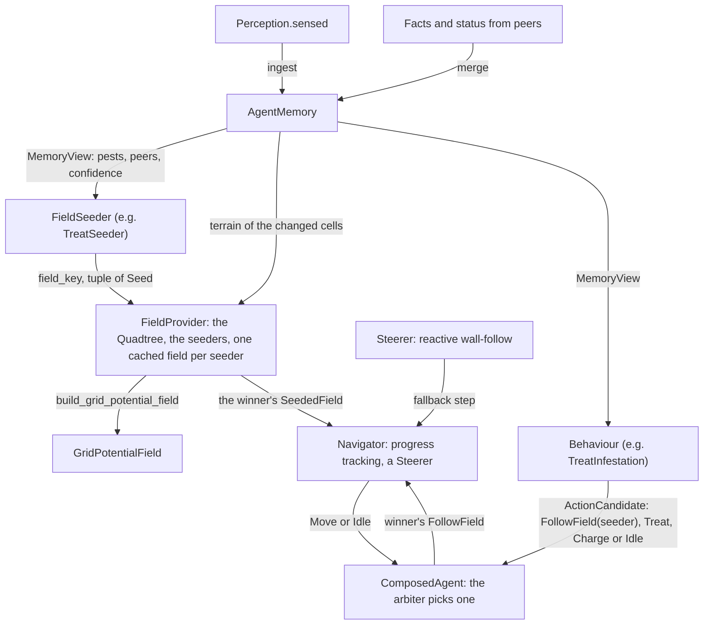
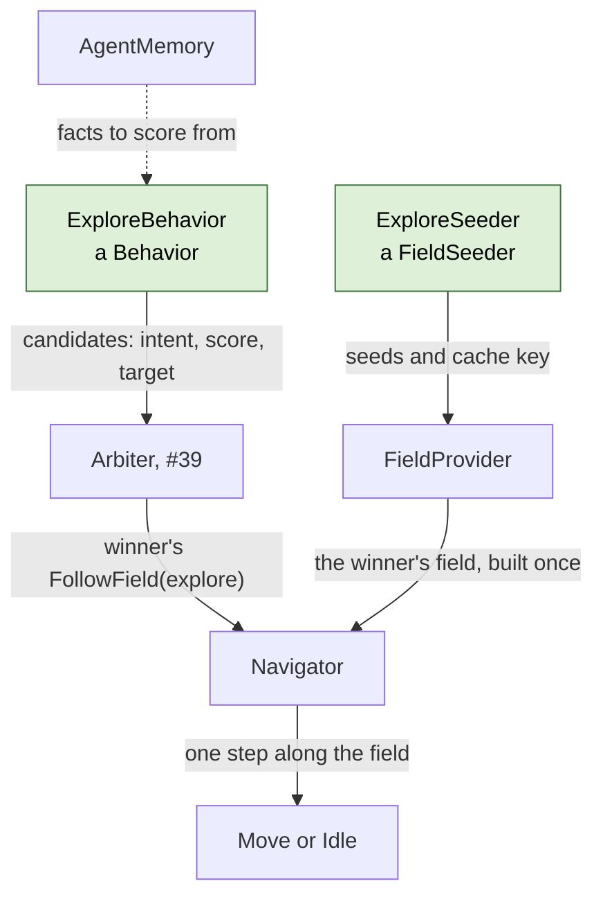

# Robot memory and navigation (v1)

This document describes what was built for the robot's local memory and for navigation by grid potential fields, and where the implementation differs from the *Field-level swarm design* document. It stays at a high level: for the details, read the classes and functions it names, whose docstrings explain the rules and show small diagrams.



Memory holds facts and nothing else. The quadtree says where a robot can be and where it can move, and knows nothing about costs or targets. The builder turns targets and the quadtree into a grid potential field, and knows nothing about pests or objectives. A *field seeder* is the small piece of code that connects memory to targets: it reads memory and decides which cells are targets of one field and how attractive each one is. A *behaviour* bids for what the robot does next, scoring its bid from the robot's own state and memory, and says what to do if it wins: follow a seeder's field, or act on the spot. It never reads a field. The *field provider* holds the quadtree and the seeders, hands targets to the builder, and keeps the field it built for each seeder. Only the winning bid's field is built: it picks the robot's target. The *navigator* is the one movement seam: it steps along the winner's field, asking the *steerer* for a step whenever the field cannot guide. `TreatSeeder` with `TreatInfestation`, and `ExploreSeeder` (see [`explore.md`](./explore.md)), are the real ones so far; "Writing a behaviour" below shows how to add more.

| Module | Contents |
| --- | --- |
| `swarm/memory.py` | `AgentMemory`, `MemoryView`, `DecayConfig`, `KnowledgeSnapshot`, `CellFacts` |
| `swarm/sharing.py` | `KnowledgeExchange`, `SharingConfig`, `SharingStrategy` |
| `swarm/field/quadtree.py` | `Quadtree`, `Leaf`, `find_leaves`, `TerrainView`, `traversable_cells` |
| `swarm/field/dijkstra.py` | `IndexedGraph`, `SearchResult`, `SettledNode` |
| `swarm/field/builder.py` | `Seed`, `build_grid_potential_field`, `GridPotentialField`, `MixedGraph` |
| `swarm/provider.py` | `FieldProvider` (the quadtree, the seeders, one cached field per seeder) |
| `swarm/navigator.py` | `Navigator` (the seam: progress, fallback) |
| `swarm/steering.py` | `Steerer`, `Sensing`, `QuadtreeSensing`, `SteeringConfig` |
| `swarm/seeder.py` | `FieldSeeder`, `SeededField`, `TreatSeeder`, `RegroupSeeder` |
| `swarm/behavior.py` | `Behavior`, `ActionCandidate`, `FollowField`, `Intent`, `DecisionContext`, `TreatInfestation`, `ExploreBehaviour`, `Regroup` |
| `swarm/brain.py` | `ComposedAgent` |

Tests: `tests/test_memory.py`, `tests/test_quadtree.py`, `tests/test_field.py`, `tests/test_provider.py`, `tests/test_navigator.py`, `tests/test_steering.py`, `tests/test_swarm.py`, `tests/test_sharing.py`.

## Memory

`AgentMemory` stores the contract `Observation`s a robot senses or receives, unchanged. Each fact has an identity: the cell for terrain and infestation facts, the robot id for peer facts. Memory keeps one fact per identity: an incoming fact replaces the stored one only if it was observed strictly later, so on a tie the robot keeps what it already has. The robot's own sensing (`ingest`) and facts from peers (`merge`) go through this same rule, so a fact that comes back through a third robot changes nothing. A cell seen to be clean is stored as an infestation fact with severity 0. That is how memory tells "known clean" from "never seen", and how a report that a pest was treated replaces the old pest fact.

Terrain and infestation facts are stored in arrays over the field (`CellFacts`), one entry per cell: the fact object itself, when it was observed, and the memory `version` at which it was first and last stored. The version counts the facts memory has stored so far. Peer facts stay in a small dict. The arrays make sharing cheap: `knowledge()` copies the facts into a `KnowledgeSnapshot`, a few arrays per kind, and `merge_snapshot` merges one with a few vectorised operations instead of a dict lookup per fact. The result is exactly what merging the snapshot's facts one by one would give, including the order in which facts are read back, so a run does not change; `tests/test_sharing.py` checks this on whole pest runs.

Confidence is not stored. `AgentMemory.confidence` computes it when asked, from the fact's age and the decay time of its kind in `DecayConfig` (24 h for infestation, 10 min for peers, no decay for terrain). Nothing in memory changes as time passes, so there is no decay step, unlike the `decay(now)` sketched for the `Memory` port in `architecture.md`.

Memory does not compute aggregates (such as the coarse tiles in the design document) and does not know about objectives or fields. Behaviours and objectives read it through `MemoryView`. For seeders that value every cell at once, it also keeps two arrays over the field, updated in `merge`: `last_observed_times()`, when each cell was last observed by the robot or a peer (from the cell's infestation fact, which every observation carries, clean or not), and `monitorable_cells()`, which leaves out known obstacles. Both are read-only views.

A robot senses the crop, the infestation and the peers of the cell it stands on, and the terrain of that cell and its neighbours (`WorldState.observe_for`). A cell is a patch of about 10 × 10 m that the robot monitors as a whole, while obstacles such as a river are large enough to see from the next cell. A robot therefore learns an obstacle only when it stands next to it, unless it starts with the terrain map, as `swarm_field.experiments` does. Peers are known from their status messages: at every decision point `ComposedAgent` broadcasts a `PeerObservation` of itself (`MessageKind.STATUS`) with its cell, the target of its winning candidate (`PeerObservation.target`) and the candidate's objective (`PeerObservation.objective`), and stores the status of its peers as ordinary peer facts.

Contract changes made for memory: `ObstacleObservation` became `TerrainObservation` with a `Terrain` value (`FREE`, `OBSTACLE`, `OUTSIDE`; no observation means unknown); `PeerObservation` gained the peer's `body` an optional `target`, the cell the peer says it is heading for, and an optional `objective` (an `AgentObjective`: `TREAT`, `EXPLORE`, `VERIFY` or `RECHARGE`) it is heading there for; `BodyType` moved to `contracts/ids.py`; and `TimeUnit` gives named durations, e.g. `24 * TimeUnit.HOUR` (`Time` is in milliseconds).

## Quadtree

The design document computes the far part of a field on fixed 4 × 4 tiles. That was built first and dropped: a tile only records whether its borders can be crossed, not how the cells inside are connected, so a river running straight through the middle of a tile left both of its borders open, and the coarse search saw a crossing that does not exist. The `Quadtree` replaces the tiles.

The quadtree starts from one boolean per cell, *traversable*: can a robot of this body be in the cell. `traversable_cells` reads it from any `TerrainView` (`AgentMemory` is one) using the v1 cost rule below. The quadtree then groups the cells into *leaves*: square blocks that are entirely traversable or entirely blocked, with a side of 1, 2, 4, 8 or 16 cells, aligned to multiples of their side. Open ground becomes a few 16 × 16 leaves, while leaves near obstacles shrink down to single cells.

It stores just two arrays: the traversability of each cell, and for each cell the size of the leaf whose corner is at that cell (0 for every other cell of a leaf). `find_leaves` builds the second array bottom-up with numpy. Everything else is computed when asked: `leaf_at` finds the leaf containing a cell, `leaf_neighbours` finds the leaves a robot can move into from a leaf, and `cell_neighbours` finds the cells a robot can move into from a cell. A diagonal move is allowed only if both cells beside it are traversable, so robots never cut the corner of an obstacle.

Because every leaf is uniform, two leaves are neighbours exactly when a robot can move from a cell of one into a cell of the other. So a search over leaves finds a route exactly when one exists cell by cell; only its lengths are approximate. `update` changes the traversability of some cells and rebuilds only the leaves in the 16 × 16 blocks around them.

**v1 cost rule.** Every cell costs the same to enter; unknown cells cost the same as known free ones (the design document's 1.5 for unknown cells was dropped). No robot can enter cells outside the field, and ground robots cannot enter obstacles; drones fly over them. A straight move between cells costs 1, a diagonal move 1.4.

## Grid potential fields

The design document computes a potential field in two passes: coarse over the whole field, then fine around the robot, seeded at the edge of the fine window from the coarse result. A two-pass version was built and replaced by a single search over a graph of mixed resolution, which is simpler and at least as accurate.

`build_grid_potential_field` takes the targets as a tuple of `Seed`s (a cell and a start value, lower is more attractive, typically `-beta * value` as in the design document), the robot's `Quadtree`, and the robot's cell. Around the robot, the graph has single cells: the window is the robot's 16 × 16 block and the blocks within `window_blocks` of it (default 2, so 80 × 80 cells). Everywhere else the graph has the quadtree's leaves, and a move between leaves costs the distance between their centres. Since every leaf lies inside one 16 × 16 block, each leaf is entirely inside the window (its cells are used) or entirely outside it (the leaf itself is used). `MixedGraph` links the two kinds of nodes at the window's border. One multi-source Dijkstra then spreads from all targets at once, and records for every node its value, the target whose wave reached it first, and the next node towards that target. The search runs in scipy (`scipy.sparse.csgraph.dijkstra`): the graph is indexed once into a sparse matrix (`IndexedGraph`), with a virtual source linked to every target at the cost of its start value, so `FieldProvider`, which keeps the graph while the robot stays in its block, walks it in Python only once. Where two routes are equally short, scipy may pick a different one than a heap-based search would.

The result is a `GridPotentialField` with three queries:

- `value_at(cell)`: the potential at a cell, `inf` if no target is reachable. Inside the window each cell has its own value; outside it, a cell gets the value of its leaf, measured from the leaf's centre.
- `next_cell(cell)`: the neighbouring cell to move to, for a cell inside the window. `None` means the robot stands on the winning target, or no target is reachable.
- `target_for(cell)`: the target the robot is heading for, even when it is far outside the window.

**Accuracy.** In the tests and in comparisons on fields up to 120 × 120 (open, with a river crossed by one bridge, with scattered obstacles), a robot that follows `next_cell` and rebuilds the field after every step always reached its target. The route was at most 2 % longer than the optimal one found by a plain Dijkstra over all cells.

**Speed.** On a 500 × 500 field with a river and 500 scattered obstacles (about 7,000 leaves), building the quadtree takes about 0.5 ms and an update about 0.25 ms. Building a field takes about 0.26 s, against about 2.1 s for a plain Dijkstra over all 250,000 cells. On 100 × 100 and 250 × 250 fields, it takes about 26 ms and 85 ms. A robot that walks across the 500 × 500 field rebuilds its field once per block it enters, 57 times, so a trip costs about 15 s of field building, more than one plain Dijkstra, whose exact field would serve the whole trip as long as nothing changes. `tests/benchmark_field.py` measures all of this. Almost all of that time is spent finding the neighbours of each leaf, which is recomputed for every field (see below).

## The field provider

`FieldProvider` holds the robot's quadtree, kept in sync with memory through `update_terrain`, and the seeders it was created with, by name. Its one query, `field_for(seeder, robot, now)`, hands out a seeder's `SeededField` (the field and the seeds it was built from), or `None` if the seeder has no targets. Only the brain calls it, for the winning candidate's `FollowField`. Behaviours never call it, so a decision builds at most one field, the winner's.

Field building is expensive (~0.26 s on a 500 × 500 field) and robots re-ask every decision point, so the provider keeps one field per seeder and reuses it while the seeder's `field_key`, the terrain and the robot's 16 × 16 block are all unchanged; the seeder is only asked for its seeds when one of them changed. Comparing the seeds themselves would not work: a seed's value usually changes a little at every tick (confidence decays, re-sensing a cell resets its age), so the seeder hands out a coarser key instead. The quadtree carries a version counter that every change of a cell's traversability bumps, so one comparison covers "did the terrain change"; re-sensing known terrain, which a robot does at every tick, changes nothing. A field is only reused while the robot is still in the block it was built in, because a robot's window is centred on its own block. Each seeder has its own slot, so a robot that switches between objectives does not evict the other fields, and a robot pays one build per block travelled for each field it follows. `tests/benchmark_field.py` measures the worst case, a trip with two fields read at every step: twice the builds, and about twice the time.

## The navigator

`Navigator` is the single seam between a field and the robot's next physical step. Its one call, `step_towards(seeded, robot)`, returns one `Move` (a `to` cell) or `Idle`, and never anything else. Only the brain calls it, for the winning candidate's `FollowField`, with the field from the provider. It prefers the field, whatever the distance to the target: the robot steps into the neighbouring cell the field points at, which is one step of a route that is near-optimal around the obstacles the quadtree knows, at any range and without a map of the whole field.

The `Steerer` is the fallback, used when the field cannot guide. That is either no route at all — no wave reaches the robot, so `target_for` is `None` and the steerer walks towards the seeder's most attractive target anyway, stalling and reporting if it is walled off for good — or a field that stopped guiding: the navigator remembers the lowest potential the robot has seen on its current plan, and three ticks without a new minimum hand the step to the steerer. The handover is not latched; as soon as the field points forward again the robot follows it. This is what covers the one case the field cannot: route lengths through leaves are approximate, so a robot near the edge of its window could in principle turn back and forth. The policy itself, and its `Sensing` port, are designed in [`navigation-module.md`](./navigation-module.md). The reactive policy is also the honest answer to "which cell is this?", since the quadtree is only believed terrain. A plan is one field: when the navigator is handed a different `SeededField` than at its last step (another seeder's, or the same seeder's rebuilt), it starts tracking afresh.

## The brain

`ComposedAgent` owns one `AgentMemory`, one `FieldProvider`, one `Navigator` and one `Arbiter`. At every decision it merges what the robot sensed and received into memory, gives the provider the cells that got new terrain facts (the provider re-reads them from memory and updates its `Quadtree`), and hands the robot's state and memory to the behaviours in the `DecisionContext`. Every behaviour returns a tuple of `ActionCandidate`s, and the arbiter picks one (see [`research/arbiter.md`](./research/arbiter.md)). The brain then turns the winner's intent into one action: for a `FollowField` it asks the provider for that seeder's field, whose target becomes the robot's current target, and the navigator steps along it. Any other intent (`Treat`, `Charge`, `Idle`) passes through unchanged. A winning `FollowField` whose seeder has no targets logs a warning and idles. With every decision the brain broadcasts two messages: a `STATUS` message, a `PeerObservation` of the robot itself carrying its current target and objective, and a `KNOWLEDGE` message whose `KnowledgeSnapshot` its `KnowledgeExchange` picks: by default all its facts at every decision, but the `SharingStrategy` in `BrainSpec.sharing` can send them less often. A receiver merges both into memory, so a peer's target is read through `MemoryView.peers()`. `inspect()` returns the memory's facts, for visualization.

## Writing a behaviour

A behaviour is two pieces with two different jobs, and keeping them apart is what lets several behaviours share the robot's fields and its single movement seam. The behaviour decides *whether and how much* the robot should pursue an objective, from the robot's state and memory. The seeder decides *where*: its field picks the target. Since a field is only built for the winner, a behaviour never reads one.

The green boxes are what a new behaviour adds, here EXPLORE (#41). The behaviour reads memory and bids to the arbiter; the seeder tells the field provider how to build and cache that field; the arbiter hands the navigator only the winner's `FollowField`, and the provider builds that field, which picks the target and which the navigator follows.



A **`FieldSeeder`** (`swarm/seeder.py`) specifies one grid potential field. It has a `name`, under which it is registered in the field provider, and two methods. `seeds(memory, robot, now)` returns the field's targets, each a `Seed` with the start value $-\beta \, v$, where $v$ is how much the target is worth and $\beta$ is how many cells of travel a value of 1 is worth: the lower the start value, the more attractive the target. Its attribute `window_blocks` says how many 16 × 16 blocks around the robot's block the field is searched cell by cell (2 for TREAT, 1 for EXPLORE, which is rebuilt far more often). `field_key(memory, robot, now)` returns any hashable value that changes whenever the seeds would change; the provider reuses the field for as long as the key, the terrain and the robot's block stay the same, and only then asks for seeds again. The key covers only what the seeds depend on (terrain is the provider's business), and the key and the seeds may depend on the robot's position only through its 16 × 16 block. Only the provider calls a seeder.

A **`Behavior`** (`swarm/behavior.py`) bids for what the robot does next. Its `propose(ctx)` returns a tuple of `ActionCandidate`s, or an empty tuple when it has nothing to propose. A candidate says what to do if it wins (`action`, an `Intent`), how much the behaviour wants it (`score`, the highest wins), which behaviour proposed it (`source`), and which cell the bid commits the robot to (`target`, or `None`), which the arbiter (#39) will use to tell a new target from the one the robot is already heading for. The `DecisionContext` holds the robot's own state, what it sensed, its memory and its inbox, but no fields: a behaviour scores from these alone, with a heuristic such as how many pests memory knows and how severe they are, or how low the battery is. Building a field is the expensive part, and only the winner's is built. A behaviour never moves the robot itself:

- to move, it proposes `FollowField(seeder_name)`, and only if the candidate wins does the brain build that field and the navigator step along it;
- when memory says the robot stands on its target, such as a known pest at its cell, it proposes its on-the-spot action instead, such as `Treat(position)` or `Charge()`;
- when memory says there is nothing to pursue, such as no known pest, it proposes nothing, since a winning `FollowField` whose seeder has no targets only idles.

An `Intent` is `FollowField`, `Treat`, `Charge` or `Idle`. There is deliberately no `Move`, so the type checker keeps every step inside the navigator. Every behaviour bids on the shared `[0, 1]` scale of the arbiter (see [`research/arbiter.md`](./research/arbiter.md)), from 0.9 up only for needs that override everything else.

`TreatSeeder`, in outline, has target value severity × confidence, over the pests left to this robot, and clustered pests reinforce each other (left out here). A pest is left to a robot unless a peer killer reported it, within the last two minutes, as the target it is heading for to `TREAT`, and is closer to it, or as close with a lower robot id (`pests_left_to_robot`). Of two killers heading for one pest, exactly one keeps it, which is how killers avoid driving to the same pest. The tie-break matters, because killers that travel together are equally close to everything. The key is a one-minute time bucket, so the field follows the decaying confidences, plus the infested cells and the pests left, so the field reacts at once when a pest is treated or a closer peer claims it:

```python
class TreatSeeder:
    name: str = "treat"

    def field_key(self, memory: MemoryView, robot: CellId, now: Time) -> Hashable:
        left = {pest.cell for pest in pests_left_to_robot(memory, robot, now)}
        return (now // TimeUnit.MINUTE, infested_cells(memory), frozenset(left))

    def seeds(self, memory: MemoryView, robot: CellId, now: Time) -> tuple[Seed, ...]:
        seeds: list[Seed] = []
        for pest in pests_left_to_robot(memory, robot, now):
            value = pest.severity * memory.confidence(pest, now)
            seeds.append(Seed(pest.cell, -self.value_amplifier * value))
        return tuple(seeds)
```

A claim needs the peer's target and objective, which only the peer's own `STATUS` report carries; a sighting of a peer in a neighbouring cell carries neither. Memory therefore takes where a peer is from its newest fact of any kind, and what it heads for from its newest own report, so being seen does not erase the pest a killer announced.

`VERIFY` would use `severity * (1 - confidence)` instead; `RECHARGE` would seed the dock cells with value 0 and a constant key. The behaviour that pursues it scores from memory alone. It treats on the spot when memory knows a pest at the robot's cell, with a score just below 1 so that a battery behaviour can still outbid it. Otherwise it bids to follow the field by the worst pest left to it, between 0.8 and 0.89: above exploring in practice, since treating is a killer's job, and below the override threshold. With no pest left to it, it does not bid, so a killer whose pests are all claimed explores instead:

```python
class TreatInfestation:
    name: str = "treat-infestation"

    def propose(self, ctx: DecisionContext) -> tuple[ActionCandidate, ...]:
        position = ctx.self_state.position
        here = ctx.memory.infestation_at(position)
        if here is not None and here.severity > 0:            # on a pest: treat it
            return (ActionCandidate(Treat(position), 0.99, self.name, position),)
        left = pests_left_to_robot(ctx.memory, position, ctx.time)
        worst = max((p.severity * ctx.memory.confidence(p, ctx.time) for p in left), default=0.0)
        if worst <= 0:                                        # nothing left to it: no bid
            return ()
        score = 0.8 + 0.09 * min(1.0, worst)
        return (ActionCandidate(FollowField(TreatSeeder.name), score, self.name, None),)
```

The brain is then assembled from its memory, its field provider with the seeders registered, a navigator over the provider's quadtree, its behaviours and an arbiter of its own. Drones (`BodyType.SCOUT`) fly over obstacles:

```python
memory = AgentMemory(robot_id, field_geometry)
fields = FieldProvider(memory, flies=body is BodyType.SCOUT, seeders=[TreatSeeder()])
navigator = Navigator(fields.quadtree)
agent = ComposedAgent(robot_id, [TreatInfestation()], memory, fields, navigator, UtilityArbiter())
decision = agent.decide(perception)
```

### Regroup

The design assumes every robot can communicate with at least one other robot. `Regroup` enforces it after the fact: a robot that received no message for `silence_timeout` (2 minutes by default, 24 missed decision points at the runner's default of 5 s) bids to follow the field of the `RegroupSeeder`. That field draws the robot to where its peers were last known to be, each peer's last cell and the target it announced, weighted by memory's confidence in the peer fact, so the most recent contact attracts most. Peers move, so the robot may arrive and still hear no one. A location counts as searched once memory holds an observation of its cell newer than the peer fact pointing there (`unsearched_peer_locations`): a peer still standing there would have been sensed or heard at that moment, which refreshes its fact. The seeder then drops the location and the robot moves on to the next. Searched locations are read from memory, so the behaviour and the seeder share no state and are registered in the runner like any other pair. The optional `rally_point` attracts least and is never dropped: it is where a robot ends up and waits once every peer location turned out empty, and since all lost robots share it, it is the step that guarantees they meet. The first received message ends the search. Only received messages count as contact; a peer sensed in a neighbouring cell does not.

`Regroup` bids 0.85, below the arbiter's override threshold of 0.9, so it goes through the ordinary arbitration and never outbids an override such as treating the pest the robot stands on (0.99) or `ReturnToDock` saving a robot whose battery runs out (0.95). With no location left and no rally point it does not bid. In a `BrainSpec` it is the behaviour and the seeder `regroup`, configured through the shared parameters:

```python
BrainSpec(
    behaviors=("treat-infestation", "regroup"),
    seeders=("treat", "regroup"),
    params={"rally-point": (16, 16), "regroup-silence": 2 * TimeUnit.MINUTE},
)
```

When a behaviour or seeder recovers from something that should not happen instead of raising, it logs a warning through its module's `logging.getLogger(__name__)` (see `AGENTS.md`).

## Not in v1

- **Claims.** A robot broadcasts its target and peers are drawn to it less, but nothing is a binding claim: two robots that pick the same cell at once may both turn away, and a target never expires. A sighting of a peer that is newer than its status also replaces the target with `None`. Claims need their own merge rule (the earliest claim wins, and claims expire), and a new fact kind in memory.
- **Crop facts and docks.** Memory ignores `CropObservation`s. Dock positions are not stored; they will be given to whatever needs them.
- **Forgetting.** Memory never deletes facts; it is bounded by the field size plus the number of robots.
- **Sending only new facts.** Robots exchange all their facts at every meeting. Sending only what the other robot has not seen yet needs, per fact, the time this robot learned it (not when it was observed).
- **Staying in range.** `Regroup` only reacts: a robot turns back after the silence timeout, and once it hears a peer it resumes its work and may walk out of range again. Nothing keeps robots in range in the first place.
- **Unreachable peer locations.** A scout flies over obstacles, so its last known cell can be one a ground robot cannot enter. The ground robot never observes that cell from inside it, so the location stays unsearched and keeps attracting it; a robot that senses its neighbouring cells, such as a scout, does see it.
- **Committing to a target.** A `FollowField` bid carries no target, since only the winner's field picks one. The arbiter therefore commits the robot to the objective but not to the cell its field leads to, and the field may switch targets within an objective without paying the arbiter's target margin.
- **Faster fields.** Each winning field costs one build per block the robot travels. Inside the quadtree, each leaf's neighbours are still found again for every field; caching them until an update touches them would make repeated fields about four to five times faster.
- **The steerer's clearance ring.** `QuadtreeSensing` reads the quadtree, so the fallback steers over *believed* terrain; a real robot would probe one cell ahead and would rather slide along a wall than cut it. The fallback is also blind to crops: it only knows what the quadtree was told, and memory does not store crops yet.
- **Terrain costs.** All traversable cells cost the same; there is no extra cost for unknown cells or rough terrain.
- **Sensing reliability.** Every observation counts as fully reliable when made; its confidence only decays with age.
- **Drone shortcut.** Drones use the same search as ground robots, with obstacles traversable, instead of the straight-line formula in the design document.
- **4-neighbour fields.** Distances between leaves always allow diagonal moves, which slightly underestimates route lengths when `connectivity=4`.
