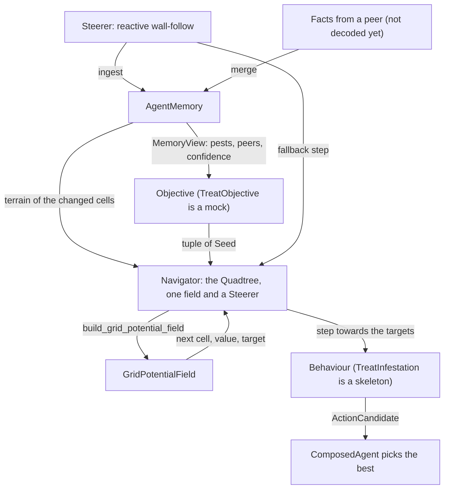

# Robot memory and navigation (v1)

This document describes what was built for the robot's local memory and for navigation by grid potential fields, and where the implementation differs from the *Field-level swarm design* document. It stays at a high level: for the details, read the classes and functions it names, whose docstrings explain the rules and show small diagrams.



Memory holds facts and nothing else. The quadtree says where a robot can be and where it can move, and knows nothing about costs or targets. The builder turns targets and the quadtree into a grid potential field, and knows nothing about pests or objectives. The *navigator* is the one movement seam: it holds the quadtree, hands targets to the builder, keeps the one field it built, and asks the *steerer* for a step whenever the field cannot guide. An *objective* is the small piece of code that connects memory to targets: it reads memory and decides which cells are targets and how attractive each one is. Only a mock objective exists; writing the real ones is the next step (see the examples below).

| Module | Contents |
| --- | --- |
| `swarm/memory.py` | `AgentMemory`, `MemoryView`, `DecayConfig` |
| `swarm/field/quadtree.py` | `Quadtree`, `Leaf`, `find_leaves`, `TerrainView`, `traversable_cells` |
| `swarm/field/dijkstra.py` | `multi_source_dijkstra`, `SettledNode` |
| `swarm/field/builder.py` | `Seed`, `build_grid_potential_field`, `GridPotentialField`, `MixedGraph` |
| `swarm/navigator.py` | `Navigator` (the seam: field, cache, progress, fallback) |
| `swarm/steering.py` | `Steerer`, `Sensing`, `QuadtreeSensing`, `SteeringConfig` |
| `swarm/objective.py` | `Objective`, `TreatObjective` (mock) |
| `swarm/behavior.py`, `swarm/brain.py` | `DecisionContext`, `TreatInfestation` (skeleton), `ComposedAgent` |

Tests: `tests/test_memory.py`, `tests/test_quadtree.py`, `tests/test_field.py`, `tests/test_navigator.py`, `tests/test_steering.py`, `tests/test_swarm.py`.

## Memory

`AgentMemory` stores the contract `Observation`s a robot senses or receives, unchanged. Each fact has an identity: the cell for terrain and infestation facts, the robot id for peer facts. Memory keeps one fact per identity: an incoming fact replaces the stored one only if it was observed strictly later, so on a tie the robot keeps what it already has. The robot's own sensing (`ingest`) and facts from peers (`merge`) go through this same rule, so a fact that comes back through a third robot changes nothing. A cell seen to be clean is stored as an infestation fact with severity 0. That is how memory tells "known clean" from "never seen", and how a report that a pest was treated replaces the old pest fact.

Confidence is not stored. `AgentMemory.confidence` computes it when asked, from the fact's age and the decay time of its kind in `DecayConfig` (24 h for infestation, 10 min for peers, no decay for terrain). Nothing in memory changes as time passes, so there is no decay step, unlike the `decay(now)` sketched for the `Memory` port in `architecture.md`.

Memory does not compute aggregates (such as the coarse tiles in the design document) and does not know about objectives or fields. Behaviours and objectives read it through `MemoryView`.

Contract changes made for memory: `ObstacleObservation` became `TerrainObservation` with a `Terrain` value (`FREE`, `OBSTACLE`, `OUTSIDE`; no observation means unknown); `PeerObservation` gained the peer's `body`; `BodyType` moved to `contracts/ids.py`; and `TimeUnit` gives named durations, e.g. `24 * TimeUnit.HOUR` (`Time` is in milliseconds).

## Quadtree

The design document computes the far part of a field on fixed 4 × 4 tiles. That was built first and dropped: a tile only records whether its borders can be crossed, not how the cells inside are connected, so a river running straight through the middle of a tile left both of its borders open, and the coarse search saw a crossing that does not exist. The `Quadtree` replaces the tiles.

The quadtree starts from one boolean per cell, *traversable*: can a robot of this body be in the cell. `traversable_cells` reads it from any `TerrainView` (`AgentMemory` is one) using the v1 cost rule below. The quadtree then groups the cells into *leaves*: square blocks that are entirely traversable or entirely blocked, with a side of 1, 2, 4, 8 or 16 cells, aligned to multiples of their side. Open ground becomes a few 16 × 16 leaves, while leaves near obstacles shrink down to single cells.

It stores just two arrays: the traversability of each cell, and for each cell the size of the leaf whose corner is at that cell (0 for every other cell of a leaf). `find_leaves` builds the second array bottom-up with numpy. Everything else is computed when asked: `leaf_at` finds the leaf containing a cell, `leaf_neighbours` finds the leaves a robot can move into from a leaf, and `cell_neighbours` finds the cells a robot can move into from a cell. A diagonal move is allowed only if both cells beside it are traversable, so robots never cut the corner of an obstacle.

Because every leaf is uniform, two leaves are neighbours exactly when a robot can move from a cell of one into a cell of the other. So a search over leaves finds a route exactly when one exists cell by cell; only its lengths are approximate. `update` changes the traversability of some cells and rebuilds only the leaves in the 16 × 16 blocks around them.

**v1 cost rule.** Every cell costs the same to enter; unknown cells cost the same as known free ones (the design document's 1.5 for unknown cells was dropped). No robot can enter cells outside the field, and ground robots cannot enter obstacles; drones fly over them. A straight move between cells costs 1, a diagonal move 1.4.

## Grid potential fields

A `GridPotentialField` is not the `PotentialField` in `swarm/behavior.py`, which is the local force field of the exploration behaviour (#9).

The design document computes a potential field in two passes: coarse over the whole field, then fine around the robot, seeded at the edge of the fine window from the coarse result. A two-pass version was built and replaced by a single search over a graph of mixed resolution, which is simpler and at least as accurate.

`build_grid_potential_field` takes the targets as a tuple of `Seed`s (a cell and a start value, lower is more attractive, typically `-beta * value` as in the design document), the robot's `Quadtree`, and the robot's cell. Around the robot, the graph has single cells: the window is the robot's 16 × 16 block and the blocks within `window_blocks` of it (default 2, so 80 × 80 cells). Everywhere else the graph has the quadtree's leaves, and a move between leaves costs the distance between their centres. Since every leaf lies inside one 16 × 16 block, each leaf is entirely inside the window (its cells are used) or entirely outside it (the leaf itself is used). `MixedGraph` links the two kinds of nodes at the window's border. One multi-source Dijkstra (`multi_source_dijkstra`) then spreads from all targets at once, and records for every node its value, the target whose wave reached it first, and the next node towards that target.

The result is a `GridPotentialField` with three queries:

- `value_at(cell)`: the potential at a cell, `inf` if no target is reachable. Inside the window each cell has its own value; outside it, a cell gets the value of its leaf, measured from the leaf's centre.
- `next_cell(cell)`: the neighbouring cell to move to, for a cell inside the window. `None` means the robot stands on the winning target, or no target is reachable.
- `target_for(cell)`: the target the robot is heading for, even when it is far outside the window.

**Accuracy.** In the tests and in comparisons on fields up to 120 × 120 (open, with a river crossed by one bridge, with scattered obstacles), a robot that follows `next_cell` and rebuilds the field after every step always reached its target. The route was at most 2 % longer than the optimal one found by a plain Dijkstra over all cells.

**Speed.** On a 500 × 500 field with a river and 500 scattered obstacles (about 7,000 leaves), building the quadtree takes about 1.5 ms and an update about 0.25 ms. Building a field takes about 0.4 s, against about 4.3 s for a plain Dijkstra over all 250,000 cells. On 100 × 100 and 250 × 250 fields, it takes about 70 ms and 180 ms. Almost all of that time is spent finding the neighbours of each leaf, which is recomputed for every field (see below).

## The navigator

`Navigator` is the single seam between an objective and the robot's next physical step: `step_towards(seeds, robot)` returns one `Move` (a `to` cell) or `Idle`, and never anything else. It prefers the field, whatever the distance to the target: the robot steps into the neighbouring cell the field points at, which is one step of a route that is near-optimal around the obstacles the quadtree knows, at any range and without a map of the whole field.

The `Steerer` is the fallback, used when the field cannot guide. That is either no route at all — no wave reaches the robot, so `target_for` is `None` and the steerer walks towards the objective's most attractive target anyway, stalling and reporting if it is walled off for good — or a field that stopped guiding: the navigator remembers the lowest potential the robot has seen on its current plan, and three ticks without a new minimum hand the step to the steerer. The handover is not latched; as soon as the field points forward again the robot follows it. This is what covers the one case the field cannot: route lengths through leaves are approximate, so a robot near the edge of its window could in principle turn back and forth. The policy itself, and its `Sensing` port, are designed in [`navigation-module.md`](./navigation-module.md). The reactive policy is also the honest answer to "which cell is this?", since the quadtree is only believed terrain.

Field building is expensive (~0.4 s on a 500 × 500 field) and robots re-ask every decision point, so `field_for` keeps a single field and reuses it while the seeds, the terrain and the robot's 16 × 16 block are all unchanged. The quadtree carries a version counter that every update bumps, so one comparison covers "did the terrain change". One slot is enough: a robot's window is centred on the robot's own block, so the field is only reused while the robot is still in that block.

## The brain

`ComposedAgent` owns one `AgentMemory` and one `Navigator`. At every decision it merges what the robot sensed and received into memory, gives the navigator the cells that got new terrain facts (the navigator re-reads them from memory and updates its `Quadtree`), and hands memory and navigator to the behaviours in the `DecisionContext`. It then picks the candidate action with the highest score. `inspect()` returns the memory's facts, for visualization.

Several parts are placeholders, each marked with a `TODO` comment in the code: decoding facts from received messages and sending facts to peers (both in `ComposedAgent`), the arbiter that picks the action (for now the highest score wins), the targets of `TreatObjective`, and the treat action and the score in `TreatInfestation`.

## How to use it

Assemble a robot's brain from its memory, its navigator and its behaviours. Drones (`BodyType.SCOUT`) fly over obstacles:

```python
memory = AgentMemory(robot_id, field_geometry)
navigator = Navigator(memory, flies=body is BodyType.SCOUT)
agent = ComposedAgent(robot_id, [TreatInfestation()], memory, navigator)
decision = agent.decide(perception)
```

An objective turns memory into seeds. Filling in `TreatObjective.seeds` with the `TREAT` objective of the design document, with target value severity × confidence and `beta = 10` cells, would look like this:

```python
def seeds(self, memory: MemoryView, now: Time) -> tuple[Seed, ...]:
    seeds: list[Seed] = []
    for pest in memory.infestations():
        if pest.severity > 0:
            value = pest.severity * memory.confidence(pest, now)
            seeds.append(Seed(pest.cell, -10 * value))
    return tuple(seeds)
```

`VERIFY` would use `severity * (1 - confidence)` instead; `RECHARGE` would seed the dock cells with value 0. A behaviour asks the navigator for one step towards its objective's targets, and reads the field at the robot's cell to score them, as `TreatInfestation.propose` does:

```python
step = ctx.navigator.step_towards(seeds, position)
if isinstance(step, Idle):                        # on the target, or stalled
    return ()
score = -ctx.navigator.field_for(seeds, position).value_at(position)  # lower is better
```

## Not in v1

- **Claims.** Robots cannot yet claim a target so that others leave it alone. Claims need their own merge rule (the earliest claim wins, and claims expire), and a new fact kind in memory.
- **Crop facts and docks.** Memory ignores `CropObservation`s. Dock positions are not stored; they will be given to whatever needs them.
- **Forgetting.** Memory never deletes facts; it is bounded by the field size plus the number of robots.
- **Sending only new facts.** Robots exchange all their facts at every meeting. Sending only what the other robot has not seen yet needs, per fact, the time this robot learned it (not when it was observed).
- **Sharing facts.** Nothing packs facts into a `Message` or decodes them; `MessageKind` still only has `HELLO`. The places for both are in `ComposedAgent`.
- **Objectives, behaviours, arbiter, crowding.** `TreatObjective` returns no targets and `TreatInfestation` is a skeleton; the example above is not in the code. The brain picks the highest score, with no overrides for urgent needs (such as a low battery) and nothing against switching objectives back and forth. Spreading robots over different targets is not addressed.
- **Faster fields.** `Navigator.field_for` keeps one field, so a robot only pays for a new search when its targets, its terrain or its 16 × 16 block changed. Inside the quadtree, each leaf's neighbours are still found again for every field; caching them until an update touches them would make repeated fields about four to five times faster.
- **The steerer's clearance ring.** `QuadtreeSensing` reads the quadtree, so the fallback steers over *believed* terrain; a real robot would probe one cell ahead and would rather slide along a wall than cut it. The fallback is also blind to crops: it only knows what the quadtree was told, and memory does not store crops yet.
- **Terrain costs.** All traversable cells cost the same; there is no extra cost for unknown cells or rough terrain.
- **Sensing reliability.** Every observation counts as fully reliable when made; its confidence only decays with age.
- **Drone shortcut.** Drones use the same search as ground robots, with obstacles traversable, instead of the straight-line formula in the design document.
- **4-neighbour fields.** Distances between leaves always allow diagonal moves, which slightly underestimates route lengths when `connectivity=4`.
