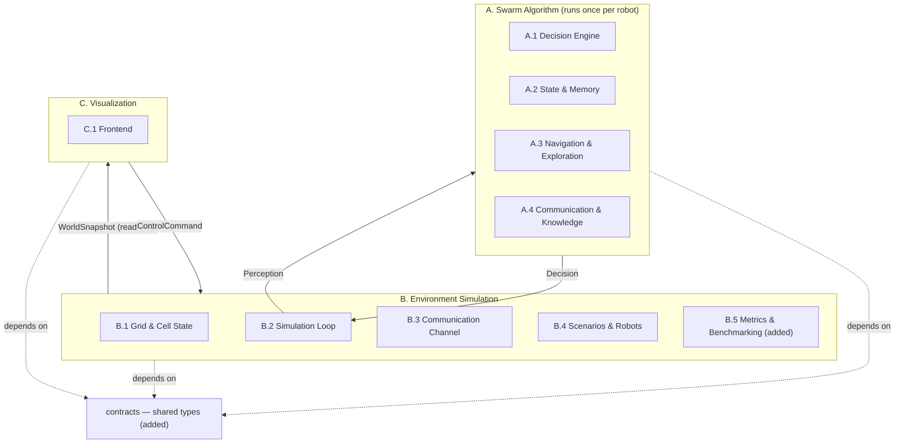
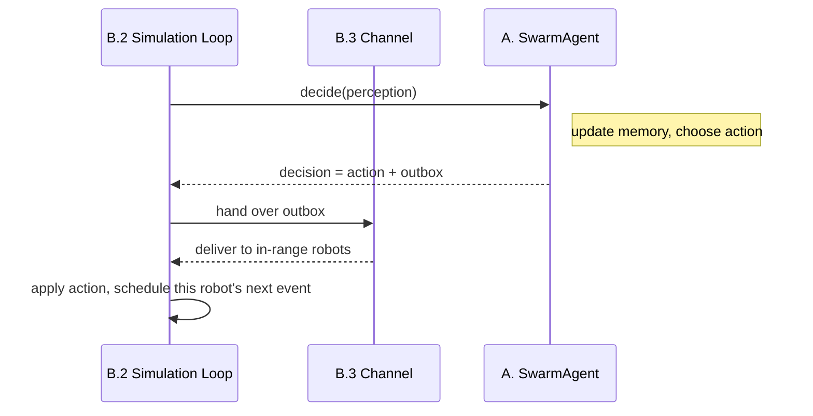
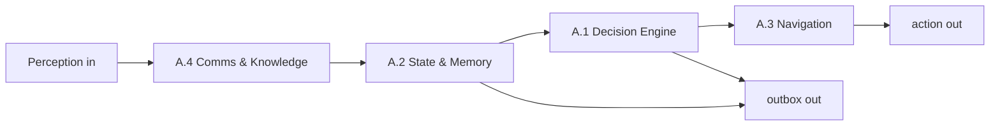
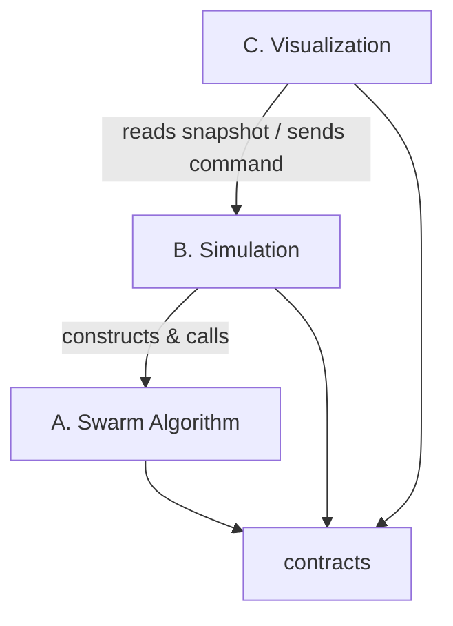

# System Decomposition & Module Interfaces

> **Purpose.** This document is the Phase‑1 systems review. It takes the initial mind‑map sketch as the baseline structure and turns it into a set of **modules with clear boundaries and interfaces**. It deliberately does *not* decide how each module is implemented internally — that is the concern of whoever builds it. Each module is described by **what it must do (requirements)** and **what it exposes / consumes (interface)**.
>
> **Scope for v1** (agreed): scenario **S1 wide‑row (maize)** and **S3 (multi‑species strip / pixel cropping)**. Both are grid‑based, so a single 4/8‑neighbour grid engine covers them. The rail graph (S2), stacked layers (S5) and slope / irreversible actions (S4) are **out of scope for v1** but must not be designed out — leave interface seams.
>
> Notation: the type sketches below are **real contract shapes** (`@dataclass` / `Enum` / type aliases), but field lists may still grow. They fix the *boundary*, not the internals. `*added*` marks a module or concept not in the original mind map, pulled in from the literature review because the system is incomplete without it — each is flagged and justified.

> **Current implementation note (high-level world model).** The repository now uses a coarse field grid: one cell represents an area of field rather than one plant; multiple robots may share a cell; movement is `Move(to=CellId)` without turn/facing; each robot has its own speed; and obstacles can occupy arbitrary groups of cells. The detailed sketches below contain earlier design proposals and are retained as the broader architecture reference. For the implemented B.1 behaviour, see [`docs/high-level-world-model.md`](high-level-world-model.md).

---

## 1. Boundary principles

These rules are the whole point of this phase. Everything else follows from them.

1. **One shared vocabulary, no shared internals.** There is a single `contracts` module holding the data types crossing module boundaries. Every other module depends on `contracts` and on nothing else across the A/B/C split. `contracts` depends on nothing.
2. **The Algorithm never imports the Simulation, and vice‑versa.** The robot brain is a pure‑ish function of *what it perceives* → *what it decides*. It must be swappable so different algorithms can be benchmarked against the same environment (this is a stated research goal). The simulation must never reach into a robot's memory except through an explicit read‑only inspection interface.
3. **The Simulation is the only owner of ground truth.** Cell state, true infestation, true robot position all live in the simulation. The Algorithm only ever sees *perceptions* (noisy, partial, range‑limited). If a module needs truth, it lives in B.
4. **Visualization is read‑only by default.** It consumes snapshots. It may influence the world only through an explicit, enumerated set of interactive commands — never by mutating state directly.
5. **The communication channel is payload‑agnostic.** The simulation's channel (B.3) decides *who receives a message* based on range and timing. It does **not** understand message contents. This means the "how do robots share knowledge" decision (map‑merge vs. vicinity‑vector) is contained entirely inside the Algorithm and does not leak into the Simulation.

---

## 2. Top‑level decomposition

Three components (from the mind map) plus one cross‑cutting foundation.



**Reading the arrows.** The only runtime coupling between the Algorithm and the Simulation is the `Perception → Decision` exchange (Section 4). The only coupling between the Simulation and Visualization is `WorldSnapshot` out and `Command` in. Everything else is a compile‑time dependency on `contracts`.

---

## 3. The `contracts` module *(added)*

**Why it exists.** The mind map describes three components that clearly must exchange data (the simulation "exposes its state", robots "share information", the frontend "shows robot memory"), but never names the shared types. Without a single owner for those types, the three teams will invent three incompatible versions of "an observation" or "a message". This module is that owner.

**Responsibility.** Define the data types that cross a module boundary. No behaviour, no logic — just shapes. It is the interface contract the other modules are written against.

**Depends on:** nothing. **Everyone depends on it.**

### 3.1 Identifiers, geometry and the clock

The simulation is **discrete-event**: time is an integer timestamp (`Time`) in fine units (e.g. milliseconds), and events are processed in time order. There is **no fixed timestep** — the clock jumps to the next scheduled event. Integer time keeps decay / staleness comparisons and event ordering exact.

```python
from dataclasses import dataclass, field
from enum import Enum, auto
from typing import Protocol

# --- identifiers & geometry ---
RobotId = int
CellId  = tuple[int, int]      # grid coordinate (v1); treated as an opaque handle elsewhere
Time    = int                  # integer timestamp in fine units (e.g. ms); events run in time order

class Direction(Enum):
    N = auto();  NE = auto();  E = auto();  SE = auto()
    S = auto();  SW = auto();  W = auto();  NW = auto()

class CropType(Enum):
    ...                        # scenario-defined; S3 has several distinct crops

class PestType(Enum):
    ...                        # scenario-defined; may be unknown at low confidence
```

### 3.2 Ground truth (owned by B, never read directly by A)

```python
@dataclass
class CellState:
    crop: CropType | None
    growth_stage: float
    infestation: float          # 0..1 TRUE severity
    obstacle: bool
    occupant: RobotId | None
```

### 3.3 Observations — a tagged union

An observation is a **belief about a cell, not a truth**. Observations come in different shapes (a crop reading, an infestation reading, an obstacle, a sighting of another robot), so — like `Action` — this is a **union of dataclasses matched with `match`/`case`**, sharing a common base for the fields every observation carries (which cell, how reliable, when, and by whom).

Who decides what a robot observes is a **boundary rule, not a robot choice**: the robot never names a cell and asks the world for its truth. The world computes each robot's observations from the robot's pose, `facing`, field of view and sensor suite (all of which the world owns as part of the robot body model), and returns them in `Perception.sensed`. The robot influences *what* it perceives only physically — by moving, by `Turn`‑ing to face a direction, and by choosing `Sense(SCOUT)` (quick, wide, low confidence) vs. `Sense(VERIFY)` (slow, focused, high confidence). This keeps ground truth strictly on the simulation side (boundary principle 3).

```python
@dataclass(frozen=True)
class ObservationBase:
    cell: CellId
    confidence: float           # 0..1 — how reliable this reading is
    observed_at: Time
    source: RobotId

@dataclass(frozen=True)
class CropObservation(ObservationBase):
    crop: CropType | None
    growth_stage: float

@dataclass(frozen=True)
class InfestationObservation(ObservationBase):
    severity: float             # ESTIMATED 0..1 (not the true value)
    pest: PestType | None       # may be None when confidence is low

@dataclass(frozen=True)
class TerrainObservation(ObservationBase):
    terrain: Terrain            # FREE | OBSTACLE | OUTSIDE; no observation = unknown

@dataclass(frozen=True)
class PeerObservation(ObservationBase):
    peer: RobotId | None        # identity if resolvable, else an anonymous sighting
    body: BodyType
    target: CellId | None = None   # the cell the peer says it is heading for
    objective: AgentObjective | None = None   # what the peer is heading there for

Observation = (
    CropObservation | InfestationObservation | TerrainObservation | PeerObservation
)
```

### 3.4 Actions — a tagged union

Exactly one **physical** action per decision (movement, turning and treatment are mutually exclusive — the robot commits to it until it completes). Communication is *not* an action; it rides on `Decision.outbox` and may accompany any action.

```python
class SenseMode(Enum):
    SCOUT  = auto()             # quick, wide footprint, low confidence
    VERIFY = auto()             # slow, focused, high confidence

class TreatJob(Enum):
    REMOVE = auto()             # v1; DISPERSE / COLLECT (S2 / S5) added later without breaking this

@dataclass(frozen=True)
class Move:
    to: CellId                  # an adjacent, non-obstacle cell

@dataclass(frozen=True)
class Turn:
    facing: Direction           # reorient in place; cheap, but changes what is sensed next

@dataclass(frozen=True)
class Sense:
    mode: SenseMode

@dataclass(frozen=True)
class Treat:
    job: TreatJob
    cell: CellId                # target cell

@dataclass(frozen=True)
class Charge:
    pass                        # only meaningful at a charging point / for a battery body

@dataclass(frozen=True)
class Idle:
    pass

Action = Move | Turn | Sense | Treat | Charge | Idle
```

### 3.5 Messages (envelope only; payload opaque to B)

```python
class MessageKind(Enum):
    KNOWLEDGE = auto()          # belief-sharing ("what is there")
    STATUS    = auto()          # the sender's own position and current target
    BEACON    = auto()          # hop values, as a tuple of Beacons ("how far to an objective")
    CLAIM     = auto()          # task lease, if the algorithm uses one
    STIGMERGY = auto()          # pheromone-style mark ("where to go")

@dataclass(frozen=True)
class Message:
    sender: RobotId
    sent_at: Time
    kind: MessageKind
    payload: object             # opaque to B; A owns its shape. Must be serializable if A/B/C
                                #   ever run as separate processes.

@dataclass(frozen=True)
class Beacon:                   # a BEACON payload item, relayed to guide robots to an objective
    kind: BeaconKind            # TREAT guides killers to a pest, DOCK robots to a dock
    value: float                # hops to the objective, whole or metric; 0 is the objective itself
    cell: CellId                # the sender's cell, or the objective's cell for a source
```

`Beacon` sits in `contracts` because B sends one too: the mock pest sources of `PestSourceSpec` broadcast a TREAT beacon of 0 from each infested cell, and with `DockBeaconSpec` every dock broadcasts a DOCK beacon of 0 from its own cell.

### 3.6 The per‑robot exchange (B ⇄ A)

```python
class BodyType(Enum):
    MONITOR   = auto()          # SCOUT / VERIFY; v1
    KILLER    = auto()          # REMOVE; v1
    SCAVENGER = auto()
    BATTERY   = auto()
    # AERIAL / LOGISTICS bodies added later

@dataclass(frozen=True)
class RobotSelfState:
    robot_id: RobotId
    position: CellId            # PERCEIVED pose (subject to position error), not ground truth
    facing: Direction
    battery: float              # remaining energy
    body: BodyType
    consumable: float           # 0..1, e.g. spray-tank level
    health: float               # 0..1 degradation (1 = healthy)

@dataclass(frozen=True)
class Perception:
    time: Time
    self_state: RobotSelfState
    sensed: list[Observation]   # world-computed from pose / facing / FOV / sensors
    inbox: list[Message]        # already range-filtered by B.3

@dataclass(frozen=True)
class Decision:
    action: Action                              # one physical action for this decision
    outbox: list[Message] = field(default_factory=list)   # optional broadcast(s)
```

### 3.7 Read‑only views (B → C) and interactive input (C → B)

```python
@dataclass(frozen=True)
class RobotPublicState:
    robot_id: RobotId
    position: CellId            # GROUND-TRUTH position, for rendering
    facing: Direction
    body: BodyType
    battery: float
    health: float
    current_action: Action | None

@dataclass
class FieldGeometry:
    width: int                  # cells
    height: int                 # cells
    cell_size: float            # metres
    row_sp: float
    in_row_sp: float
    headland: float
    connectivity: int           # 4 or 8; the seam where rail (S2) / layers (S5) plug in later

@dataclass
class WorldSnapshot:
    time: Time
    field: FieldGeometry
    cells: dict[CellId, CellState]
    robots: list[RobotPublicState]
    metrics: "MetricsSample | None"

# interactive commands (union, like Action)
@dataclass(frozen=True)
class InjectInfestation:
    cell: CellId
    severity: float
    pest: PestType | None = None

@dataclass(frozen=True)
class AddRobot:
    body: BodyType
    at: CellId

@dataclass(frozen=True)
class AddObstacle:
    cell: CellId

@dataclass(frozen=True)
class MovePlant:
    src: CellId
    dst: CellId

@dataclass(frozen=True)
class SetTimeScale:
    factor: float

@dataclass(frozen=True)
class Pause:
    pass

@dataclass(frozen=True)
class StepOnce:
    pass

Command = (
    InjectInfestation | AddRobot | AddObstacle | MovePlant | SetTimeScale | Pause | StepOnce
)

@dataclass
class AgentInspection:               # what A exposes read-only for the "click a robot" feature
    robot_id: RobotId
    current_goal: str | None
    belief: object                   # A-owned memory snapshot; opaque to C except for display
```

### 3.8 Scenario definition and metrics

```python
class TargetPreset(Enum):
    P1 = auto()                 # mobile pest
    P2 = auto()                 # static patch
    P3 = auto()                 # radial focus
    # P4 (harvest) is out of v1 scope

@dataclass
class RobotSpec:
    body: BodyType
    start: CellId
    v_max: float
    battery: float
    radio_range: float
    # further params (mass, sensor suite, ...) filled in by the implementers

@dataclass
class ScenarioConfig:
    field: FieldGeometry
    crops: dict[CellId, CropType]    # one entry per cell; crops>1 allowed (S3)
    target_preset: TargetPreset
    host_match: bool                 # S3 spread modifier
    robots: list[RobotSpec]
    seed: int                        # determinism for reproducible benchmarks
    pest_sources: PestSourceSpec | None   # mock broadcasts from every pest, standing in for an explorer above it
    dock_beacons: DockBeaconSpec | None   # a DOCK beacon from every dock, for swarms that relay beacons

@dataclass(frozen=True)
class PestSourceSpec:
    period: Time                     # time between two broadcasts
    radio_range_m: float             # how far each broadcast reaches; infinite is an oracle

@dataclass(frozen=True)
class DockBeaconSpec:
    period: Time                     # time between two broadcasts of every dock
    radio_range_m: float             # how far a dock's broadcast reaches

@dataclass(frozen=True)
class MetricsSample:
    time: Time
    targets_remaining: int
    detection_latency: float
    energy_per_area: float
    messages_sent: int
    coverage: float
```

**Requirements**

- Pure data. Serializable (for logging, replay, and the simulation↔visualization link if they run as separate processes).
- Stable: changes here ripple everywhere, so this is the most carefully reviewed module.
- Extensible closed sets (`Action`, `Observation`, `Command`, `MessageKind`, `TargetPreset`) so v1‑out‑of‑scope items (rail graph, DISPERSE / COLLECT, layers) can be added without breaking the boundary.

**Explicitly NOT its concern:** any behaviour, any algorithm, any rendering.

---

## 4. The critical boundary: Algorithm ↔ Simulation

This is the single most important interface in the system, because the research goal is to *swap algorithms and benchmark them* against the same environment.

**Interface (one Protocol, both directions).**

```python
class SwarmAgent(Protocol):        # implemented by A, called by B
    def decide(self, perception: Perception) -> Decision: ...
    def inspect(self) -> AgentInspection: ...   # read-only, for C.1 "click a robot"
```

The Simulation constructs one `SwarmAgent` per robot and calls `decide()` at each of that robot's **fixed-interval decision events**, independent of when the previous movement finishes, applies the returned `action`, and hands `outbox` to the channel (B.3). `inspect()` lets Visualization read a robot's memory / current goal **without** the frontend reaching into the algorithm's internals (preserves boundary principle 4).



**Contract guarantees the two sides can rely on:**

- A sees only `Perception`; it can assume nothing about global truth.
- A returns exactly one physical `action`; movement, turning and treatment are mutually exclusive, and the robot commits to it until it completes (actions are not interrupted). Communication (`outbox`) may accompany any action.
- B guarantees `sensed` reflects only what the robot's sensors would perceive given its pose / facing / FOV, and `inbox` reflects only messages whose senders were in radio range per the channel rules.
- Neither side blocks on the other; a slow or crashed agent is the Simulation's problem to bound.

**No global frame.** Because the simulation is discrete-event, robots do not decide on a shared snapshot — each acts at its own decision events on its own latest information. This is more honest for a decentralized swarm (there is no shared clock in reality), and it removes the old "simultaneous vs. sequential tick" question entirely.

---

## 5. Component A — The Swarm Algorithm (runs per robot)

The robot "brain". One instance per robot. Internally split into four sub‑modules matching the mind map. Their internal dataflow:



> The four sub‑modules share a process and may be tightly coupled internally. The boundaries below are **recommended internal seams**, lighter than the hard A/B/C boundaries. The team owning A may adjust them; the only hard contract A must honour externally is `SwarmAgent` (Section 4).

### A.1 Decision Engine

- **Responsibility:** given current memory + capabilities, choose the next objective and the physical action that serves it.
- **Requirements:** must weigh the drivers the mind map lists (pest detected, battery level, own capabilities, shared information); must produce a decision at each decision event without blocking; must respect feasibility (never pick an action the robot can't afford / can't reach).
- **Consumes:** memory view from A.2. **Provides:** an objective / goal to A.3, plus decisions that may emit messages via A.4.
- **NOT its concern:** how movement toward a goal is computed (A.3); message transport (B.3).
- **Open decisions (team):** one shared decision engine vs. body‑specific engines (mind map A.1); exact utility / weighting scheme.

### A.2 State & Memory

- **Responsibility:** hold the robot's own state (position, facing, speed, range, battery, capabilities) and its local belief map of the field.
- **Requirements:** must store observations with timestamps so information can **decay**; must merge incoming knowledge from A.4; must expose a read‑only view for `inspect()`; must fit the storage assumption (a robot may not hold the entire field — assumption 4 in the problem statement).
- **Consumes:** `Perception.self_state` + `Observation`s (own sensed + received). **Provides:** memory view to A.1; knowledge to A.4 for broadcasting; inspection snapshot for C.
- **NOT its concern:** deciding what to do (A.1); message delivery (B.3).
- **Open decisions (team):** grid‑cell map vs. continuous markers; how duplicate events are de‑duplicated (is A's sighting the same as B's?).

### A.3 Navigation & Exploration

- **Responsibility:** turn an objective (a target, or "keep exploring") into the next `Move` / `Turn` action.
- **Requirements:** must handle obstacle avoidance and stay within movement constraints; must support both "go to a known target" and "explore the unknown / under‑observed".
- **Consumes:** goal from A.1 + local map from A.2. **Provides:** a `Move` / `Turn` (or "arrived") to A.1.
- **NOT its concern:** *choosing* the target (A.1); global path truth (it only has the local map).
- **Status:** goal‑directed movement is implemented in A.3 as one seam on the `Navigator`: a behaviour proposes `FollowField(name)`, and for the winning candidate `step_towards(field_for(name, robot, now), robot)` returns one `Move` or `Idle`, with the `Guidance` from the `FieldProvider`, which holds one objective field per name; a Dijkstra potential field over the quadtree of believed terrain guides the robot, and the reactive right‑hand wall‑following `Steerer` takes over whenever the field cannot guide (no reachable target, or following it stopped bringing the robot closer). Exploration runs on the same grid potential fields: the `ExploreSeeder` draws robots to the cells whose information is the stalest, see [`explore.md`](./explore.md). A second objective field, the `HopField`, guides by a `Heading` the `Steerer` follows instead, see [`navigation-module.md`](./navigation-module.md) §7.
- **Open decisions (team):** potential‑field vs. coverage‑control vs. other (mind map A.3 / lit review §3); whether exploration uses a separate algorithm from navigation.

### A.4 Communication & Knowledge

- **Responsibility:** package outgoing knowledge into `Message`s and integrate incoming `Message`s into memory (decay, identify sources / events).
- **Requirements:** decay old information; update memory on receipt; identify other robots / events; produce broadcasts respecting that transport only reaches robots in range (it builds the payload; B.3 decides reach).
- **Consumes:** `inbox` from Perception + knowledge from A.2. **Provides:** `outbox` messages; merged updates back into A.2.
- **NOT its concern:** *who* receives a message (B.3 owns range / delivery); rendering.
- **Open decisions (team):** map‑merge (share specific points) vs. vicinity‑vector (share aggregated attraction / repulsion) — mind map A.3 / A.4. **This choice lives entirely inside the opaque `Message.payload` and does not affect any other module.**
- **Status:** `ComposedAgent` broadcasts its `STATUS` every decision. It adds a `KNOWLEDGE` message with the facts its `SharingConfig.facts` selects, as often as its `SharingStrategy` says. With a `BeaconConfig` its `BeaconLink` also broadcasts a `BEACON` message with its TREAT hop value. The beacons form a hop gradient towards a pest, which the `HopField` follows, see [`research/hop-field.md`](./research/hop-field.md).

---

## 6. Component B — The Environment Simulation

Owns ground truth, drives time, delivers messages, defines scenarios, records metrics.

### B.1 Grid & Cell State

- **Responsibility:** the field as a graph of cells with per‑cell state; owns ground truth including infestation dynamics; answers what each robot's sensors perceive.
- **Requirements:** configurable neighbour connectivity (4/8‑neighbour grid covers S1 + S3); per‑cell crop type supporting **multi‑crop fields** (S3, `crops>1`); obstacle cells; robot occupancy; simulate infestation spawn / growth / spread per a **target preset** (P1–P3) with the **`host_match`** modifier for multi‑crop spread (S3). Detection is answered **probabilistically and from the robot's parameters**: given a robot's pose, `facing`, field of view and sensor suite, the module computes which cells fall in the footprint and returns confidence‑weighted `Observation`s — the robot does not request specific cells.
- **Consumes:** `ScenarioConfig`. **Provides:** truth queries to B.2 (observe for robot → `list[Observation]`; apply action → new state); cell state to `WorldSnapshot`.
- **NOT its concern:** time stepping (B.2); who can talk to whom (B.3).
- **Seam for later:** connectivity is configurable, so rail graph (S2) and stacked layers (S5) plug in here without touching A or C.

### B.2 Simulation Loop (discrete-event)

- **Responsibility:** drive the run as a **discrete-event loop** — pop the earliest event from a time-ordered queue, advance the clock to it, handle it; handlers schedule follow-up events. There is no fixed `dt`.
- **Requirements:** on a robot **decision event**, build the robot's `Perception`, call `SwarmAgent.decide()`, apply the `action` to B.1, hand `outbox` to B.3, and schedule that robot's **next fixed decision event**; run recurring **world events** (infestation dynamics) on their own coarse cadence; be deterministic given a seed (ties broken by `time`, then world-before-robot, then `robot_id`).
- **Consumes:** `SwarmAgent`s (from A), B.1, B.3. **Provides:** the run; assembles a `WorldSnapshot` on demand.
- **NOT its concern:** robot logic (A); rendering (C).
- **Open decisions (team):** the stationary-robot decision interval; how finely to sub-schedule sensing; the exact event tie-break key. All invisible to A.
- **Simplifying assumptions (v1):** no collisions / occupancy conflicts, and actions cannot be interrupted — so no scheduled event is ever cancelled (the queue is append-only).

### B.3 Communication Channel

- **Responsibility:** deliver `Message`s between robots according to range and timing.
- **Requirements:** at a robot's broadcast, deliver the message immediately to every robot within the sender's radio range and append it to their inbox (read at the recipient's next decision); range is computed from robots' whole‑cell positions (radio range is fuzzy, so sub‑cell error is irrelevant); **treat payload as opaque**.
- **Consumes:** `outbox` from each robot + robot positions from B.1. **Provides:** each robot's `inbox`.
- **NOT its concern:** message *meaning* (A owns that); knowledge merging (A.4).
- **Status:** `Channel.broadcast_from_cell` also delivers a message sent from a cell rather than a robot, for the mock pest sources of `PestSourceBroadcast` and the docks of `DockBroadcast`. Those messages are left out of the robots' message counts.
- **Seam for later:** two‑tier radio / aerial relay / store‑and‑forward (lit review §2.4.4) refine this module only.

### B.4 Scenarios & Robots

- **Responsibility:** define a runnable scenario — field + crops + infestation preset + robot roster — and construct the initial world.
- **Requirements:** load / produce a `ScenarioConfig` for S1 (maize, wide row) and S3 (multi‑species strip / pixel); define robot specs (geometry, speed, battery, body / capabilities) per the parameter tables; seedable.
- **Consumes:** config files / presets. **Provides:** `ScenarioConfig` to B.1 / B.2, robot roster to A.
- **NOT its concern:** running the loop (B.2); truth dynamics (B.1).

### B.5 Metrics & Benchmarking *(added)*

- **Responsibility:** measure swarm performance over a run so algorithms can be **compared** — the explicit purpose of the whole simulation (problem statement §6, research question 4). The mind map omits this entirely; the system is incomplete without it.
- **Requirements:** sample periodically and summarise per‑run: targets remaining over time, detection latency, energy per unit area, messages sent, coverage, and degradation when *k* agents fail; reproducible given a seed; exportable (CSV / JSON) for offline analysis.
- **Consumes:** read‑only truth + events from B.1 / B.2 / B.3. **Provides:** `MetricsSample` into `WorldSnapshot`; run summaries to disk.
- **NOT its concern:** deciding anything; it is a passive observer.

---

## 7. Component C — Visualization

### C.1 Frontend

- **Responsibility:** render the world and let a user interact with a run.
- **Requirements (from mind map C.1):** draw the grid (type, state, occupancy), robots, infestations and spread; on clicking a robot, show its state / memory / current action (via `inspect()`); control time (pause, speed up; rewind optional); interactively inject an infestation and, optionally, add robots / obstacles / move plants.
- **Consumes:** `WorldSnapshot` (read‑only) + `AgentInspection`. **Provides:** `Command`s to B.
- **NOT its concern:** any simulation logic; it must not mutate state except via `Command`.
- **Decision (implemented):** Python‑native matplotlib, drawn behind the `Renderer` port — but it talks only through `WorldSnapshot` / `Command`, so the choice is isolated.

---

## 8. Completeness review (the Task‑1 answer)

**Kept from the mind map, unchanged in structure:** A.1–A.4, B.1–B.4, C.1. The three‑component split is sound and preserved.

**Added because the system is otherwise incomplete (each justified):**

| Added | Why it was missing / needed |
|---|---|
| `contracts` module | The mind map implies data crossing all three components but never owns the types. Without it the interfaces are undefined. |
| B.5 Metrics & Benchmarking | The stated purpose is to *benchmark and compare* algorithms (problem statement §6, RQ4). No metrics = no deliverable. |
| Probabilistic, parameter‑driven detection (in B.1) | Sensing is not a truth reveal; detection quality depends on footprint / dwell / facing. The world computes it from robot parameters. |
| Position error (in `RobotSelfState`) | Robots act on *perceived* pose, not truth. Assumed away in the mind map; matters for map merging. |
| Energy model (battery in state, consumed by B.2) | Battery is listed as robot state (A.2) but nothing consumed / produced it. Feasibility and battery‑robot behaviour need it. |
| Determinism / seeding (`ScenarioConfig.seed`) | Reproducible benchmarking is impossible without seeded RNG; required by B.5. |

**Explicitly out of scope for v1 (seams left, not built):** rail graph (S2), stacked layers (S5), slope / irreversible actions (S4), DISPERSE / COLLECT jobs, two‑tier radio + aerial relay + store‑and‑forward. Each refines exactly one module (B.1 or B.3) without touching the boundaries above.

**Open design decisions register (deferred to implementers / the team):**

| # | Decision | Owner module | Affects boundary? |
|---|---|---|---|
| 1 | Shared vs. body‑specific decision engine | A.1 | No |
| 2 | Map‑merge vs. vicinity‑vector knowledge sharing | A.4 | No (lives in opaque payload) |
| 3 | Potential‑field vs. coverage‑control navigation | A.3 | No |
| 4 | Grid‑cell map vs. continuous markers for memory | A.2 | No |
| 5 | Stationary-robot decision interval; event tie-break key | B.2 | No (invisible to A) |
| 6 | Range on previous vs. next whole-cell position | B.3 | No |
| 7 | Rendering technology (Python vs. other) | C.1 | No (talks via snapshot / command) |

The fact that every open decision is marked "boundary: No" is the success criterion for this phase: the module interfaces are stable regardless of how these are resolved.

---

## 9. Dependency summary



- `contracts` is a leaf (depends on nothing).
- `A` depends only on `contracts`. It is unit‑testable with hand‑built `Perception`s, no simulation.
- `B` depends on `contracts` and, at runtime, holds `SwarmAgent` instances behind the Protocol (it depends on the *interface*, not on any concrete algorithm).
- `C` depends on `contracts` and consumes `B`'s snapshot; it never depends on `A`.
